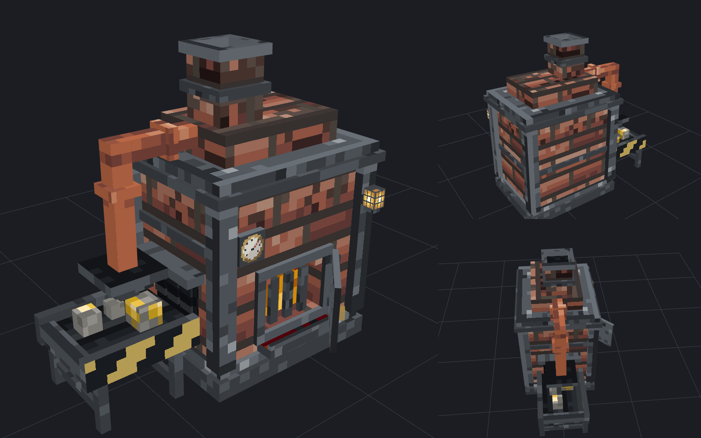

# STSV

스트리머 시즌 서버의 공통 기반입니다. 대상 버전은 마인크래프트 26.3(Paper), Java 25입니다.



## 폴더 구성

| 경로 | 내용 |
|---|---|
| `plugin/` | **STSV 코어 플러그인**. 커스텀 아이템, 가구, 레시피, 리소스팩 자동 배포, 모듈 시스템 |
| `content/stsv/` | 기본 콘텐츠 팩 (플러그인 jar에 포함되고, 첫 실행 때 서버에 설치됨) |
| `tools/assetgen/` | 3D 모델과 텍스처를 **코드로** 만드는 도구 (공통 팔레트로 일관성 유지) |
| `docs/ART_STYLE.md` | 아트 스타일 규칙 |
| `docs/CORE_DESIGN.md` | 코어 구조와 공통 기능 가안, 개발 순서 |

## 빌드

플러그인 (JDK 25 필요):
```bash
cd plugin && ./gradlew build
```
결과물: `plugin/build/libs/stsv-core-<버전>.jar` → 서버의 `plugins/` 폴더에 넣으면 됩니다.

에셋 (Python 3 + Pillow, 미리보기 렌더링은 Node + Playwright):
```bash
cd tools/assetgen && python3 build.py --render
```

전용 동작 아이템이 바닐라와 같은 구조인지 확인 (마인크래프트 클라이언트 jar에서 `assets/minecraft`를 풀어둔 경로):
```bash
python3 tools/assetgen/check_vanilla.py <경로>/assets/minecraft
```

## 업데이트

새 jar로 바꾸고 서버를 재시작하면 기본 콘텐츠(`contents/stsv`)도 자동으로 새 버전이 됩니다.
**직접 수정한 파일은 덮어쓰지 않고** 콘솔에 알려줍니다.

배포 전에 (콘텐츠 변경을 커밋한 다음) 아래를 실행해 이전 버전 기록을 갱신합니다:
```bash
python3 tools/content_history.py
```

## 서버에서 콘텐츠 추가하기

`plugins/STSV/contents/<팩 이름>/` 아래에 파일을 넣고 `/stsv reload` 하면 리소스팩까지 다시 만들어져 접속자에게 전송됩니다.

```
contents/mypack/
  pack.yml            namespace: mypack
  items/*.yml         아이템, 가구
  recipes/*.yml       레시피
  models/*.bbmodel    3D 모델 (Blockbench 파일 그대로)
  textures/*.png      2D 아이템 텍스처
  assets/...          그 밖의 리소스팩 파일 (폰트, 사운드 등) 그대로 병합
```

아이템과 레시피 작성 예시는 `content/stsv/` 의 YAML 파일을 참고하세요.

### 게임 안에서
| 명령어 | 하는 일 |
|---|---|
| `/stsv browse` | 아이템 목록 GUI (클릭해서 받기) |
| `/stsv recipe create <id> <종류> [시간] [경험치]` | 레시피 편집기. 종류: shaped, shapeless, furnace, blasting, smoking, campfire, stonecutting |
| `/stsv recipe delete <id>` / `list` | 편집기로 만든 레시피 삭제 / 목록 |
| `/stsv fuel set <틱>` / `remove` / `list` | 손에 든 아이템의 화로 연료 시간 (석탄 = 1600틱) |
| `/stsv reload` | 콘텐츠, 레시피, 리소스팩 다시 읽기 |

## 서버 설정

`plugins/STSV/config.yml` 의 `resource-pack.host.public-url` 은 **플레이어가 접속할 수 있는 주소**여야 합니다.
예: `http://서버IP:8163`. 방화벽에서 해당 포트를 열어야 합니다.
