# STSV

스트리머 서버의 공통 기반입니다. 대상 버전은 마인크래프트 26.3(Paper), Java 25입니다.


## 폴더 구성

| 경로 | 내용 |
|---|---|
| `plugin/` | **STSV 코어 플러그인**. 커스텀 아이템, 가구, 레시피, 리소스팩 자동 배포, 모듈 시스템 |
| `content/stsv/` | 기본 콘텐츠 팩 (플러그인 jar에 포함되고, 첫 실행 때 서버에 설치됨) |
| `economy/` | **경제 서버** 콘텐츠 플러그인 (STSV-Economy) 과 그 콘텐츠 팩 `economy/content/economy/`. 설명은 [economy/README.md](economy/README.md) |
| `tools/assetgen/` | 3D 모델과 텍스처를 **코드로** 만드는 도구 (공통 팔레트로 일관성 유지) |
| `docs/ART_STYLE.md` | 아트 스타일 규칙 |
| `docs/CORE_DESIGN.md` | 코어 구조와 공통 기능 가안, 개발 순서 |

## 빌드

플러그인 (JDK 25 필요):
```bash
cd plugin && ./gradlew build
```
결과물: `plugin/build/libs/stsv-core-<버전>.jar` → 서버의 `plugins/` 폴더에 넣으면 됩니다.

경제 서버 (코어를 함께 빌드해서 컴파일):
```bash
cd economy && ./gradlew build
```
결과물: `economy/build/libs/stsv-economy-<버전>.jar` (코어 jar 와 함께 `plugins/` 에)

에셋 (Python 3 + Pillow, 미리보기 렌더링은 Node + Playwright):
```bash
cd tools/assetgen && python3 build.py --render
```

전용 동작 아이템이 바닐라와 같은 구조인지 확인 (마인크래프트 클라이언트 jar에서 `assets/minecraft`를 풀어둔 경로):
```bash
python3 tools/assetgen/check_vanilla.py <경로>/assets/minecraft
```

## 업데이트

새 jar로 바꾸고 서버를 재시작하면 기본 콘텐츠(`contents/stsv`)도 자동으로 새 버전이 됩니다.
**직접 수정한 파일은 덮어쓰지 않고** 콘솔에 알려줍니다.
문구(`plugins/<플러그인>/messages.yml`)도 같습니다: 예전 기본 문구 그대로인 줄은 새 문구로 바뀌고, 직접 고친 줄은 그대로 남습니다.

배포 전에 (콘텐츠·문구 변경을 커밋한 다음) 아래를 실행해 이전 버전 기록을 갱신합니다:
```bash
python3 tools/content_history.py
python3 tools/content_history.py economy/content economy/src/main/resources/default-content-history.txt
python3 tools/messages_history.py plugin
python3 tools/messages_history.py economy
```

## 서버에서 콘텐츠 추가하기

`plugins/STSV/contents/<팩 이름>/` 아래에 파일을 넣고 `/관리자 리로드` 하면 리소스팩까지 다시 만들어져 접속자에게 전송됩니다.

```
contents/mypack/
  pack.yml            namespace: mypack
  items/*.yml         아이템, 가구
  recipes/*.yml       레시피
  models/*.bbmodel    3D 모델 (Blockbench 파일 그대로)
  textures/*.png      2D 아이템 텍스처
  menus/*.yml         메뉴 (칸 배치, 버튼, 배경 그림) - content/stsv/menus/wardrobe.yml 참고
  titles/*.yml        칭호
  assets/...          그 밖의 리소스팩 파일 (폰트, 사운드 등) 그대로 병합
```

아이템과 레시피 작성 예시는 `content/stsv/` 의 YAML 파일을 참고하세요.

**TEST 아이템·레시피는 서버에 실리지 않습니다.** 플러그인이 지원하는 모든 종류를 하나씩 담은 테스트 자료(`plugin/src/test/fixtures/stsv`)로, 자동 테스트와 새 콘텐츠를 만들 때 참고용입니다.

### 게임 안에서

관리자 명령어는 `/관리자` 하나로 모여 있습니다(`/관리자 도움말`, 예전 `/관리` 도 별칭으로 됨). 경제 서버 같은 콘텐츠 플러그인의 관리 명령어도 같은 `/관리자` 아래에 붙고, 도움말에 플러그인별로 나옵니다. 모든 명령어와 하위 명령어는 한국어이고 탭으로 자동완성됩니다.

| 명령어 | 하는 일 |
|---|---|
| `/관리자 지급 <플레이어> <아이템> [개수]` | 커스텀 아이템 지급 |
| `/관리자 아이템목록 [검색어]` | 아이템 목록 GUI (클릭해서 받기). 맨 윗줄 **분류 탭**: 전체 · 기계·가구 · 탈것 · 치장·교환권 · 장비·도구·스킨 · 작물·씨앗 · 물고기 · 음식 · 직업 생산품·재료 · 기타 (아이템이 있는 분류만, 정의한 파일과 종류로 나눔. 아홉 개가 넘으면 아래 줄 버튼 사이 빈칸에 이어짐). 아래 줄 **나침반 = 검색**(누른 뒤 채팅에 이름이나 id, 예: `김치`, `ruby`), 방벽 = 검색 지우기 |
| `/관리자 목록` / `정보` | 아이템 목록 / 손에 든 아이템 정보 |
| `/관리자 탈것 목록 [플레이어]` · `숨김 [플레이어]` · `회수 <번호>` · `삭제 <번호>` · `제거 [반경]` · `정리` | **탈것**(아래 "탈것"): 지금 있는 탈것(번호, 종류, 주인, 어디 있는지 / 아이템과 누가 가졌는지 / 돌려줄 예정. 아이템이 사라진 것은 숨기고 몇 대인지만) / 사라진 것으로 보이는 탈것 / 그 탈것을 **주인에게 아이템으로** 돌려줌(세워져 있든, 아이템을 잃어버렸든, 숨긴 것이든: 예전 아이템은 못 쓰게 됨. 짐칸의 짐은 그대로) / 한 대를 아예 지움(테스트용 등) / 내 주변 반경(기본 8, 최대 64)의 탈것을 지움(짐칸의 물건은 바닥에) / 서버가 지금 볼 수 있는 곳 어디에도 없는 탈것·지게 아이템을 목록에서 숨김(지우지 않음: 다시 나타나면 목록에 나오고 그대로 씀) |
| `/관리자 지게 목록 [플레이어]` · `회수 <번호>` | **지게**(아래 "지게"): 모든 지게(번호, 주인, 짐 칸 수, 지금 지고 있는 사람) / 그 지게를 **새 아이템으로 주인에게** 보냄(우편함, 없으면 접속해 있을 때 인벤토리로): 새 확인 값이라 예전 아이템(복사본 포함)은 모두 못 쓰게 됨. 짐은 지게 번호에 그대로 있어 새 아이템을 입으면 나옴 |
| `/관리자 레시피 생성 <id> <종류> [시간] [경험치]` | 레시피 편집기. 종류: 모양조합, 무형조합, 화로, 용광로, 훈연기, 모닥불, 석재절단기 |
| `/관리자 레시피 삭제 <id>` / `목록` | 편집기로 만든 레시피 삭제 / 목록 |
| `/관리자 연료 설정 <틱>` / `제거` / `목록` | 손에 든 아이템의 화로 연료 시간 (석탄 = 1600틱) |
| `/관리자 스킨 해제` | 손에 든 아이템의 스킨 해제 (스킨북 반환) |
| `/관리자 치장 지급\|회수 <플레이어> <치장>` / `정보 [플레이어]` | 치장 지급/회수 (교환권 없이 바로) / 착용 상태 |
| `/관리자 기간 시작 <id> <이름>` / `종료` / `정보` | 콘텐츠 기간 시작 / 종료(명예의 전당 기록) / 상태 |
| `/관리자 칭호 지급\|회수 <플레이어> <칭호>` / `목록` | 칭호 지급, 회수, 목록 |
| `/관리자 통계 추가 <플레이어> <통계> <값>` | 기록 보정 |
| `/관리자 경제 지급\|회수\|설정 <플레이어> <금액> [메모]` | 돈 지급 / 회수 / 정확한 금액으로 지정 (모두 거래 기록에 남음) |
| `/관리자 경제 기록 <플레이어> [개수]` | 그 플레이어의 최근 거래 (취소된 거래는 줄 그음) |
| `/관리자 경제 되돌리기 <플레이어> <분>` | 그 플레이어가 낀 최근 N분 거래를 모두 취소. 넘겨준 돈은 받은 쪽에서도 빠지고, 그 사이 쓴 수표는 무효(이미 입금됐으면 입금도 취소) |
| `/관리자 경제 통계` | 최근 24시간 생성/소멸/거래량, 총 통화량, 빈부격차(지니 계수) |
| `/관리자 보고서 [...]` | 서버 상태: TPS(1·5·15분), 틱 시간(평균·최근 최대), 메모리, 월드별 청크·엔티티·블록 엔티티·접속 인원. 콘텐츠 플러그인이 있으면 그 보고서가 이어짐(경제 서버: `[일차]`) |
| `/관리자 초기화 경제\|기록 [확인]` | **테스트용.** 경제 = 모든 잔액, 거래 기록, 수표 (접속 중인 사람은 시작 금액을 다시 받음). 기록 = 모든 통계, 기간, 명예의 전당, 칭호. 콘텐츠 플러그인이 더한 대상도 있음(경제 서버: `경제서버`). `확인` 없이 입력하면 안내만 나옴 |
| `/관리자 리로드` / `리소스팩` | 콘텐츠, 레시피, 메뉴, 칭호, 문구, 리소스팩 다시 읽기 / 리소스팩 다시 받기 |
| `/관리자 야생초기화 [확인]` | 야생월드와 그 지옥·엔드를 함께 새 시드로 다시 만듦(엔더 드래곤도 다시). 세 월드 안의 플레이어를 건축월드 스폰으로 먼저 옮기고, 거기 세워 둔 **탈것은 주인에게 아이템으로**(우편함 또는 다음 접속, 짐칸의 짐은 탈것 번호에 그대로) 돌려보내고(서버를 켤 때도 없어진·새로 만들어진 월드에 남은 탈것은 같은 방법으로), 월드를 내린 뒤 폴더를 지우고 새로 만듦. `확인` 없이 입력하면 안내만(30초 안에 `확인`). 자동으로는 절대 초기화하지 않음 |
| `/관리자 부계정 허용\|해제 <플레이어>` · `목록` · `정보 <플레이어\|IP>` · `초기화 <플레이어\|IP>` | **부계정 금지**(한 IP에 한 계정, 아래 "부계정 금지"): 같은 IP를 쓰는 가족·친구 계정 허용 / 허용 해제 / 허용 목록 / 그 플레이어(접속 중이면 지금 IP)나 IP의 주인 보기 / 그 플레이어가 주인인 IP 모두, 또는 그 IP의 주인 지우기(다음에 처음 접속하는 계정이 주인) |
| `/관리자 야생스팟 [채우기 <개수>\|비우기]` | `/야생월드` 의 **준비된 자리**(렉 방지, 아래 "야생월드 렉 줄이기"): 개수·상태(채우는 중 / 가득 참 / 서버가 바빠서 쉬는 중)·이번 실행 통계. `채우기 <개수>` = 그만큼 더 빠르게 채움(그래도 한 번에 청크 하나, 서버가 바쁘면 쉼. 접속자가 없을 때 쓰기 좋음). `비우기` = 모두 버리고 다시 채움. `/관리자 보고서` 에도 한 줄 나옴 |
| `/메뉴` (`/통합메뉴`) · **Shift+F** | (플레이어) **통합 메뉴**: 모든 플레이어 기능을 한곳에 (아래 "통합 메뉴") |
| `/건축월드` · `/야생월드` | (플레이어) 월드 이동 (아래 "건축월드 / 야생월드") |
| `/tpa <플레이어>` (`/텔포`) · `/tpahere <플레이어>` (`/텔포여기`, `/tpa여기`) | (플레이어) 텔레포트 요청: 그 사람에게 가기 / 그 사람을 내 쪽으로 부르기. 상대가 수락하면 이동하는 사람이 3초 가만히 있은 뒤 이동 (아래 "텔레포트 요청") |
| `/tpaccept [플레이어]` (`/수락`) · `/tpdeny [플레이어]` (`/거절`) | (플레이어) 받은 요청 수락 / 거절. 이름을 빼면 가장 최근 요청. 요청 메시지의 **[수락] [거절]** 을 클릭해도 됨 |
| `/tpacancel` (`/텔포취소`, `/tpa취소`) · `/tpatoggle` (`/텔포차단`, `/tpa차단`) | (플레이어) 보낸 요청 취소 / 요청 받지 않기 켜기·끄기(접속을 끊어도 유지) |
| `/탈것 목록` · `/탈것 양도 <플레이어>` (`/vehicle`) | (플레이어) **내 탈것·지게 목록**(지금 있는 것만, 어디 있는지·누가 가졌는지) / 손에 든 탈것·지게 아이템, 아니면 타고 있거나 끌거나 바라보는 탈것을 **다른 사람에게 넘겨주기**(접속하지 않은 사람도. 10초 안에 같은 명령을 한 번 더 = 확인. 아래 "탈것" 귀속) |
| `/탈것 권한 [플레이어]` · `/탈것 권한취소 <플레이어>` (`/vehicle`) | (플레이어) **내 탈것을 쓸 수 있는 사람** 정하기(아래 "탈것"). 허락한 사람은 내 탈것 **모두**를 운전하고, 리어카를 끌고, 짐칸을 열 수 있습니다(회수는 주인·관리자만). 이름만 쓰면 목록. 접속하지 않은 사람도 계정 이름이나 한글 닉네임으로(다른 명령어와 같은 방법). 최대 45명, DB 에 저장 |
| `/지게` (`/jige`) | (플레이어) 가슴 칸에 입은 **지게**의 짐(54칸) 열기. 웅크리고 빈손 우클릭과 같음(아래 "지게") |
| `/야간투시` | (플레이어) 야간 투시 켜기·끄기. 켜 두면 접속을 끊거나 죽거나 우유를 마셔도 유지 |
| `/치장` (`/옷장`) | (플레이어) 어디서나: 서 있던 자리에 내 스킨을 입은 마네킹이 서고, 몇 칸 앞에서 보는 시점 + 메뉴(큰 상자, 전용 UI, 치장이 28개를 넘으면 페이지). 위쪽 분류 탭: 전체 · 머리 · 머리 위 · 어깨 · 등 · 꼬리 · 펫 · 발자취 · 처치 효과(이름 옆 = 가진 수/전체 수), 아래쪽에 보기(전부/가진 것만/없는 것만) · 착용 중. 없는 치장은 어두운 '?' 카드(등급 색)로 함께 나옴. 부위마다 하나씩 착용. 치장 클릭 → 메뉴가 닫히고 마네킹 미리보기(미보유는 마네킹에 입혀 보기만 + 얻는 곳 안내, 뽑기 치장은 Shift+클릭 = 뽑기 열기). 벗기 버튼 = 지금 탭의 부위(전체 탭이면 전부). `내 화면에 표시` = 머리 위·어깨·등·꼬리 치장을 내 F5에서도 보기(기본 꺼짐: 1인칭에서 어깨 친구가 시야를 가려서. 다른 사람에게는 늘 보임). 웅크리기 = 메뉴 다시 열기, 나가기 버튼 = 원래 자리로. 땅에 서 있을 때만(떨어지는 중, 물·용암 속, 불붙음, 탈것, 피해 입고 10초 안에는 안 됨) |
| `/업적` | (플레이어) 업적: 분류 → 업적 목록(진행도 막대, 보상, 달성한 사람 수). 달성하면 알림(어려움 이상은 서버 전체), 보상은 여기서 직접 받음(빈칸이 모자라면 안 받아짐), 모두 받기. 처음 접속 때 받을 보상이 있으면 알려 줌 |
| `/관리자 업적 정보\|지급\|회수 <플레이어> [업적]` | 업적 상태 / 달성 처리(보상은 본인이 /업적 에서) / 기록 삭제. `/관리자 초기화 업적` = 모든 달성 기록 |
| `/뽑기` (`/치장뽑기`) | (플레이어) 치장 뽑기 화면: 1회 · 10회 뽑기(두 번 눌러야 뽑힘), 옷장과 같은 분류 탭과 나오는 치장 목록(등급순, 없는 것은 '?' 카드). 이미 가진 치장은 교환권으로. 상점 `구매 → 치장 뽑기`, `/치장` 화면, 통합 메뉴에서도 열림 |
| `/칭호` · `<이름>` · `해제` | (플레이어) 칭호 화면: 위 = 분류 탭(전체 · 업적 · 직업 · 도감 · 랭킹 · 상점 · 이벤트·기타, 관리자에게는 **칭호 배너** 탭도), 탭 안에서 가진 칭호(장착 중 → 보유) 먼저, 아직 없는 칭호와 얻는 법. 클릭 = 장착/해제. `/칭호 강태공` 처럼 이름으로 바로 장착 |
| `/감정표현` (`/emote`) · `<이름>` · `그만` | (관리자 테스트 기능, 권한 `stsv.emote`) 감정표현 목록 / 하기 / 끝내기(웅크려도 끝남). 내 스킨을 입은 관절 인형이 내 자리에서 동작을 하고, 나는 카메라로 지켜봄. 첫 감정표현: `트월킹` |
| `/프로필 [플레이어]` | (플레이어) 기록과 칭호. 내 칭호는 클릭해서 장착 |
| `/명예의전당 [기간]` | (플레이어) 지난 콘텐츠의 부문별 순위 |
| `/돈 [플레이어]` / `/돈 순위` | (플레이어) 잔액 / 부자 순위 10명 |
| `/송금 <플레이어> <금액>` | (플레이어) 송금. 수수료 2%(최소 1G, 사라짐). 1만G 이상은 같은 명령을 한 번 더 입력해야 실행 |
| `/수표 <금액>` | (플레이어) 돈을 수표 아이템으로 꺼냄(100G 이상). 우클릭하면 입금. 한 장은 한 번만 입금됨(복사해도 소용없음) |

### 통합 메뉴 (/메뉴, Shift+F)

웅크린 채 **F**(손 바꾸기 키)를 누르면 통합 메뉴가 열립니다. 그냥 F 는 원래대로 손 바꾸기이고, 다른 상자·메뉴가 열려 있거나 치장 화면 안에서는 열리지 않습니다. `/메뉴` 로도 열립니다. 처음 접속한 플레이어에게 한 번만 안내가 나옵니다.

- 맨 위(좌우 대칭): **건축월드로** · **야생월드로** · 가운데 **내 정보**(머리: 지금 있는 월드, 잔액, 칭호, 업적 점수, 경제 서버면 직업·땅. 클릭 = 프로필) · **텔레포트 요청**(클릭 = `/tpa `, 우클릭 = `/tpahere ` 입력 줄) · **야간 투시**(켜기·끄기, 이름에 지금 상태)
- 코어 기능: 치장 · 치장 뽑기 · 칭호 · 업적(우클릭 = 업적 순위) · 명예의 전당 · 부자 순위 / 잔액 · 송금 · 수표 · 닫기
- 경제 서버가 있으면 그 판(`contents/economy/menus/hub.yml`)이 대신 열려 두 줄이 더해집니다(경제 README 참고).
- 이름이나 금액을 이어서 써야 하는 버튼(텔레포트 요청, 송금, 수표, 직거래, 기부)은 메뉴를 닫고 채팅에 클릭하면 `/송금 ` 이 입력되는 줄을 보여 줍니다.
- 결과를 채팅으로만 알려 주는 버튼(잔액, 부자 순위, 업적 순위, 명예의 전당, 야간 투시, 월드 이동 등)은 **누르면 메뉴가 닫혀서** 채팅의 결과가 바로 보입니다. 다른 메뉴를 여는 버튼은 그 메뉴로 바뀝니다. 모든 메뉴의 `command:` 동작과 통합 메뉴의 `run:` 이 같습니다.
- 메뉴에서 금액·검색어를 **채팅으로 입력**받는 기능(코어 `MenuModule.prompt`, 경제 서버의 판매 등록·입찰·거래소 검색): 메뉴가 닫히고 다음 채팅 한 줄이 답이 됩니다(다른 사람에게는 보이지 않음). `취소` 를 쓰면 메뉴로 돌아가고, 60초가 지나면 그만둡니다.
- 설정: `hub.hotkey`(Shift+F 끄기), `hub.join-tip`. 모양: `content/stsv/menus/hub.yml`. 버튼 동작 `hub:run:<명령어>|run:<우클릭 명령어>`, `hub:suggest:<명령어>` 설명은 그 파일 맨 위.
- 콘텐츠 플러그인이 더 큰 판으로 바꾸는 법: 켜질 때 `core.menus().override("stsv:hub", "<팩>:hub")` + 자리표시자 `core.hub().provide(...)`, 꺼질 때 되돌림(경제 서버의 `Hub.java`). 플러그인을 빼면 남은 콘텐츠 폴더가 있어도 코어 판이 열립니다.

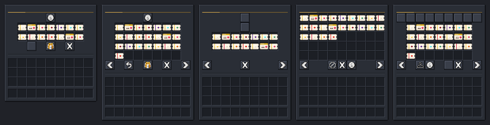

### 건축월드 / 야생월드 (+ 야생월드의 지옥·엔드)

서버는 두 월드로 나뉩니다. **인벤토리는 함께** 씁니다(월드를 오가도 그대로). 지옥과 엔드는 **야생월드에 딸린** 월드입니다.

| | 건축월드 | 야생월드 | 야생 지옥 · 야생 엔드 |
|---|---|---|---|
| 설정 (`config.yml worlds`) | `build-world` (비우면 서버 기본 월드) | `wild-world` (기본 `wild`. 없으면 켜질 때 일반 지형·새 시드로 만듦) | `wild-nether` · `wild-end` (비우면 `wild_nether` · `wild_the_end`. 없으면 야생월드와 같은 시드로 만듦) |
| 땅 (경제 서버) | `/땅 구매` 는 여기서만. **내 땅(소유·구성원)에서만 블록을 부수고 놓음**, 주인 없는 곳은 문·상자·동물 사용만 | 보호 없음, 누구나 자유 | 보호 없음, 누구나 자유 |
| 가는 법 | `/건축월드` | `/야생월드` | 야생월드의 **지옥 포털 / 엔드 포털**(명령어 없음) |
| 죽으면 | 바닐라 | 아이템을 떨어뜨림(바닐라) | **아이템과 경험치가 그대로 남음** (`keep-inventory`) |
| 도착 | 그 월드의 마지막 위치(없으면 스폰) | **매번 무작위 위치** (스폰에서 300~5000블록, 월드 경계 안, 물·용암·나뭇잎·선인장·가루눈 위는 피하고 머리 위 두 칸이 빈 곳). 미리 찾아 둔 **준비된 자리** 중 하나로 바로 감(아래 "야생월드 렉 줄이기"). 안전한 자리를 못 찾으면 이동하지 않음 | 지옥: 바닐라처럼 좌표 1/8 자리의 포털(없으면 만들어짐). 엔드: 바닐라 흑요석 발판(100, 48, 0, 없으면 만들어짐) |
| 초기화 | 없음 | `/관리자 야생초기화 확인` (관리자가 직접할 때만) | 야생월드와 함께 |
| 적대 몹 | **없음** (`worlds.build-peaceful`, 아래) | 바닐라 | 바닐라 |

- 이동은 **3초 동안 가만히** 있어야 합니다(움직이거나 피해를 입으면 취소, 관리자는 바로). 야생월드로는 한 번 간 뒤 **60초** 동안 다시 갈 수 없습니다(정찰 방지). 모두 `worlds.travel-warmup-seconds`, `worlds.wild-random.*` 에서 바꿈.
- **포털**: 야생월드의 지옥 포털 ↔ 야생 지옥(좌표 ×8 / ÷8, 포털 찾기·만들기는 바닐라 그대로), 야생월드의 엔드 포털 → 야생 엔드(엔더 드래곤, 엔드 관문, 엔드 시티 모두 바닐라). 엔드에서 나가는 포털(드래곤을 잡은 뒤 포함)은 내 리스폰 지점이 야생 쪽(야생월드·지옥·엔드)에 있으면 거기, 아니면 **야생월드 스폰**으로. 아이템·몹도 같은 길로 다닙니다.
- **건축월드에서는 지옥·엔드로 갈 수 없습니다.** 건축월드의 포털은 아무 데로도 가지 않고(액션바 "건축월드에서는 지옥·엔드로 갈 수 없습니다 → /야생월드의 포털로"), 지옥 포털에 불도 붙지 않습니다.
- **야생 지옥·엔드에서 죽으면 아이템과 경험치가 그대로 남습니다**(그 월드에 들어갈 때 채팅으로 안내). 설정 `worlds.keep-inventory: [nether, end]` 는 월드를 역할로 적습니다(`build`, `wild`, `nether`, `end`): 켜질 때와 그 월드를 불러올 때마다 그 월드의 `keepInventory` 게임 규칙을 켜고, 목록에 없는 월드는 건드리지 않습니다(목록에서 빼도 켜진 규칙은 남으니 끄려면 그 월드에서 `/gamerule keep_inventory false`). 야생월드나 건축월드도 원하면 목록에 넣으면 됩니다.
- 야생월드·야생 지옥·야생 엔드에서 죽으면 침대(또는 리스폰 정박기)가 있으면 거기, 없으면 **야생월드 스폰**에서 살아납니다(건축월드로 넘어가지 않음).
- 서버 기본 지옥·엔드(`world_nether`, `world_the_end`)는 **더 이상 쓰지 않습니다**: 거기서 접속하거나 되살아나는 사람은 야생월드 스폰으로 옮겨집니다. 월드와 그 안의 데이터는 지우지 않습니다. 바닐라 포털 계산이 이 두 월드를 거쳐 가므로 `server.properties` 의 `allow-nether` 와 `bukkit.yml` 의 `allow-end` 는 **끄지 마세요**(끄면 야생월드의 포털도 동작하지 않음). 안의 지형을 없애고 싶으면 서버를 끄고 `world_nether`, `world_the_end` 폴더(새 저장 방식이면 그 차원의 폴더)를 지우면 다음 실행 때 빈 새 월드로 다시 만들어집니다(경제 서버: 거기 있던 예전 땅 기록은 남음).
- 야생월드를 끄면(`wild-world: ""`) 야생 지옥·엔드도 없고 포털은 모두 바닐라대로입니다.
- **건축월드 평화로움** (`worlds.build-peaceful: true`, 기본): 건축월드에는 적대 몹(좀비, 크리퍼, 스켈레톤, 엔더맨, 팬텀, 슬라임, 마녀, 약탈자·파괴수 등)이 생기지 않습니다. 자연 스폰, 스포너, 습격(습격 자체가 시작되지 않음), 순찰대, 좀비 마을 습격, 변신 모두 막고, 그래도 들어온 적대 몹(청크를 불러올 때 있던 것, 포털·순간이동으로 온 것)은 사라집니다(5초마다 확인). **난이도는 그대로**라 배고픔은 줄어듭니다(평화로움 난이도로 바꾸지 마세요). 관리자의 `/summon`, 스폰알, 다른 플러그인이 소환한 몹은 남습니다. 야생월드와 그 지옥·엔드는 그대로입니다.
- **야생초기화 때 접속하지 않았던 사람**: 접속을 끊을 때 있던 야생월드(지옥·엔드 포함)를 기억해 두었다가, 다시 들어왔을 때 그 월드가 새로 만들어진 것이면(같은 이름, 다른 월드) **건축월드 스폰**으로 옮기고 알려 줍니다(새 지형의 같은 좌표에서 땅속에 갇히거나 떨어지지 않게). 이 기능이 들어가기 전에 접속을 끊은 사람은 기억이 없어 그대로입니다.
- 통합 메뉴 제목과 내 정보에 지금 있는 월드가 보입니다.

### 텔레포트 요청 (/tpa, /tpahere)

다른 플레이어에게 가거나 불러올 때 씁니다. **상대가 수락해야** 이동합니다. 모든 월드(건축월드, 야생월드, 야생 지옥·엔드) 사이에서 됩니다.

1. `/tpa Steve` = Steve 에게 가겠다는 요청, `/tpahere Steve` = Steve 를 내 쪽으로 부르는 요청. 이름은 Tab 으로 완성됩니다. 통합 메뉴의 **텔레포트 요청** 버튼(우클릭 = 부르기)으로도 됩니다.
2. Steve 의 채팅에 요청과 **[수락] [거절]** 버튼이 뜹니다(소리도 남). 클릭하거나 `/tpaccept`, `/tpdeny` (여러 개를 받았으면 가장 최근 요청, `/tpaccept Alex` 처럼 이름으로 고를 수도 있음).
3. 수락하면 **이동하는 사람**(`/tpa` 는 보낸 사람, `/tpahere` 는 받은 사람)이 **3초 동안 가만히** 있어야 합니다(월드 이동과 같음, 움직이거나 피해를 입으면 취소되고 양쪽에 안내). 그 뒤 상대가 **그때 있는 자리**로 이동합니다.

- 요청은 **60초** 뒤 사라지고(양쪽에 안내), 한 사람이 보낼 수 있는 요청은 **하나**입니다(다른 사람에게 새로 보내면 이전 요청은 취소, 같은 요청을 또 보내면 "이미 보냈습니다"). 보낸 요청은 `/tpacancel`.
- 요청으로 이동한 뒤 요청한 사람은 **30초** 동안 새 요청을 보낼 수 없습니다. 관리자는 대기·재사용 대기 없음.
- 요청은 한 사람이 **5초에 한 번**만 보낼 수 있습니다(`/tpa` 와 `/tpahere` 를 번갈아 보내 같은 사람에게 알림을 도배할 수 없게, `tpa.request-gap-seconds`).
- 가만히 있는 시간이 끝났을 때 상대가 **안전한 곳에 서 있지 않으면**(날거나 겉날개로 나는 중, 떨어지는 중, 용암·불·마그마·가루눈 속, 머리가 블록에 낀 곳) 이동하지 않고 양쪽에 알립니다. 다시 요청하면 됩니다.
- `/tpatoggle` = 모든 요청 거절 켜기·끄기(켜 두면 보내는 사람에게 "요청을 받지 않고 있습니다"). 접속을 끊어도 유지됩니다.
- 치장 화면에 있는 사람은 이동하지 않습니다(나간 뒤 다시 요청). 나가면 그 사람이 보내거나 받은 요청은 취소됩니다.
- 설정 `config.yml tpa`: `timeout-seconds`(60), `cooldown-seconds`(30), `request-gap-seconds`(5). 가만히 있을 시간은 월드 이동과 같은 `worlds.travel-warmup-seconds`. 권한 `stsv.tpa`(기본 모두).

### 한글 닉네임 (/닉네임) · 닉네임 색 (/닉네임 색)

마인크래프트 계정 이름에는 한글을 쓸 수 없어서, 서버가 **닉네임**을 대신 보여 줍니다.

- `/닉네임 홍길동` = 닉네임 정하기. 한글·영문·숫자 **2~8자**(한글 한 글자 = 1자), 띄어쓰기·기호·색 코드(`&c`, `§c`, `<red>`)는 안 됩니다. 다른 사람의 닉네임(대소문자 무시)이나 **다른 사람의 실제 계정 이름**과 같으면 안 되고, `nicknames.banned-words` 의 말이 들어가도 안 됩니다.
- **처음 정하는 닉네임은 무료**, 그다음부터 바꿀 때마다 **5,000 G**(`/돈` 의 코어 돈, 15초 안에 같은 명령을 한 번 더 입력해야 실행). `/닉네임 해제` 는 무료. 경제 서버 플러그인이 없는 서버에서는 무료(`free-without-economy-plugin`). 바꾼 뒤 다시 바꿀 때까지의 대기는 `cooldown-hours`(기본 0 = 없음).
- 닉네임이 보이는 곳: 채팅(이름에 마우스를 올리면 **계정 이름**), 접속·퇴장·사망·발전 과제 메시지, 탭 목록(순서는 그대로 계정 이름 순), **머리 위 이름**, `/프로필`(계정 이름도 표시), 명예의 전당, 부자 순위, 업적 순위·공지, 치장 뽑기 공지, 텔레포트 요청, 송금·수표, 통합 메뉴. 경제 서버: 주간 순위, 직업 순위·레벨 업 공지, 거래소·경매(판매자, 입찰자, 낙찰), 직거래 창, 땅(소유자, 구성원, 초대·추방·양도), 주식왕, 낚시·도감 공지, 기념비, 기계 정보 등. 기계로 만든 물건의 "제작: 이름" 줄만은 **계정 이름** 그대로입니다(닉네임을 바꿔도 같은 물건끼리 계속 겹쳐지도록).
- **플레이어를 적는 명령어는 닉네임도 받습니다**: `/tpa`, `/tpahere`, `/tpaccept`, `/송금`, `/돈 <플레이어>`, `/프로필`, `/거래`, `/땅 초대|추방|양도`, `/관리자 ...` 등. Tab 완성에도 닉네임과 계정 이름이 함께 나옵니다. 계정 이름이 먼저, 그다음 닉네임(접속하지 않은 사람도), 그다음 접속 중인 사람의 이름·닉네임 앞부분.
- **머리 위 이름**: 바닐라 이름표는 플레이어마다 하나씩 만든 스코어보드 팀(`stsv_n_<계정 이름>`)으로 숨기고, 치장 모델처럼 플레이어에 붙어 다니는 글자 디스플레이로 닉네임을 그립니다. 본인에게는 안 보이고, 웅크리면 흐려지고 벽 너머로 안 보이며, 투명·관전·사망 중에는 안 보입니다. **다른 플러그인이 이미 팀에 넣은 플레이어는 건드리지 않습니다**(그 사람은 바닐라 이름표에 계정 이름). 끄기: `nicknames.name-tag: false`.
- **닉네임 색**: `/닉네임 색` = 색 고르기 메뉴(한 가지 색 36개 + 그라데이션 9개, 칸 이름에 내 닉네임이 그 색으로 보임, `기본` 버튼 = 색 없음). 직접: `/닉네임 색 #ffb7c5`, 그라데이션 `/닉네임 색 #ffb347 #ff5e8a`(첫 글자 → 끝 글자), 메뉴 색 이름 `/닉네임 색 벚꽃`, 없애기 `/닉네임 색 기본`. 한 가지 색은 **10,000 G**, 그라데이션은 **30,000 G**(처음에도 같음, `colors.cost`, `gradient-cost`, `first-free`). 채팅·탭 목록 배경이 어두워서 **너무 어두운 색은 거절**합니다(`colors.min-brightness`, 사람 눈 기준 밝기 0.35: 순수한 파랑·짙은 회색·검정 계열). 색은 이름과 따로 저장되고 닉네임이 보이는 모든 곳(메시지 문구가 자기 색을 쓰는 순위 줄 등에서도)에 그 색으로 보입니다. 닉네임이 없어도 계정 이름에 색을 쓸 수 있습니다. 메뉴의 색과 이름은 `nicknames.colors.palette`, `gradients`.
- 관리: `/관리자 닉네임 설정 <플레이어> <이름> [강제]`(비용·대기 없음, 규칙 검사는 함. `강제` = 금지어·실제 이름 검사 없이, 다른 사람이 쓰는 닉네임이면 그 사람 것을 해제하고 줌), `해제 <플레이어>`, `색 <플레이어> <#색 [#색]|이름|기본>`, `목록`, `정보 <플레이어>`(바꾼 횟수, 마지막 변경, 머리 위 이름 상태).
- 저장: DB 표 `nickname`(플레이어, 닉네임, 비교용 키(유일), 색, 바꾼 시각, 바꾼 횟수). 서버가 켜질 때 모두 메모리에 올리고, 접속할 때 그 사람 것을 다시 읽음(MySQL 을 함께 쓰는 다른 서버에서 바뀐 것). **`/관리자 초기화 경제·기록` 으로 지워지지 않습니다.**
- 사이드바 패널: 지금 패널 줄(잔액, 직업, 미션, 사건)에는 플레이어 이름이 나오지 않아 닉네임 글자를 위해 패널 글꼴을 늘리지 않았습니다(패널 글꼴은 서버 문구에 쓰인 한글만 담아 메모리를 아낌. 11,172자를 모두 담으면 패널 줄 글꼴마다 0.8MB 가 넘게 늘어 10MB 한도를 넘음). 땅 들어갈 때 안내 같은 화면 아래 안내 문구(액션바)는 게임 기본 글꼴로 이어져서 어떤 닉네임이든 그대로 보입니다.
- 설정 `config.yml nicknames`, 문구 `messages.yml nickname`, 권한 `stsv.nickname`(기본 모두).

### 부계정 금지 (한 IP에 한 계정)

- 한 IP로는 **한 계정만** 접속할 수 있습니다. 그 IP로 **처음 접속한 계정이 주인**이 되고, 같은 IP의 다른 계정은 접속할 때 "이 IP에서는 이미 다른 계정이 접속하고 있습니다 · 부계정은 허용되지 않습니다" 안내와 함께 거절됩니다(접속 전 단계에서, 서버에 들어오지 못함). 한 계정이 여러 IP(집, 휴대폰 핫스팟)의 주인이 되는 것은 괜찮습니다.
- **관리자(OP)** 와 `/관리자 부계정 허용 <플레이어>` 로 허용한 계정은 검사하지 않고, IP의 주인도 되지 않습니다. 같은 집에 사는 가족·친구는 이렇게 허용하세요. 거절된 계정도 이름으로 허용할 수 있습니다(서버에 들어온 적이 없어도 됨).
- **처음 켤 때**: 이미 접속해 있는 사람은 그대로 둡니다(아무도 쫓겨나지 않음). 그다음부터 IP마다 **처음 접속하는 계정**이 주인이 됩니다. 그러니 처음 켠 뒤에는 원래 계정으로 먼저 들어오면 됩니다.
- 주인이 그 IP로 **30일**(`alts.expire-days`) 동안 접속하지 않으면 IP가 풀려 다음 계정이 주인이 됩니다(인터넷 회사가 IP를 다른 집에 줄 때를 위해). 잘못 잡힌 주인은 `/관리자 부계정 초기화 <플레이어|IP>` 로 지웁니다. `정보 <플레이어|IP>` 로 주인과 마지막 접속을 봅니다(IP는 뒷자리를 가려서 보여 줌).
- **개인정보**: IP를 그대로 저장하지 않습니다. 서버 비밀값(`plugins/STSV/data/alt-secret.txt`, 처음 켤 때 만들어짐)으로 만든 해시(HMAC-SHA256)만 DB(`stsv_ip_owner`)에 남고, 주인 계정·이름·마지막 접속 시각이 함께 저장됩니다. IPv6 는 앞 64비트(한 집의 네트워크)로 봅니다. 해시는 비밀값 없이는 IP로 되돌릴 수 없지만, 비밀값과 DB를 함께 가진 사람은 IPv4 를 하나씩 대입해 볼 수 있으니 두 파일을 함께 공개하지 마세요. MySQL 을 여러 서버가 함께 쓰면 비밀값 파일을 모든 서버에 같게 복사하세요.
- 이 컴퓨터·내부망(127.0.0.1, 192.168.x.x 등)에서의 접속은 검사하지 않습니다(`alts.ignore-local`). **프록시(Velocity/BungeeCord)나 TCPShield 뒤에 있으면** 실제 IP가 서버에 전달되게 설정해야 합니다(아니면 모두 같은 IP로 보여 한 명만 들어옴). 끄려면 `alts.enabled: false`. DB가 응답하지 않으면 막지 않고 들여보냅니다(콘솔에 기록).

### 화면 표시: 사이드바 패널과 체력바 (/사이드바)

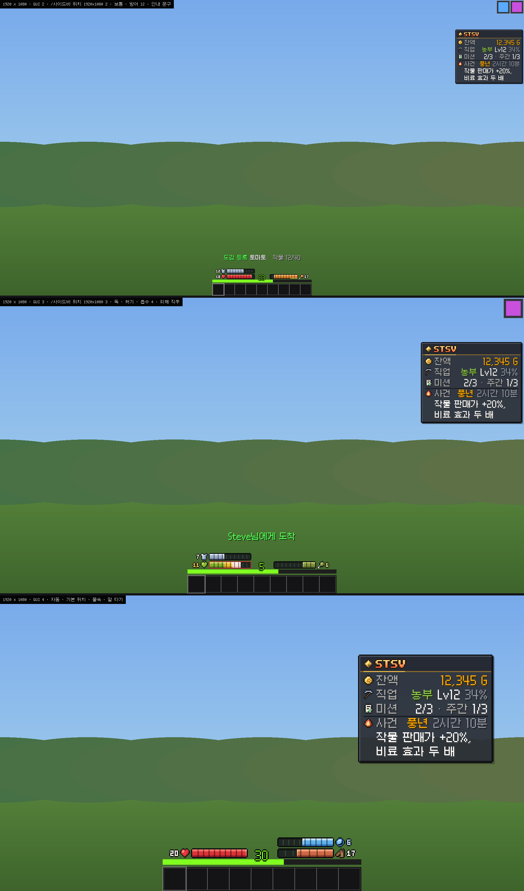

기본(`config.yml hud.mode: pack`)은 **리소스팩으로 그린 HUD** 입니다. 스코어보드를 쓰지 않으므로 다른 플러그인의 스코어보드·팀(이름 색 등)과 부딪히지 않습니다.

- **사이드바 패널**: 메뉴와 같은 짙은 회색·금색 패널(픽셀 테두리, 그림자, 서버 마크가 있는 제목 줄과 금색 선)에 줄마다 아이콘(잔액 동전, 직업 곡괭이, 미션 종이, 사건 불꽃)과 한글. 이름은 왼쪽, 값은 오른쪽 끝에 맞춰 정렬됩니다(문구의 탭 `\t` 앞이 이름, 뒤가 값). 내용은 예전 사이드바와 같고(잔액, 직업·레벨, 미션, 진행 중인 사건과 설명) 1초마다 갱신됩니다. 내용이 없는 줄은 빠지고, 긴 줄은 두 줄로 고르게 나뉘며(마지막 단어 하나만 남지 않게) 그래도 넘치면 `…`. 빈 줄(사건 앞)은 가는 구분선이 됩니다.
- **글씨**: 한글·영문·숫자 모두 픽셀 글꼴 갈무리9(Galmuri9, 작게·크게 패널은 갈무리7, SIL OFL 1.1, 라이선스는 리소스팩 `assets/stsv/textures/font/hud/LICENSE-galmuri.txt`)를 GUI 1픽셀 = 글꼴 1픽셀(크게는 2픽셀)로 그려, 어느 GUI 크기에서도 선명하고 패널의 픽셀 그림과 굵기가 맞습니다.
- **체력바**: 바닐라 하트·배고픔·방어·공기 방울·탈것 하트 대신, 같은 자리(핫바 위)에 테두리가 있는 칸 나뉜 바(칸 하나 = 하트 하나, 하트가 12개를 넘으면 칸 하나 = 하트 두 개). 숫자는 바 위가 아니라 아이콘 옆에 있어 바와 겹치지 않습니다: 왼쪽은 `18` 과 하트, 오른쪽은 고기와 `17`. 독=초록, 시듦=검정, 동상=하늘색 바와 하트, 체력이 낮으면 숫자가 빨강, 흡수는 체력 뒤에 금색으로 이어지고 숫자도 금색(체력+흡수), 배고픔 바 아래 노란 줄 = 포화도, 허기 효과=초록. 피해를 입으면 잃은 만큼이 잠깐 하얗게 남고 테두리가 빨갛게, 크게 회복하면(2 이상) 새로 찬 부분이 연두색으로 잠깐 빛납니다. 방어구를 입으면 하트 위 줄에 방어 바, 물속에서는 배고픔 위 줄에 공기 바(남은 방울 수), 탈것을 타면 배고픔 대신 탈것의 체력 바. 가운데는 경험치 레벨 숫자 자리로 비워 둡니다. 크리에이티브·관전 모드에서는 숨습니다.
- **안내 문구**(작물 상태, 도감 등록, 텔레포트 도착 등)는 체력바 위의 원래 액션바 자리에 함께 나와서, 문구가 떠도 체력바가 사라지지 않습니다.
- **`/사이드바`** (별칭 `/hud`, `/sidebar`): 내 사이드바 켜기·끄기 (`/사이드바 켜기`, `/사이드바 끄기`). 방송 화면에서 가리고 싶을 때. 플레이어에게 저장되어 다시 접속해도 유지됩니다. 체력바는 끌 수 없습니다(바닐라 하트를 리소스팩이 숨기므로). 권한 `stsv.hud`(기본 모두).
- **`/사이드바 위치`**: 마우스로 패널을 옮기고 크기를 바꿉니다(아래 "패널 옮기기"). `/사이드바 위치 기본` = 서버 기본 자리·크기로, `/사이드바 위치 취소` = 편집 취소, `/사이드바 위치 저장` = 편집 저장. 플레이어에게 저장되어 다시 접속해도 유지됩니다.
- 리소스팩을 받기 전(다운로드 중)에는 아무것도 그리지 않고, 리소스팩을 거절한 사람(`resource-pack.required: false` 일 때)에게는 예전 스코어보드 사이드바와 바닐라 하트가 보입니다.

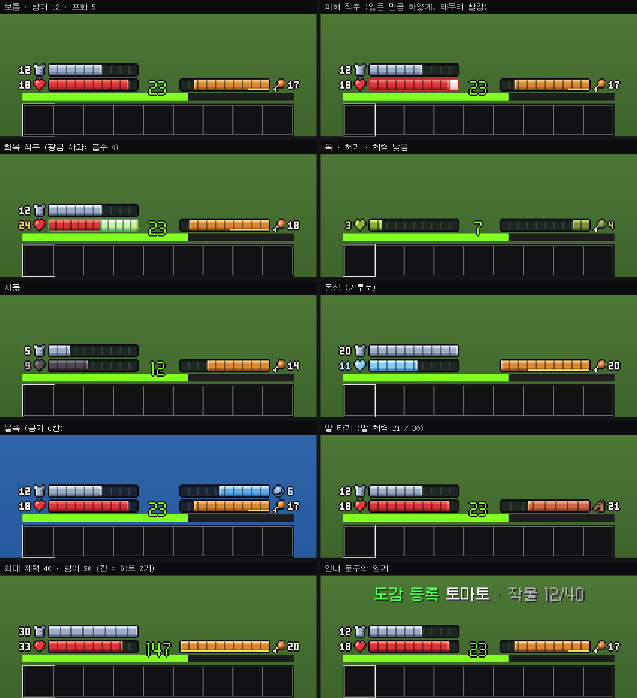

**패널 위치**: 게임은 서버에 화면 크기와 GUI 크기를 알려 주지 않고, 보스바 제목은 화면 가운데를 기준으로 그려지므로 패널은 "가운데에서 몇 픽셀"로만 놓을 수 있습니다(화면 오른쪽 끝 기준으로 놓는 방법은 스코어보드뿐인데, 스코어보드는 배경을 지울 수 없고 다른 플러그인과 부딪힙니다). 그래서 기본 위치는 16:9 화면의 자동 GUI 크기(720p·1440p·4K 모두 GUI 폭 427)에서 화면 오른쪽 끝에 딱 붙는 자리(`right: 212`)이고, 1080p 자동(GUI 4)에서는 오른쪽 끝에서 26픽셀 안쪽, GUI 2·3처럼 화면이 넓으면 가운데 오른쪽에 보입니다. 다른 자리가 좋으면 플레이어가 직접 마우스로 옮깁니다.

**패널 옮기기 (`/사이드바 위치`)**: 서버는 마우스 커서를 볼 수 없지만 시선(고개 방향)은 보이므로, 편집하는 동안에는 **고개를 돌린 만큼 패널이 따라 움직입니다**(1도에 GUI 2픽셀: 마우스를 오른쪽으로 → 패널도 오른쪽, 위로 → 위로). 시작할 때 시선을 정면으로 맞추고, 끝나면 원래 보던 방향으로 돌려 놓습니다.

- 가로로는 1픽셀 단위로 어디든(가운데에서 -900 ~ +960픽셀), 세로로는 패널 한 줄 높이씩 화면 맨 위부터 기본 높이 조금 아래까지(줄이 적은 패널일수록 더 아래까지). 끝에 닿으면 멈추고, 반대로 움직이면 바로 돌아옵니다.
- **마우스 휠**: 크기 **작게**(갈무리7) · **보통**(갈무리9, 기본) · **크게**(갈무리7 을 두 배로, 최대 6줄). 휠을 위로 = 크게, 아래로 = 작게(핫바 선택 칸은 그대로). 크기를 바꿔도 오른쪽 끝은 그대로입니다.
- **왼쪽 클릭** 또는 **F**(양손 바꾸기) = 저장, **웅크리기**(Shift) 또는 `/사이드바 위치 취소` = 취소(원래 자리 그대로), 1분이 지나면 자동 취소. `/사이드바 위치` 를 한 번 더 쳐도 저장.
- 편집하는 동안 패널 네 모서리에 노란 꺾쇠가 보이고, 체력바 위에 "마우스로 이동 · 휠로 크기 보통 · 클릭으로 저장 · 웅크리면 취소 52초" 안내가 나옵니다. 사이드바를 꺼 둔 사람도 편집하는 동안에는 보이고, 줄이 하나도 없으면 견본 줄을 보여 줍니다.
- 편집하는 동안에는 걷기·날기 속도가 0, 점프가 막히고(시야 확대·축소 효과 없음), 아이템 쓰기·블록 부수기/놓기·엔티티 상호작용·공격·버리기가 막힙니다(때리면 공격 대신 저장). **보호는 없습니다**: 피해를 입으면, 1.5블록 넘게 밀려나면, 죽거나 나가거나 다른 곳으로 텔레포트되거나 게임 모드가 바뀌면 바로 취소되고 속도가 돌아옵니다. 속도는 바꾸기 전에 플레이어에게 적어 두므로, 편집 중에 서버가 꺼져도 다음 접속 때 돌아옵니다. 탈것을 타거나 겉날개로 나는 중·자는 중에는 시작할 수 없습니다.
- 예전 `/사이드바 위치 1920x1080 3` 으로 정한 자리는 그 오른쪽 끝 그대로(보통 크기, 기본 높이) 이어서 씁니다.

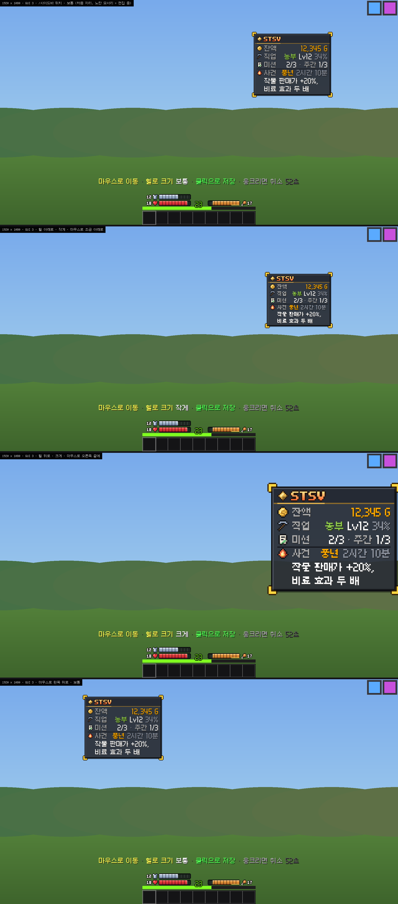

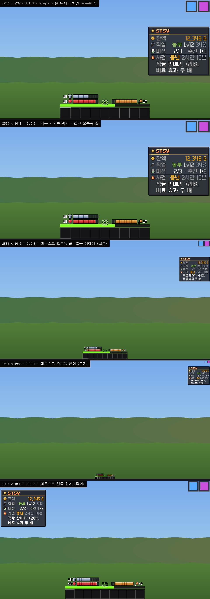

**어떻게 그리나**: 사이드바 패널은 막대가 투명한 보스바(흰색, 리소스팩이 흰색 보스바의 막대 그림을 투명하게 만듦)의 제목에, 체력바는 액션바에 글꼴 글리프로 그립니다. 게임은 액션바를 화면 아래에서, 보스바 제목을 화면 위에서 일정한 거리에 두므로, 글리프의 높이(ascent)와 픽셀 단위 이동 문자만으로 GUI 크기와 화면 비율에 상관없이 같은 자리에 그려집니다. 글씨는 액션바·보스바 줄에서 위아래로 옮길 수 없는 게임 글꼴 대신 HUD 전용 글꼴 시트(갈무리9: ASCII·기호·자모, KS X 1001 한글 2350자 + 저장소 문구에 쓰인 글자)를 쓰고, 플러그인이 모든 글자 폭을 게임과 똑같이 계산해서 패널은 오른쪽 끝 정렬, 안내 문구는 가운데 정렬, 체력바는 문구 길이와 상관없이 제자리에 둡니다. 글꼴과 그림은 `tools/assetgen/hud.py` 가 `plugin/src/main/resources/pack/hud/` 에 만들고(갈무리9·7 글리프 자료는 `tools/assetgen/fonts/galmuri9.txt`·`galmuri7.txt`, 네트워크 없이 다시 만들 수 있음), 글꼴 JSON 은 플러그인이 설정(위치, 줄 수)에 맞춰 리소스팩을 만들 때 생성합니다. 글리프의 높이는 글꼴마다 하나로 정해지므로, 패널이 놓일 수 있는 줄 높이마다(크기 셋 × 높이 여럿, 모두 30줄) 글꼴이 하나씩 있습니다.

**클라이언트 메모리**: 게임은 글꼴의 그림 시트를 (시트, 높이)마다 통째로 RGBA 로 메모리에 올립니다. 패널이 놓일 수 있는 줄마다 한글 시트가 한 벌씩 필요해서, 예전 HUD(Unifont 16×16 시트 2.4MB × 10벌)는 약 28MB, 크기·높이를 바꿀 수 없던 패널은 약 7.2MB(한글 2350자 시트 0.8MB × 8벌) 였습니다. 지금 패널의 한글 시트는 **서버 문구에 실제로 쓰이는 글자만** 담습니다: 저장소의 문구·콘텐츠에 쓰인 글자(약 800자) + 서버의 `plugins/STSV*` 폴더 yml 파일과 메시지에 쓰인 글자(서버에서 고친 직업·사건 이름도 들어감, 많아도 자주 쓰는 1024자까지). 그래서 한 벌이 약 0.3MB 로 줄어, 크기 셋과 여러 높이(30벌)를 담고도 HUD 전체가 약 9.4MB 입니다(테스트 상한 10MB). 패널에 없는 글자는 `?` 로 보입니다(액션바 안내 문구는 지금처럼 한글 2350자 전부). `max-rows` 를 한 줄 늘리거나 줄이면 약 0.8MB 씩 늘거나 줄어듭니다. 리소스팩을 만들 때 서버 로그에 HUD 메모리가 나옵니다.

| 설정 (`config.yml hud`) | 기본 | |
|---|---|---|
| `mode` | pack | `pack` = 리소스팩 HUD, `scoreboard` = 예전 스코어보드 사이드바 + 바닐라 하트 (리소스팩이 꺼져 있으면 자동으로 scoreboard) |
| `sidebar.enabled` | true | 사이드바 전체 켜기·끄기 |
| `sidebar.right` · `sidebar.y` | 212 · 54 | 기본 패널(보통 크기) 오른쪽 끝 (화면 가운데에서 오른쪽으로 GUI 픽셀; 패널은 여기에 맞춰 왼쪽으로 늘어남), 위쪽 끝 (화면 위에서; 상태 효과 아이콘 두 줄 아래). 플레이어가 `/사이드바 위치` 로 정한 자리·크기가 있으면 그쪽이 우선. 마우스로 옮길 수 있는 높이는 맨 위부터 `y` 조금 아래까지 |
| `sidebar.max-width` · `max-rows` | 132 · 7 | 패널 최대 폭(보통 크기 기준, 작게·크게는 글자 크기만큼 줄고 늚), 최대 줄 수(크게는 최대 6줄, 한 줄마다 클라이언트 메모리 약 0.8MB) |
| `sidebar.boss-bar-color` | white | 패널을 싣는 보스바 색 (이 색의 보스바 막대는 투명해짐) |
| `sidebar.icons` | | 줄 id → 아이콘 (`coin`, `job`, `mission`, `event`, `star`, `clock`, `heart`, `food`, `armor`, `air`, `mount`) |
| `health.enabled` · `health.armor` | true · true | 체력바 (끄면 바닐라 하트), 방어 바 |
| `health.resend-ticks` | 20 | 바뀐 것이 없어도 다시 보내는 간격. 다른 플러그인이 액션바를 덮어쓰면 이 시간 안에 체력바가 돌아옴 |

위치·줄 수·모드를 바꾸면 `/관리자 리로드` 로 리소스팩까지 다시 만들어 보냅니다(서버에서 콘텐츠 이름을 바꿨을 때도: 새 글자가 패널 글꼴에 들어감). 예전 `sidebar.x` 는 더 쓰지 않습니다(`right` 로 바뀜). 16:10·4:3 처럼 좁은 화면의 자동 GUI 크기에서 패널이 오른쪽에서 잘리면 그 플레이어가 `/사이드바 위치` 로 직접 옮기거나, 서버 전체는 `sidebar.right` 를 줄이세요.

### 게임 기본 글꼴 (한글: Neo둥근모)

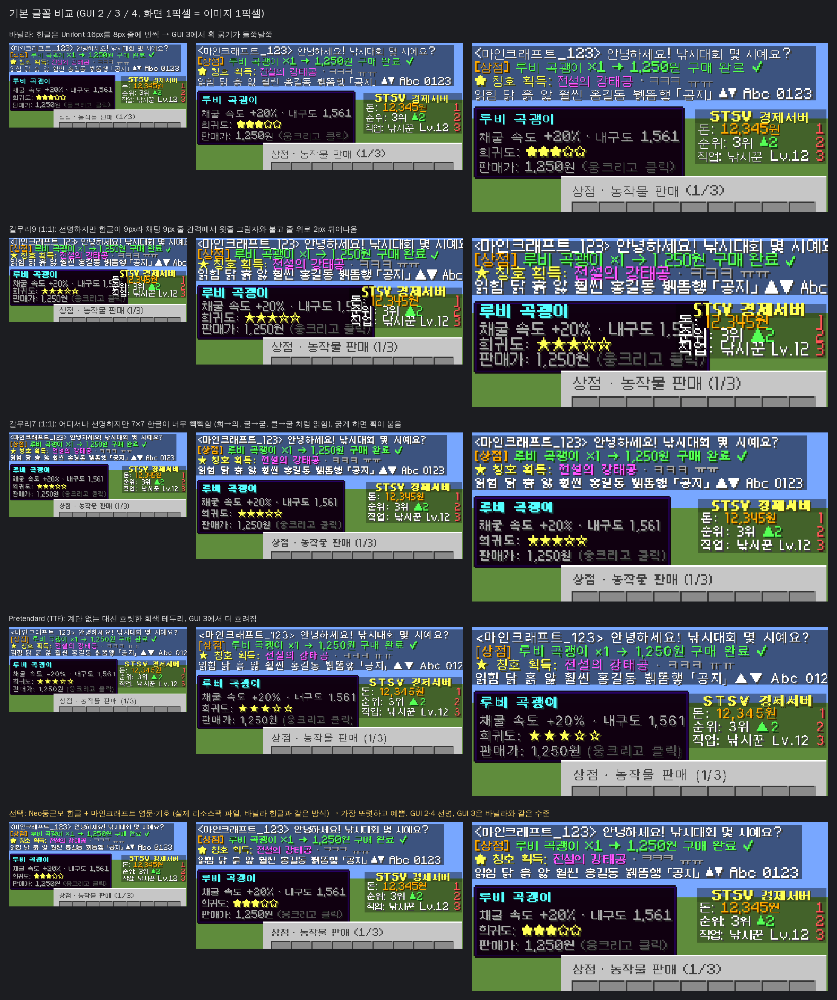

채팅, 아이템 이름·설명, 메뉴 제목, 표지판, 스코어보드 등 **게임 기본 글꼴의 한글을 픽셀 글꼴 Neo둥근모** 로 바꿉니다(`config.yml resource-pack.default-font: true`, `false` 면 바닐라 그대로).

- **바닐라 한글과 같은 방식**: 바닐라는 한글을 Unifont 16px 글자로 8px 줄에 그립니다(글꼴 1픽셀 = GUI 0.5픽셀, 그림자·굵게도 0.5픽셀). 리소스팩은 같은 방식(unihex)으로 Unifont 대신 Neo둥근모 글자를 넣을 뿐이라, 줄 간격·그림자·굵게(`<b>`)·글자 폭이 바닐라 한글과 같고 획이 또렷하고 읽기 쉬운 글자체만 바뀝니다. GUI 크기 2·4(1080p 자동 = 4)에서 선명하고, 3 에서는 바닐라 한글과 같은 수준입니다.
- **바뀌는 글자**: 한글 11,172자 전부, 자모(ㅋㅋ ㅠㅠ, Neo둥근모 원래 모양대로 글자 속 자리에 그려짐), 「」『』【】、。 같은 문장 부호. 한글은 마인크래프트 영문과 같은 기준선에 앉고, 그림자까지 9px 줄 안에 들어갑니다. 한 글자 폭은 7~9px(바닐라와 비슷하거나 좁음)이라 메뉴 제목 등이 넘치지 않습니다.
- **영문·숫자·기호는 마인크래프트 그대로**: 게임의 8px 그림 글자(ASCII, · × → ★ ✔ ❤ ▲ ◀ 등)가 먼저이고, 그 다음 Neo둥근모, 마지막에 Unifont 입니다. 그래서 다른 플러그인이 영문 폭으로 맞춘 정렬도 그대로이고, HUD 글꼴(`stsv:hud/...`, 갈무리)과 메뉴 배경 글꼴(`stsv:menus`)은 바뀌지 않습니다. 마인크래프트 설정의 **유니코드 글꼴 강제**를 켠 사람에게는 바닐라처럼 Unifont 로 보입니다.
- 비교한 후보(갈무리9, 갈무리7, Pretendard)와 고른 이유는 위 그림에 있습니다. 갈무리7(7×7)은 어느 GUI 크기에서도 선명하지만 '희'가 '의', '굴'이 '굳'처럼 읽힐 만큼 빽빽했고, 갈무리9 는 9px 줄에 비해 커서 윗줄 그림자와 붙습니다.
- **크기**: 리소스팩 +약 85KB(글자 zip 82KB + 글꼴 JSON + 라이선스), 클라이언트 메모리 약 1MB(글자를 그림이 아닌 비트로 들고 있음; 바닐라 Unifont 와 같은 방식).
- 파일: `tools/assetgen/default_font.py` 가 `plugin/src/main/resources/pack/default_font/` 에 만들고(Neo둥근모 글리프 자료 `tools/assetgen/fonts/neodgm.txt`, `neodgm.py` 로 TTF 에서 정확히 뽑음, 네트워크 없이 다시 만들 수 있음), 리소스팩의 `assets/minecraft/font/default.json` 과 `assets/stsv/font/default/korean.zip` 으로 들어갑니다. 콘텐츠 팩이 `assets/minecraft/font/default.json` 을 직접 넣으면 그쪽이 우선합니다.
- **라이선스**: Neo둥근모(© Eunbin Jeong (Dalgona.))는 SIL OFL 1.1 이라 리소스팩에 넣어 배포·변환할 수 있습니다. 라이선스는 리소스팩 `assets/stsv/font/default/LICENSE-neodgm.txt` 에 함께 들어갑니다. 예약 글꼴 이름("Neo둥근모", "NeoDunggeunmo" 등)이 있어서, 변환한 글자 파일은 그 이름을 쓰지 않습니다(출처 표기만).

### 탈것 (경찰차 · 1톤 트럭 · 골프 카트 · 리어카)

운전할 수 있는 탈것 세 가지와 짐을 나르는 **리어카**(타지 않고 끔, 아래), 그리고 **세대 사다리**의 도로 탈것 다섯 가지(짐자전거·배달 오토바이·사륜 오토바이·소형 화물 밴·탑차, 아래). 연료는 없고 월드 제한도 없습니다. **1~3세대**는 경제 서버 **상점의 탈것** 분류에서 삽니다(한 번에 1대, 되팔 수 없음): 지게 30,000 · 리어카 100,000 · 짐자전거 150,000 · 소달구지 250,000 · 배달 오토바이 400,000 · 경운기 500,000 G. 나머지(4·5세대, 특수, 경찰차·골프 카트)는 **관리자만 지급**(`/관리자 아이템목록` 의 **탈것** 탭, `/관리자 지급`).
상점·뽑기·레시피에는 없습니다(`VehicleContentTest` 가 확인). `/관리자 탈것 목록|회수|제거` 는 리어카도 똑같이 다룹니다.

| | 경찰차 | 1톤 트럭 | 골프 카트 |
|---|---|---|---|
| 최고 속도 (후진) | 10 (3.5) 블록/초 | 8 (3) | 6 (2.5) |
| 가속 · 브레이크 | 3 · 9 블록/초² | 2.2 · 8 | 2.5 · 8 |
| 방향 (도/초, 이 속도부터 다 돎) | 72 (3 블록/초) | 58 (3) | 85 (2) |
| 크기 (길이×너비×높이) | 4.6×1.9×1.65 | 4.9×1.8×2.05 | 2.5×1.3×2.0 |
| 자리 | 4 (운전석 + 3) | 운전석 + 옆자리, 짐칸에 2 | 2 |
| 스페이스 (경적, 누르는 동안) | 중간 높이 두 음 "빠앙" | 낮고 굵은 두 음 "부웅" | 높고 가는 "삑" |
| 달리는 소리 | 부드러운 엔진 소리 | 조금 거친 디젤 소리 | 조용한 전기 모터 소리 (서 있으면 없음) |
| Ctrl | 사이렌 켜기·끄기 (경광등 빨강·파랑 + 소리) | | |
| 그 밖 | 이벤트 탈것 (세대 없음) | **4세대 · 짐칸 보관함 450칸** (45칸 × 10쪽) | 이벤트 탈것 · 뒤에 골프백 거치대 |

**누가 쓸 수 있나**: 운전, 리어카 끌기, 짐칸 열기, 지게 지기 = **주인, 주인이 `/탈것 권한 <플레이어>` 로 허락한 사람, 주인이 사는 땅의 구성원(경제 서버), 관리자**. 허락은 그 주인의 **모든 탈것**에 적용됩니다(`/탈것 권한` = 목록, `/탈것 권한취소 <플레이어>` = 취소: 그 사람이 지금 운전·끌기·짐칸을 쓰고 있으면 바로 손을 뗌). 아이템으로 회수는 그대로 **주인과 관리자만**.

**귀속 · 양도**: 탈것(세운 것이든 아이템이든)과 지게는 **주인 것**입니다. 아이템을 누가 들고 있든 **주인(과 관리자)만 세울 수 있고**(다른 사람이 들고 우클릭하면 "OO님의 탈것" 안내), 지게는 주인·허락받은 사람·땅 구성원만 질 수 있습니다. 아이템 설명에 주인이 적혀 있습니다. 상점에서 산 탈것·지게는 **산 사람에게 묶이고**, 관리자가 지급한 아이템은 처음 세운(입은) 사람 것이 됩니다(관리자가 남의 아이템을 세우면 주인 것으로 섬). 넘겨줄 때는 **`/탈것 양도 <플레이어>`**: 손에 든 탈것·지게 아이템(새 아이템이 받는 사람 인벤토리나 우편함으로, 접속하지 않았으면 다음 접속 때. 들고 있던 아이템은 못 쓰게 됨), 아니면 타고 있거나 끌거나 바라보는 탈것(그 자리 그대로, 짐칸의 짐과 함께). 10초 안에 같은 명령을 한 번 더 입력해야 넘어가고, 둘 다 알림을 받고 서버 기록에 남습니다. 거래소·경매·직거래에는 탈것·지게(와 그것이 든 셜커 상자·꾸러미)를 올릴 수 없습니다(양도 안내).

**목록은 지금 있는 것만**: `/탈것 목록`, `/관리자 탈것 목록`, `/관리자 지게 목록` 에는 세워져 있거나, 아이템으로 어딘가에 있거나, 돌려받을 예정인 것만 나옵니다. 아이템이 **바닥에서 없어지면**(용암·불·선인장·폭발·공허·5분 지나 사라짐) 바로, **들고 있던 사람에게서 없어지면**(`/clear`, 크리에이티브에서 지움, 다른 데 써 버림: 접속·나감·창 닫을 때·10초마다·목록을 볼 때 인벤토리와 엔더 상자를 살펴봄) 목록에서 빠집니다. 상자·바닥·우편함·다른 사람에게 간 아이템은 "그곳에 있음"으로 칩니다. 지우는 것이 아니라 **숨기는 것**이라, 아이템이 다시 나타나면(상자에서 꺼냄 등) 목록에 돌아오고 그대로 세울 수 있습니다. 예전부터 남아 있던 기록은 `/관리자 탈것 정리`(서버가 지금 볼 수 있는 모든 곳에 없는 아이템을 숨김), 아예 지우려면 `/관리자 탈것 삭제 <번호>`.

- **세우기**: 아이템을 들고 땅을 우클릭 → 그 자리에 **내가 보는 방향**으로 섭니다. **어디든 되지만** 남의 땅(내가 주인·구성원이 아닌 땅), 서버 땅(스폰 마을·하역장·터미널), 보호 구역(경제 `roads.avoid`)은 안 됩니다(주인 없는 건축월드 땅과 야생월드는 됨. 운영자는 어디든). 다른 보호 플러그인과 가구 자리 규칙은 그대로 물어봄(가구처럼 블록 설치로). 자리가 모자라거나 용암·깊은 물 위면 안 됨.
- **타기**: 우클릭. 운전할 수 있는 사람(**주인, 허락받은 사람, 주인이 사는 땅의 구성원, 관리자**)은 빈 운전석에, 그 밖의 사람은 빈 옆자리·뒷자리에 앉습니다. 몹은 탈 수 없음.
- **운전**: W 앞으로(서서히 빨라짐), S 브레이크 → 멈추면 후진, A·D 방향(움직일 때만, 빠를수록 많이 돎. 제자리 회전 없음), 아무것도 안 누르면 천천히 멈춤. 시점은 자유. **스페이스 = 경적**(진짜 경적처럼 **누르고 있는 동안** 울리고 떼면 바로 멈춤. 짧게 누르면 짧게 "빵", 24블록쯤까지 들리고 차를 따라 움직임. 5초 넘게 누르면 끊기고 뗐다가 다시 눌러야 함, 멈춘 뒤 0.3초는 쉼: 연타해도 1초에 두 번쯤), **Ctrl = 경찰차 사이렌** 켜기·끄기(누를 때마다, 내리면 꺼짐). **웅크리기 = 내리기**(내 자리 쪽 옆의 안전한 곳으로, 막혀 있으면 반대쪽·앞·뒤·지붕 위).
- **타고 있을 때 몸**: 보트·말을 탈 때처럼 **몸은 차의 앞을 보고**(차가 돌면 같이 돎) 시점을 돌리면 **머리만** 돌아갑니다(85도까지, 50도를 넘으면 어깨가 조금 따라감. 뒤를 보면 몸이 그만큼만 틀어짐). 시점은 막지 않고, 운전 방향은 시점과 상관없이 A·D 로만 바뀝니다. 다른 사람이 볼 때도, 내가 F5 로 볼 때도 같습니다.
- **소리**: 운전석에 사람이 있으면 **엔진 소리**가 납니다(16블록까지, 작게). 빠를수록 음이 높아지고, 서 있으면 더 작고 낮게(골프 카트는 서 있으면 조용). 내리거나 차를 회수·제거하면 경적·엔진 소리가 모두 멈춥니다. 소리는 리소스팩에 든 **직접 만든 소리**(`tools/assetgen/sounds.py` 가 numpy 로 합성해 ogg 로 저장: 경적 3종 + 끝소리 + 엔진 3종, 모두 합쳐 약 96KB)입니다.
- **움직임**: 중력, 지형을 따라 달림, 1칸 턱·반 블록·계단은 그대로 올라감(땅에서 막 떨어진 뒤 6틱 안에도: 한 칸 내려갔다 바로 한 칸 오르는 곳에서 속도를 잃지 않음), 내려갈 때는 반 블록은 바로, **한 칸까지는 한 틱에 반 칸씩 땅을 따라 내려감**(떨어지지 않음, 그보다 높으면 떨어지고 착지해도 속도는 그대로), 벽·나뭇잎·울타리에 부딪히면 멈춤(블록 안으로 들어가지 않음), 물(얕은 곳 40%)·꿀·거미줄·가루눈(50%)·영혼 모래(50%)·모래·자갈·눈·진흙(75%)에서는 느려짐(**사륜 오토바이**는 영혼 모래·모래·자갈·눈·진흙에서 느려지지 않음), 용암·깊은 물·불러오지 않은 청크로는 들어가지 않음, 낭떠러지에서는 떨어짐. 바퀴는 속도만큼 구르고 앞바퀴는 꺾이는 각도가 보입니다.
- **아이템으로 회수**: **웅크리고 우클릭**(주인·관리자만, 아무도 타지 않았을 때). 같은 번호의 아이템으로 돌아옵니다(탈것 번호 #12). 관리자가 남의 탈것을 회수하면 주인에게 돌아갑니다(경제 서버: 인벤토리, 자리가 없으면 우편함).
- **1톤 트럭 짐칸**: **웅크리고 짐칸을 우클릭**하면 보관함(450칸 = 10쪽, 아래 줄 화살표로 쪽 넘김)이 열립니다. 칸 수는 탈것마다 `vehicles.yml` 의 `cargo.slots`(9 의 배수, 최대 810 = 18쪽. 마지막 쪽이 덜 차면 남는 칸은 잠긴 유리판, 한 쪽뿐이면 그만큼 작은 상자 창: 27칸 = 3줄)로 바꿀 수 있습니다(줄이면 이미 든 짐은 뒤쪽에 남아 꺼낼 수 있음). 주인·허락받은 사람·땅 구성원·관리자만, 한 번에 한 사람만, 멈춰 있을 때만. 차가 움직이거나 멀어지면 닫힘. 넣은 만큼 짐칸에 **짐이 보입니다**(나무 상자·자루 → 가득 차면 방수포를 덮은 짐: 4단계). **짐칸에 물건이 있으면 회수할 수 없습니다**(짐은 아이템에 들어가지 않으므로 복사될 일이 없음).
- **땅**: 남의 땅도 지나가고 타고 내릴 수 있습니다. 세우는 것만 위의 규칙(남의 땅·서버 땅·보호 구역 안 됨)을 따릅니다. 내 탈것은 어디서든 회수할 수 있습니다(남의 땅에 세워 둔 내 차를 치울 수 있도록).
- 탈것은 **부서지지 않고 아무도 다치게 하지 않습니다**(부딪혀도 밀지 않음). 타고 있는 사람은 평소처럼 맞습니다. 접속을 끊거나 죽거나 다른 곳으로 이동하면 내리고, 탈것은 그 자리에 남습니다. 운전석이 비어 있고 **손님만** 타고 있으면 주인(또는 관리자)이 웅크리고 우클릭해 회수할 때 손님을 옆에 내려 주고(안내) 회수합니다(운전 중인 사람은 내리지 않음). 탄 사람에게 `/tpa` 하면 그 사람 자리(땅 위의 좌석) 대신 내릴 때 서는 탈것 옆 안전한 자리로 갑니다.

#### 리어카 (끄는 탈것)

**1세대.** 바퀴 둘 달린 나무 손수레. 넓은 짐칸과 긴 손잡이(끝을 가로대로 이은 ㄷ자). **아무도 타지 않고, 사람이 끌고 다닙니다.** 짐칸 보관함 **135칸**(45칸 × 3쪽, `vehicles.yml` 의 `cargo.slots`), 크기 2.3×1.65칸(손잡이까지 3.4칸).

- **세우기**: 다른 탈것과 같음(블록 규칙). 손잡이가 **나를 향하게** 섭니다.
- **끌기**: 손잡이 끝(또는 리어카)을 **우클릭** → 손잡이를 잡습니다. 손잡이 사이에 서서 가로대를 잡은 모습이 되고, 걸으면 리어카가 **트레일러처럼 뒤를 따라옵니다**(바퀴 축을 중심으로 나를 향해 돌고, 손잡이 끝이 늘 내 자리에. 뒤로 걸으면 밀림). 옆에서 잡으면 한 틱에 24도·0.6칸까지만 돌고 움직여 부드럽게 따라 돕니다. 중력, 1칸 턱 오르기, 벽·울타리(블록 안으로 들어가지 않음), 용암·깊은 물·불러오지 않은 청크 앞에서 멈춤은 운전하는 탈것과 같습니다.
- **속도**: 끄는 동안 **걸음이 40% 느려지고**(`pull.slowdown`, 이동 속도 속성 수정자: 저장되지 않는 임시 수정자라 서버가 꺼져도 남지 않음) **달릴 수 없습니다**(달리기를 시작하면 클라이언트에 배고픔이 6이라고 알려 달리기를 끊고, 그 사이에도 달리기 보너스만큼 수정자가 깊어져 빨라지지 않음. 실제 배고픔은 그대로이고 놓으면 바로 원래대로 알려 줌).
- **놓기**: **웅크리기**, 또는 **다시 우클릭**. 리어카가 걸려 멈췄는데 계속 걸어 손잡이에서 **4칸**(`pull.release-distance`) 넘게 멀어지면 저절로 놓치고 채팅으로 알려 줍니다(사람을 끌어당기지 않음). 접속 끊기, 죽음, 월드 이동, 텔레포트, 다른 것에 타기, 관전 모드, 리어카가 회수·제거되거나 청크가 내려갈 때도 놓고 속도가 돌아옵니다.
- 아무도 잡지 않으면 손잡이 쪽으로 **16도 기울어** 손잡이 끝이 땅에 닿습니다(`pull.rest-tilt`, 잡으면 수평으로 부드럽게 들림).
- **짐칸**: **웅크리고 짐칸을 우클릭**(아무도 끌고 있지 않을 때, 멈춰 있을 때, 한 번에 한 사람). 3쪽을 아래 줄 화살표로 넘김. 누가 손잡이를 잡으면 닫힘. 넣은 만큼 짐이 보입니다(상자·자루 → 가득 차면 방수포: 4단계). 바뀔 때마다 DB 에 저장.
- **회수**: **웅크리고 손잡이를 우클릭**(주인·관리자만, 아무도 끌지 않고 짐칸이 비어 있을 때).
- 굴러갈 때 1.8칸마다 아주 작은 나무 소리(`pull.sound`, 빼면 소리 없음).

#### 세대 사다리 · 도로 탈것 (짐자전거 · 배달 오토바이 · 사륜 오토바이 · 소형 화물 밴 · 탑차)

탈것은 세대를 따라 올라갑니다: **1세대 리어카 → 2세대 짐자전거 → 3세대 배달 오토바이 → 4세대 1톤 트럭 · 소형 화물 밴 → 5세대 탑차**, 그리고 **특수** 사륜 오토바이. 아이템 설명 첫 줄에 "N세대"(특수는 "특수")가 적혀 있습니다(경찰차·골프 카트는 이벤트 탈것이라 없음). 도로 탈것은 모두 **관리자만 지급**(상점·뽑기·레시피에 없음, `VehicleRoadContentTest` 가 확인). 타기·운전·내리기·회수·`/탈것 권한`·저장은 위와 같습니다. 모두 직접 만든 디자인입니다(실제 상표·차종·로고 없음).

| | 짐자전거 (2세대) | 배달 오토바이 (3세대) | 사륜 오토바이 (특수) | 소형 화물 밴 (4세대) | 탑차 (5세대) |
|---|---|---|---|---|---|
| 최고 속도 (후진) 블록/초 | 6.5 (1.2) | 9.5 (1.5) | 8 (3) | 8.5 (3) | 7.5 (2.5) |
| 방향 (도/초, 이 속도부터 다 돎) | 90 (2) | 85 (2.5) | 80 (2.5) | 66 (3) | 42 (3.5): 크고 느리게 돎 |
| 크기 (길이×너비×높이) | 2.2×0.6×1.25 (좁음) | 2.1×0.8×1.6 | 2.2×1.35×1.2 | 3.6×1.6×1.95 | 6.5×2.2×3.0 (좁은 길은 어려움) |
| 자리 | 1 | 2 (운전자 + 뒷자리) | 1 | 2 | 2 |
| 짐칸 | 27칸 (앞 바구니 + 뒤 짐받이, 짐이 보임) | 54칸 (뒤 배달통, 닫힘) | 54칸 (앞뒤 짐받이, 짐이 보임) | 360칸 = 8쪽 (닫힌 짐칸) | 720칸 = 16쪽 (닫힌 짐칸) |
| 스페이스 | 벨 "따릉" | 가볍고 높은 "빽" | 짧은 두 음 | 밝은 자동차 경적 | 깊고 굵은 경적 |
| 달리는 소리 | 엔진 없음: 작은 체인 소리 (서 있으면 없음) | 가벼운 2행정 엔진 | 단기통 "통통" 엔진 | 작은 휘발유 엔진 | 큰 디젤 |
| 그 밖 | 페달이 바퀴와 함께 돌고, 방향을 틀면 몸체가 안쪽으로 기욺 | 방향을 틀면 기욺 | 모래·자갈·눈·진흙·영혼 모래에서도 제 속도 | 오른쪽 미닫이문 | 뒤 셔터문, 6.5칸 길이 |

- **짐칸 열기**: 웅크리고 짐칸 쪽을 우클릭(짐자전거·사륜 오토바이는 뒤 짐받이, 배달 오토바이는 배달통), 앞쪽(운전석 쪽)을 웅크리고 우클릭하면 아이템으로 회수(짐칸이 비어 있어야 함). 짐자전거 27칸은 3줄짜리 작은 창, 54칸은 45칸 + 다음 쪽 9칸(나머지는 잠긴 유리판).
- **기울기·페달**(`vehicles_road.yml` 의 `lean`, `spinners`): 두 바퀴 탈것은 앞바퀴를 꺾은 만큼, 빠를수록 더(최대 `lean` 도) 안쪽으로 기울고 몸체·바퀴·짐·페달이 함께 기웁니다(타는 사람은 그대로). 짐자전거의 페달(크랭크)은 바퀴가 구르는 만큼 반 바퀴씩 돕니다(`ratio: 0.5`).
- 설정은 `content/stsv/items/vehicles_road.yml`(설정 이름은 vehicles.yml 과 같고, 더 있는 것: `lean`, `spinners`, `all-terrain`). 콘텐츠 팩의 `items/*.yml` 어느 파일에든 `vehicle:` 이 있으면 탈것입니다. 모델 `tools/assetgen/models/vehicles_road.py`, 아이콘 `vehicle_icons_road.py`, 소리 `sounds.py`(ROAD), 미리보기 `python3 vehicle_preview_road.py` → `docs/previews/vehicles_road.png`.

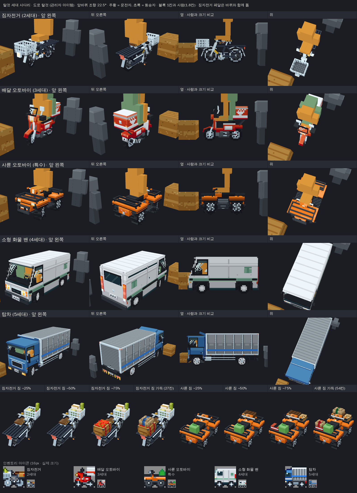

#### 농사 탈것 (소달구지 · 경운기 · 트랙터: 끄는 쪽 + 짐칸)

끄는 쪽(소, 경운기, 트랙터)에 **짐칸(트레일러)이 매달린** 탈것. 모두 **관리자만 지급**(`/관리자 아이템목록` 의 탈것 탭, `/관리자 지급`), 상점·뽑기·레시피에는 없음. 설정은 `content/stsv/items/vehicles_farm.yml`(`vehicle.train`, 파일 맨 위 설명).

| | 소달구지 (2세대) | 경운기 + 짐칸 (3세대) | 트랙터 + 트레일러 (5세대) |
|---|---|---|---|
| 최고 속도 (후진) | 4 (1.5) 블록/초 | 5 (2) | 6 (2.5) |
| 자리 | 수레 앞 의자에 2 (운전 + 1) | 짐칸 앞 의자에 2 (운전 + 1, 손잡이가 그 앞까지) | 트랙터 운전석 + 펜더 옆자리 1 |
| 짐칸 | 270칸 (6쪽) | 360칸 (8쪽) | 트레일러 두 대 × 360 = 720칸 (16쪽) |
| 가장 크게 꺾이는 각도 | 45° | 40° | 50° (두 이음매 모두) |
| 스페이스 | "음메" (합성한 소 울음, 누르는 동안) | 작은 경적 | 낮은 경적 |
| 소리 | 엔진 없음, 걸을 때 발굽 소리 | 통통통 단기통 엔진 (플라이휠이 돎) | 디젤 엔진 |
| 땅 (최고 속도) | 밭 75%, 흙 95% · 모래·자갈·눈·진흙 75% (다른 탈것과 같음) | 밭 95%, 흙길·흙 100% · 모래·진흙 75% | 흙·밭·잔디 100%, 모래·자갈·눈·진흙도 100% (all-terrain) |

- **운전**: 다른 탈것과 같음(W·S·A·D, 스페이스, 웅크리기 = 내리기). 운전석이 트레일러 위에 있어도 끄는 쪽을 운전합니다.
- **트레일러**: 바로 앞 칸의 연결점(소의 멍에 줄 뒤 고리, 경운기 뒤 핀, 트랙터 견인봉)을 향해 **자기 바퀴 축을 중심으로 돌며** 따라옵니다(리어카와 같은 계산: `TrainPhysics`). 후진하면 밀려 갑니다. 중력, 1칸 턱 오르기, 벽·울타리(블록 안으로 들어가지 않음), 용암·깊은 물 앞에서 멈춤도 운전하는 탈것과 같습니다. **트레일러가 블록에 스치면 연결점을 축으로 옆으로 밀려 비켜 갑니다**(기둥·담 모서리를 따라 미끄러짐. 한 틱에 12°까지, 꺾임 한계보다 15°까지만 더 접히고 풀리면 한 틱에 1.5°씩 한계로 돌아옴). 블록 사이에 끼어 방향을 못 돌릴 때는 방향은 잠시 그대로 둔 채 연결점을 따라 빠져나옵니다(45°까지). 그래도 갈 곳이 없으면(짐칸보다 좁은 틈, 정면의 벽) **기차 전체가 그 자리에 멈춥니다**(끊어지거나 블록에 박히지 않음: 뒤로 빼면 됨). 예전에는 짐칸이 블록에 닿기만 해도 기차가 멈췄고, 닿은 채 방향을 틀다 블록에 머리카락만큼 파고들면 어느 쪽으로도 못 움직였습니다(경운기는 짐칸이 본체보다 넓어 특히 잦았음).
- **꺾임 한계(잭나이프)**: 두 칸 사이는 표의 각도를 넘지 않습니다. 그 각도의 60%(소달구지 55%)부터는 더 꺾는 쪽으로 핸들이 천천히 돌고, 끝에서는 더 꺾이지 않습니다. 후진으로 접히면 한계에서 트레일러가 미끄러지듯 따라 돕니다.
- **짐칸**: **웅크리고 트레일러를 우클릭** = 그 트레일러의 짐칸(멈춰 있을 때, 한 번에 한 사람). 모든 트레일러가 한 보관함이라 쪽을 넘기면 다음 트레일러로 이어지고, 트레일러가 둘 이상이면 제목에 `트레일러 2` 와 그 트레일러 안의 쪽 번호가 나옵니다. 트레일러마다 **자기 칸이 찬 만큼 짐이 보입니다**(4단계: 소달구지는 볏단·가마니·항아리, 경운기는 비료 포대·배추·고무통, 트랙터는 건초 더미·상자·자루, 가득 차면 그물이나 방수포).
- **회수**: **웅크리고 끄는 쪽(소·경운기·트랙터)을 우클릭** = 기차 전체가 아이템 하나로(주인·관리자, 아무도 타지 않고 **모든 트레일러의 짐칸이 비어 있을 때**). 다시 세우면 트레일러가 뒤로 곧게 놓입니다(그 자리도 블록 규칙·빈자리 확인).
- **소**: 진짜 몹이 아니라 탈것의 일부(디스플레이)입니다. 다리 넷이 걸은 거리만큼 앞뒤로 흔들리고(`Gait`: 한 걸음 주기 1.5칸, 다리마다 1/4 주기씩 어긋난 걸음), 머리가 걸음마다 살짝 끄덕이고, 서면 다리가 몇 틱에 걸쳐 제자리로. 경적 대신 "음메": 리소스팩 소리(`sounds_farm.py` 가 합성), `vehicles.horn.custom-sound: false` 면 바닐라 소 울음을 낮게(`horn.vanilla`, `pitch`).
- **경운기**: 오른쪽 플라이휠이 운전하는 동안 돌고(서 있으면 천천히, 빠를수록 빨리), 엔진은 한 조각(0.5초)에 네 번 "통" 하는 단기통 소리. 탈것은 원래 밭(farmland)을 밟아 망가뜨리지 않습니다(디스플레이라 밟지 않음).
- **트랙터**: 큰 뒷바퀴가 굴러가는 만큼 돌고(바퀴 반지름 0.69칸) 앞바퀴는 조향 각도가 보입니다.
- **저장**: 탈것의 자리(끄는 쪽)는 `stsv_vehicle`, 트레일러마다의 자리·각도는 `stsv_vehicle_train`(`TrainStore`)에 함께 저장되어, 서버가 다시 켜져도 꺾인 그대로 있습니다. 회수하면 지워집니다.
- 미리보기 `cd tools/assetgen && python3 vehicle_preview_farm.py` → `docs/previews/vehicles_farm.png`(네 방향, 사람과 크기, 최대로 꺾인 모습, 소 걸음, 짐 단계, 아이콘). 모델 `tools/assetgen/models/vehicles_farm.py`, 아이콘 `vehicle_icons_farm.py`, 소리 `sounds_farm.py`.

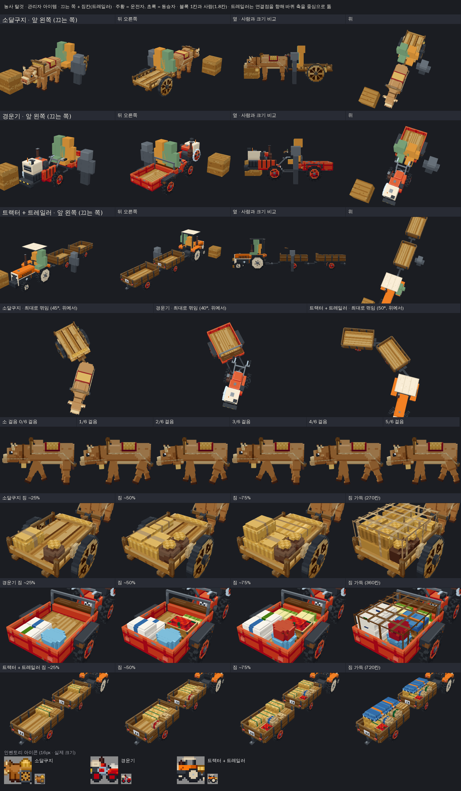

**저장 (복사·분실 방지)**: 탈것은 청크에 저장되는 엔티티가 아니라 **DB 의 한 줄**입니다(위치, 주인, 짐칸). 청크가 불러와지면 보이고(저장되지 않는 엔티티), 청크가 내려가거나 서버가 꺼지면 위치를 저장하고 사라집니다. 움직이는 동안 5초마다, 멈추면 바로 저장하므로 서버가 갑자기 꺼져도 둘이 되거나 사라지지 않고 마지막 자리에 있습니다. 짐칸은 바뀔 때마다가 아니라 창을 닫을 때, 바뀐 지 2초 안에, 월드 저장·청크 내려감·회수·서버 종료 때, 하역장 판매는 그 자리에서 저장합니다(바뀌지 않았으면 다시 저장하지 않음). 회수한 아이템에는 탈것 번호와 **확인 값**이 들어 있고, 세울 때마다 바뀝니다: 아이템을 복사해도 먼저 세운 하나만 되고 나머지는 쓸 수 없습니다(안내 후 사라짐). 아이템을 잃어버렸으면 `/관리자 탈것 회수 <번호>` 로 새로 받습니다(예전 것은 무효).

**부드럽게 움직이는 방법**: 서버가 매 틱(0.05초) 탈것을 계산해(리어카는 끄는 사람의 위치를 따라: `CartPull`) 몸체·바퀴·부품을 옮기고, 클라이언트가 그 사이를 이어 그립니다(디스플레이의 텔레포트 보간, `vehicles.smoothing-ticks` 2틱). 타는 사람은 좌석에 앉아 있고 좌석이 탈것과 함께 옮겨집니다(Paper 는 텔레포트할 때 탄 사람을 그대로 태워 둠). 좌석은 둘로 되어 있습니다: 탈것과 함께 옮겨지는 **보이지 않는 디스플레이**(몸체와 같은 보간으로 미끄러지듯 움직임) 위에 **보이지 않는 마커 갑옷 거치대**(의자)가 차와 같은 방향을 보고 있고, 사람은 그 의자에 앉습니다. 클라이언트는 탄 것이 **살아 있는 엔티티**(말, 돼지, 갑옷 거치대…)일 때만 탄 사람의 몸을 그 방향에 맞추고 머리만 돌립니다. 예전처럼 디스플레이에 바로 앉으면 서 있는 사람처럼 몸이 머리를 따라 돌아서, 시점을 돌리면 몸 전체가 같이 돌았습니다. 의자는 마커라 맞거나 클릭되거나 밀리지 않고, 떨어뜨리는 것·물리·체력 표시가 없습니다(최대 체력 1: 배고픔 칸 대신 탈것 하트가 뜨지 않음). 운전은 Paper 의 키 입력(`PlayerInputEvent`, `Player#getCurrentInput()`)으로 읽습니다.

**소리가 나는 방법**: 경적은 누르는 순간 그 차의 경적 소리(시작음 + 5초 동안 이어지는 한 덩어리)를 차 몸체에 붙여서 틀고(차와 함께 움직임), 떼면 그 소리를 들은 사람에게 멈추라고 보내고(`Player#stopSound`) 짧은 끝소리를 틉니다. 경적은 한 음이 길게 이어지는 소리라 조각을 이어 붙이면 겹치는 곳에서 소리가 울렁이므로 한 덩어리로 둡니다. 엔진은 0.5초짜리 조각(앞뒤 0.15초는 서서히 커지고 작아짐)을 앞 조각이 작아지기 시작할 때 다음 조각을 틀어 이어 가고, 조각마다 그때 속도에 맞는 음높이(0.5~2)로 틉니다(음이 높으면 조각이 짧아지므로 그만큼 빨리 다음 조각). 엔진 소리는 일정한 음 대신 넓게 흔들리는 소리로 만들어 조각이 겹쳐도 울렁이지 않습니다.

설정 `config.yml vehicles`: `max-speed`(상한 10블록/초, 너무 빠르면 청크가 못 따라옴), `smoothing-ticks`, `view-distance`, `save-seconds`, `siren.*`(소리 끄기 `sound-enabled: false`, 소리·음높이·간격, 경광등 깜빡임 간격), `horn.*`(`custom-sound: false` = 리소스팩 소리 대신 예전처럼 바닐라 소리를 누를 때마다 한 번, `min-ticks` 가장 짧은 경적 4틱, `max-hold-seconds` 5초, `cooldown` 6틱), `engine.*`(`enabled: false` = 엔진 소리 끄기, `volume` 크기 배율). 경적·엔진 소리는 탈것마다 `vehicles.yml` 의 `horn`(리소스팩 소리와 끝소리, 크기, 바닐라 대체 소리·음높이·몇 번), `engine`(소리, 달릴 때·서 있을 때 크기, 서 있을 때·최고 속도 때 음높이). 소리 파일은 `cd tools/assetgen && python3 sounds.py`(`build.py` 도 함께 만듦, ffmpeg 필요) → `content/stsv/assets/stsv/sounds/vehicle/*.ogg` 와 `assets/stsv/sounds.json`. 탈것마다의 속도·크기·좌석·바퀴 위치·짐칸 칸 수, 리어카의 `pull:`(끄는 사람 자리, 느려지는 정도, 놓치는 거리, 기울기, 소리)은 `content/stsv/items/vehicles.yml` 의 `vehicle:` (파일 맨 위·리어카 위 설명). 모델은 `tools/assetgen/models/vehicles.py`, 아이콘 `vehicle_icons.py`, 미리보기 `python3 vehicle_preview.py` → `docs/previews/vehicles.png`.

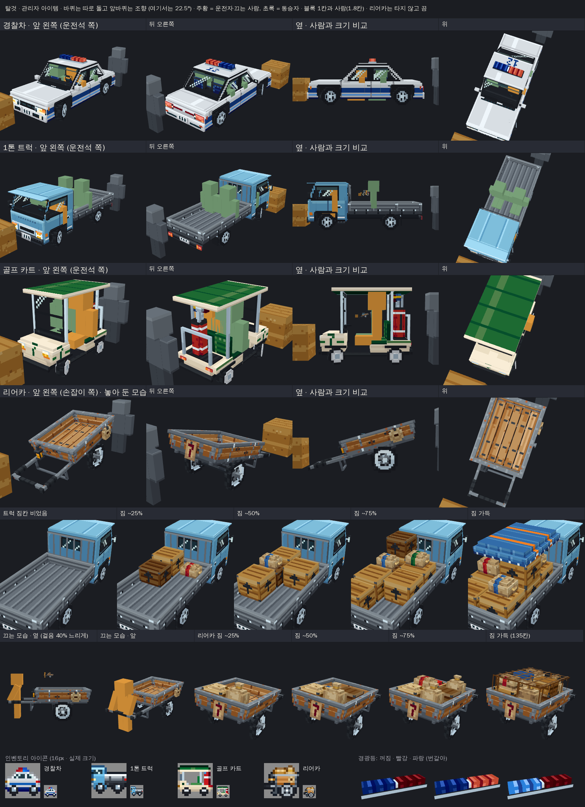

#### 통통배 (특수 · 물 위의 탈것)

나무로 짠 작은 고깃배(`content/stsv/items/vehicles_misc.yml` 의 `fishing_boat`, **관리자만 지급**: `/관리자 아이템목록` 의 탈것 탭, `/관리자 지급`). 흰 판자 선체에 파란 띠, 물 밑은 빨간 방오 도료, 앞에 올린 갑판(닻·그물 더미), 두 사람이 앉는 가로 의자, 작은 조타실(사방 창, 열린 뒷문, 풍어기 단 돛대, 서치라이트), 그 뒤 엔진 덮개와 "통통통" 굴뚝, 양옆에 폐타이어 방현재와 주황 부표, 뒤 갑판은 어창. 크기 5×2칸(조타실 지붕까지 2.5칸).

- **자리 3**: 조타실의 운전석 + 앞 갑판 가로 의자 둘. 운전·어창·권한은 다른 탈것과 같음(주인, `/탈것 권한`, 땅 구성원, 관리자).
- **띄우기**: 아이템을 들고 **물을 바라보고 우클릭**(물을 뚫고 6칸 안의 첫 물). 배의 모든 곳 아래가 물이고 걸리는 것이 없을 때만, 내가 보는 방향으로. 땅 규칙은 물 표면 칸에 블록을 놓는 것처럼.
- **물 위에서만**: 물에 떠서 용골이 수면 아래 0.375칸(`water.draft`). 물 위 최고 속도 **7블록/초**(후진 2.5). 선체 여러 곳(가운데, 길이를 따라 세 곳씩 좌우, 뱃머리·고물) 아래를 보고, 그중 하나라도 **땅(물 밖으로 나온 블록, 얕은 물가), 낭떠러지, 용암, 폭포(떨어지는 물), 거품 기둥** 위로 가게 되면 그 자리에서 **멈춥니다**(끌려 들어가지 않음). 물가 블록은 벽처럼 막고 **오르지 않습니다**(턱 오르기 없음). 흐르는 물도 반 칸 넘게 차 있으면 다닐 수 있고, 그보다 얕으면 땅처럼 멈춤. 물 높이가 바뀌면 천천히 따라 오르내림.
- **얼음**: 물에서 얼음으로 반 칸까지 미끄러져 올라가고, 얼음 위에서는 프로펠러가 거의 밀지 못하고(최고 3.5블록/초) 아주 천천히 멈춥니다(미끄러짐). 얼음에서 물로는 내려감. 땅으로는 못 감.
- **땅 위**: 물이 빠져 땅에 얹히면 움직이지 않습니다. 물가에 반쯤 걸렸으면 **물 쪽으로만** 천천히(1블록/초, `water.nudge-speed`) 밀 수 있음. 아래가 비면 떨어짐.
- **흔들림**: 물 위에서 잔잔히 앞뒤·좌우로 1~2도 흔들리고 조금 오르내림(배마다 다르게). 달리면 뱃머리가 들리고 돌 때 바깥으로 기울어짐. 보이는 모습만(타는 자리·충돌은 그대로). 얼음·땅 위에서는 가만히.
- **소리·연기**: 스페이스 = **뱃고동**(낮은 "뿌우"), 운전 중 엔진은 "**통통통**"(서 있으면 느리게, 빠를수록 빠르게). 굴뚝에서 엔진 박자에 맞춰 연기가 퐁퐁, 달리면 뱃머리에 물보라. 프로펠러는 고물 아래에서 돎.
- **낚시**: 탄 채로 낚시할 수 있습니다. 타고 있는 사람에게는 배의 클릭 상자가 보이지 않아 낚싯대를 던지면 물로 날아가고, 찌는 탈것에 걸리지 않고 지나갑니다. 경제 서버의 낚시도 그대로 됩니다.
- **어창(270칸, 6쪽)**: **웅크리고 뒤 갑판을 우클릭**(`cargo.behind` 보다 뒤). 짐이 보입니다: 생선 상자(얼음 위 생선, 빨간 상자는 참돔) → 그물·아이스박스 → 부표 → 가득 차면 방수포. 웅크리고 앞쪽 우클릭 = 아이템으로 회수(어창이 비어야 함).
- **내리기**: 웅크리기. 옆에 땅이 있으면 땅으로, 없으면 내 자리 옆 물로.
- **저장**: 다른 탈것과 같음(DB 한 줄, 청크가 내려가면 물 위 그 자리 저장, 아이템 토큰). 청크가 다시 불러와지면 그 자리 물 위에 떠 있음.

#### 지게 (1세대 · 입는 짐 지게)

소나무로 짠 A자 지게(`jige`, **관리자만 지급**). 놓는 탈것이 아니라 **가슴 칸(갑옷 자리)에 입습니다**: 그동안 겉날개와 가슴 갑옷은 못 입음(아이템 설명에 있음). 입으면 **등에 지게가 보이고**(치장의 등 자리에 그림: 등 치장을 하고 있어도 지게가 그 자리에 대신 보임, 벗으면 치장이 돌아옴), **걸음이 10% 느려집니다**(저장되지 않는 임시 이동 속도 수정자, 벗으면 바로 원래대로).

- **짐 54칸**(큰 상자 한 화면): **웅크리고 빈손으로 우클릭**(허공, 또는 문·상자처럼 쓰는 블록이 아닌 곳), 또는 `/지게`. 입고 있을 때만. 넣은 만큼 등의 모습이 바뀜: 빈 지게 → 나뭇단 몇 개(~1/3) → 나뭇단·곡식 자루(~2/3) → 가득(거적을 덮고 밧줄로 묶은 높은 짐, 낫이 꽂힘).
- **짐은 아이템에 들어가지 않습니다**: DB 에 **지게 번호**로 저장되고, 아이템에는 번호와 **확인 값**만 있음. 입을 때마다 확인 값이 바뀌어서(탈것과 같은 방법) 아이템을 복사해도 **먼저 입은 하나만** 짐을 열 수 있고 나머지는 쓸 수 없음(안내). 같은 지게를 다른 사람이 지고 있으면 입어도 열리지 않음(한 짐을 두 사람이 동시에 열 일이 없음). 짐은 바뀔 때마다 저장되고, 현재 확인 값을 가진 쪽만 저장할 수 있음.
- **벗기**: 언제든(짐이 있어도). 짐은 그 지게 번호에 남아 있다가 **같은 지게를 다시 입으면 그대로** 나옵니다. "비어 있어야 벗기"는 갑옷 칸이 바뀌는 모든 길(클릭, 웅크리고 클릭, 숫자 키, 우클릭으로 바꿔 입기, 발사기, 명령어, 다른 플러그인, 죽음)을 다 막아야 해서 하나만 빠져도 깨지지만, 짐을 번호에 묶어 두면 아이템이 어떻게 되든 짐은 DB 한 곳에만 있어 복사될 수 없습니다.
- **바닥에 떨어진 지게 아이템**은 불·용암·폭발에 타거나 부서지지 않고 사라지지도 않습니다(공허는 예외). 그래도 잃어버렸으면 `/관리자 지게 회수 <번호>` (번호는 `/관리자 지게 목록 [플레이어]`): 새 아이템이 주인에게 가고 예전 아이템은 못 쓰게 되며 짐은 그대로.
- **죽으면**: 지게는 **떨어뜨리지 않고 그대로 가지고 있음**(입은 것이든 가방에 든 것이든, `keepInventory` 와 상관없이). 짐도 그대로. 땅에 떨어진 지게를 남이 입고 짐을 가져가거나 용암·공허에 짐째 잃는 일이 없고, 아이템은 제자리에 남아 복사되지 않습니다. 살아나면 다시 짊어짐.
- 설정: `vehicles_misc.yml` 의 `jige:`(`slots` 9의 배수 최대 54, `slowdown`, `stages` 등에 보일 모습, `offset`). 모델 `tools/assetgen/models/vehicles_misc.py`, 아이콘 `vehicle_icons_misc.py`, 미리보기 `python3 vehicle_misc_preview.py` → `docs/previews/vehicles_misc.png`.

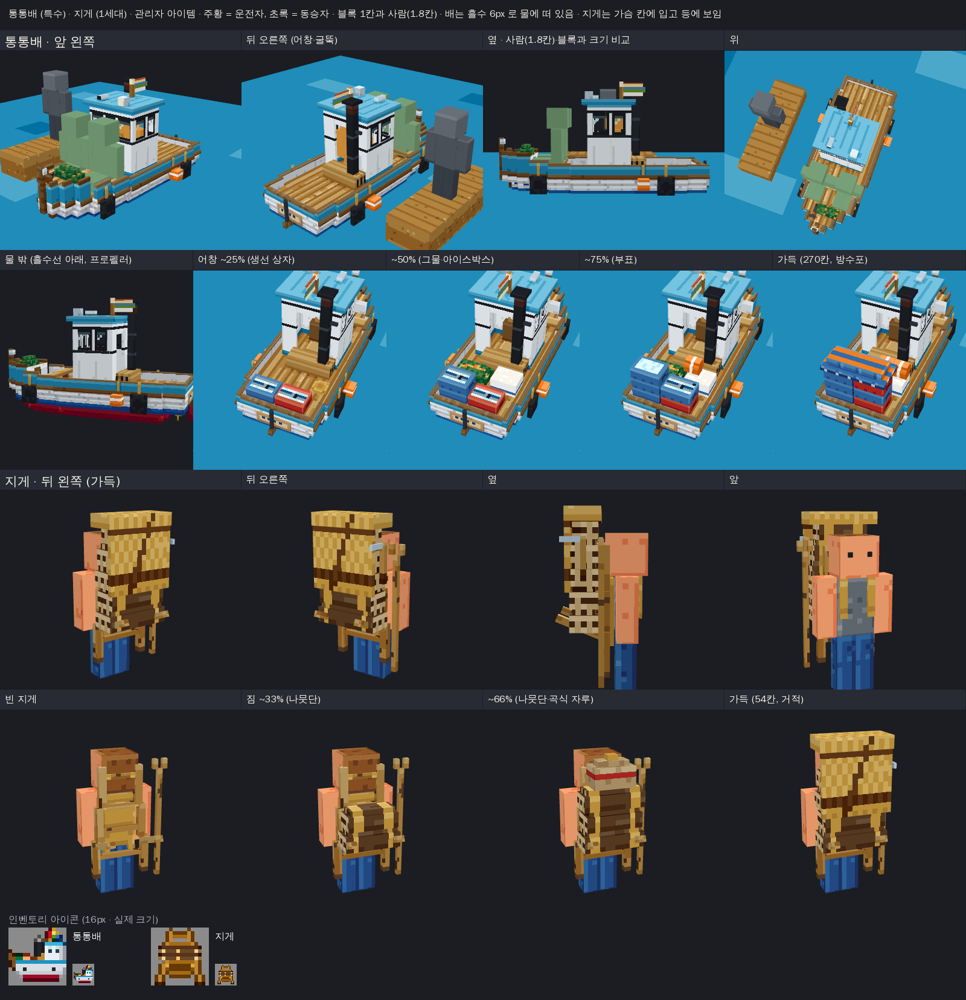

#### 작업기 (쟁기 · 로터리 · 파종기 · 수확기 · 그물 · 방수포 · 셔터)

농사 탈것은 진짜 농기계처럼 밭을 갈고 심고 거두고, 통통배는 그물을 끌고, 1톤 트럭은 방수포를 덮고, 탑차는 뒤 셔터가 오르내립니다. 설정은 `content/stsv/vehicle_tools.yml`(파일 맨 위 설명), 플러그인 `VehicleTools`(규칙 `ToolRules`, 설정 읽기 `VehicleToolSpec`).

- **바꾸기 (모두 같은 방법)**: 운전석에서 **Ctrl**(달리기 키)을 누를 때마다 다음 작업기: 처음 모습 → 작업기 1 → 2 … → 처음 모습. **멈춰 있을 때만**, 누가 짐칸을 보고 있으면 안 됨(액션바 안내). 바뀐 작업기 이름과 순서가 액션바에 나오고, 탈 때 안내에도 `Ctrl: 작업기 (지금 것)` 이 붙습니다. 작업기는 탈것에 **모델로 보이고** 움직이는 부품이 돕니다. 탈것마다 DB(`stsv_vehicle_tool`)에 기억되어 재시작해도 그대로, **아이템으로 회수하면 처음 모습**으로 돌아옵니다. (경찰차의 Ctrl 은 그대로 사이렌.)

| 탈것 | 작업기 | 하는 일 | 단 동안 최고 속도 |
|---|---|---|---|
| 소달구지 | **쟁기** (달구지 자리에: 달구지 바퀴에 매단 성에·술·보습·볏·손잡이, 앞에 2인 의자) | 지나간 **한 줄**의 잔디·흙·흙길을 밭으로 | 2.5 블록/초 |
| 경운기 | **로터리** (짐칸 자리에: 빨간 덮개, 체인 케이스, 2인 의자, **날이 돎**) | **두 줄** 갈기 | 3 |
| 트랙터 | **로터리** (뒤 3점 링크, PTO 축, 날이 돎) | **세 줄** 갈기 | 3.5 |
| | **파종기** (뒤: 파란 호퍼와 씨앗 창, 씨앗 관, 디스크 셋, **진압 롤러가 굴러감**) | 지나가는 빈 밭 **세 줄**에 **트레일러 짐칸의 씨앗**을 심음 | 4 |
| | **수확기** (앞: 분할기, 예취날, 오거, **릴이 돎**) | 지나가는 **다 자란 작물 세 줄**을 거둬 **트레일러 짐칸**으로, 다시 심음 | 3.5 |
| 통통배 | **그물 끌기** (고물의 갤로스·그물 드럼(돎)·와이어·전개판·뜸줄) | 바다(짠물)에서 천천히 가는 동안 **평균 45초에 한 마리**, 그 물의 **흔함·보통 물고기**가 어창으로 | 3 |
| 1톤 트럭 | **방수포 덮개** (활대 다섯 개에 초록 방수포, 끈으로 묶음, 뒤는 말아 올림) | 모양만: 덮은 동안 짐 모델이 안 보임. 걷으면 앞쪽으로 접힘 (덮기·걷기가 0.7초에 걸쳐 펼쳐지고 접힘) | 그대로 |
| 탑차 | **뒤 셔터** (자동, Ctrl 없음) | 짐칸을 열면(하역장 판매 화면도) 말려 올라가 안이 보이고, 달리기 시작하면 내려옴 | 그대로 |

- **일하는 때**: 운전하는 사람이 있고 **앞으로** 갈 때만(후진·정지 중에는 쟁기를 든 것처럼 쉼). 작업기의 줄(가운데 위치와 너비, `work`)이 지나가는 블록마다 **한 번씩**. 땅은 탈것이 선 높이와 위아래 한 칸까지 봅니다.
  - **갈기**: 잔디·흙·흙길 → 밭. 위에 공기나 짧은 풀·고사리만 있을 때(풀은 베어짐). **작물·꽃·블록이 있으면 그대로**(밟거나 부수지 않음).
  - **심기**: 빈 밭에 짐칸의 **맨 앞 칸 씨앗부터**(밀·당근·감자·비트·수박·호박·횃불꽃 씨앗, 경제 서버 작물의 씨앗 중 밭에 심는 것). 경제 서버 작물은 손으로 심을 때와 같은 규칙(직업 레벨 제한 등: 막힌 씨앗은 건너뛰고 다음 종류). 씨앗이 없으면 안내.
  - **거두기**: **우클릭 수확과 똑같은 길**(`CropModule#harvestInto`: 보호, 직업 보상·농부 수확 보너스·특별 재료, 떨어진 씨앗 하나로 다시 심기) 이지만 떨어지는 것이 모두 **트레일러 짐칸**으로(칸과 **적재 무게** 안에서, 넘치는 것은 그 자리에 떨어짐). 운전자 가방의 씨앗은 쓰지 않고, 농부 Lv10·20 의 줄·3×3 수확은 기계 수확에서는 퍼지지 않음(작업기 자체가 세 줄). 짐칸에 빈 칸이 2칸 미만이거나 무게가 거의 차면 쉬고 안내.
  - **그물**: 1초마다 확인, 그 물(서식지)이 바다·깊은 바다·따뜻한/차가운 바다·맹그로브·버섯 섬일 때만. 희귀·전설·진주·특별 재료는 없음. 어부는 평소처럼: 보통 물고기가 더 자주(`jobs.yml trap-uncommon`), 레벨의 두 마리 보너스, 통발처럼 직업 경험치. 어창이 차면 놓아주고 안내.
- **보호 (블록을 바꾸는 모든 작업기)**: 운전하는 사람이 **그 칸에 블록을 놓을 수 있을 때만**(가구·탈것 세우기처럼 블록 놓기로 물어봄: 내 땅·구성원인 땅·야생월드만, **남의 땅·서버 땅·주인 없는 건축월드 칸은 안 됨**), **불러온 청크만**(청크를 불러오지 않음), **스폰 보호 구역 밖**(바닐라 규칙: OP 는 예외), 경제 서버의 **국도(길의 위아래 4칸까지)·하역장·출발 터미널 청크 밖**(`VehicleModule#toolGuard`). 거두기는 실제 수확 이벤트도 거치므로 땅 보호가 한 번 더 막습니다. 막히면 액션바 안내(몇 초에 한 번).
- **서버 부하**: 모든 탈것을 합쳐 한 틱에 바꾸는 블록 수 `config.yml vehicles.tools.blocks-per-tick`(24), 평균 틱 시간이 `vehicles.tools.max-mspt`(40ms) 이상이면 쉬고 80% 이상이면 절반(국도 짓기와 같은 방식). 한 번 지나간 칸은 다시 묻지 않음.
- **짐칸**: 짐칸 자리를 대신한 작업기(쟁기, 경운기 로터리)를 단 동안 그 짐칸은 열 수 없지만 **짐은 그대로 남아** 있고, 다시 짐칸으로 바꾸면 그대로 나옵니다. 트랙터의 작업기는 트레일러를 그대로 둠.
- **API**(경제 서버가 씀): `VehicleModule#toolGuard`(국도·하역장·터미널), `#netCatch`(그물의 물고기: `FishingModule`), `CropModule#harvestInto`·`#sowFrom`·`#ripeAt`·`#collecting`.
- 모델 `tools/assetgen/models/vehicle_tools.py`(`--build` 로 모델만 쓰기: `python3 vehicle_tools_preview.py --build`, `build.py` 도 함께), 미리보기 `python3 vehicle_tools_preview.py` → `docs/previews/vehicle_tools.png`.

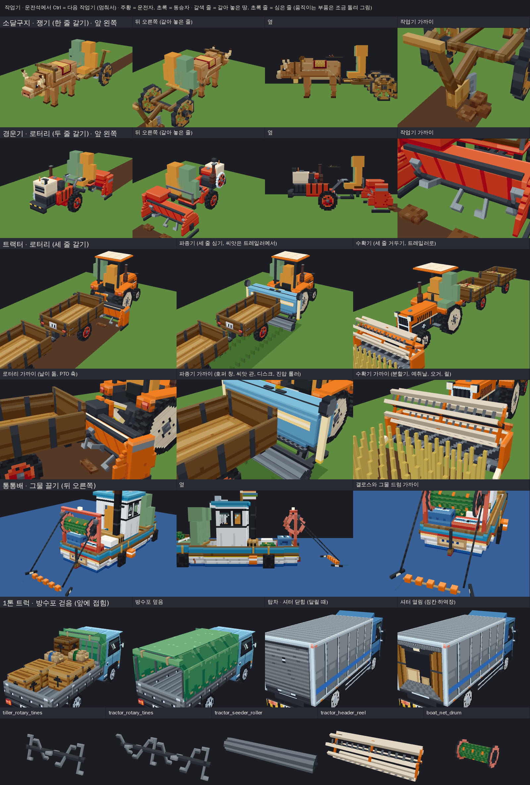

#### 적재 무게 · 하역장 (코어 쪽)

경제 서버의 **하역장**·**적재 무게**·**국도**(자세한 것은 [경제 서버 README](economy/README.md)의 "하역장", "적재 무게", "국도")를 위해 코어가 하는 일:

- **적재 무게(payload)**: 짐칸이 있는 탈것마다 실을 수 있는 무게. `cargo.payload`(기차는 `vehicle.payload` = 트레일러 모두 합쳐서, 지게는 `jige.payload`), 없으면 칸 수 × 2. 물건의 무게는 경제 서버의 `weights.yml` 이 알려 줍니다(코어만 쓰면 무게 제한 없음): 진짜 무게는 하역장이 사는 완제품만, **완제품은 무게 1 에 약 500 G**(1개 무게 = 기본 매입가 ÷ 500. 연마 진주 161.1 G → 0.32, 석등 61.2 G → 0.12. 예전에는 진주 0.2, 석등 8 이라 무게 1 에 805 G 와 8 G), 그래서 **payload P 면 한 번에 최대 약 P × 500 G**. 싼 완제품은 무게보다 칸이 먼저 찰 수 있습니다. **원재료(작물·물고기·광석·원목·블록 ...)는 64개 한 묶음이 1** 이라 칸 수가 먼저 찹니다(리어카 135칸 = 작물 135묶음 = 무게 135, 최대 150 안; 짐자전거·지게만 무게가 먼저).
  짐칸 화면의 가운데 상자 칸에 **무게 지금/최대**, 지게는 창 제목에. 넘치게 넣으면(클릭, 쉬프트 클릭, 숫자 키·F, 끌어 놓기) 받지 않고 안내합니다. 쉬프트 클릭은 들어가는 만큼만 들어감. 짐칸은 블록이 아니라서 깔때기가 닿지 않습니다.

| 탈것 | payload | 한 번에 최대 (완제품, 기본 매입가) |
|---|---|---|
| 짐자전거 | 20 | 10,000 G |
| 지게 | 30 | 15,000 G |
| 배달 오토바이 | 60 | 30,000 G |
| 경찰차 (트렁크 27칸) · 골프 카트 (골프백 거치대 27칸) | 100 | 50,000 G |
| 사륜 오토바이 | 120 | 60,000 G |
| 리어카 | 150 | 75,000 G |
| 소달구지 (기차 전체) | 400 | 200,000 G |
| 경운기 (기차 전체) | 500 | 250,000 G |
| 소형 화물 밴 | 600 | 300,000 G |
| 통통배 | 800 | 400,000 G |
| 1톤 트럭 | 1,000 | 500,000 G |
| 트랙터 (기차 전체) | 2,000 | 1,000,000 G |
| 탑차 | 2,500 | 1,250,000 G |

- **짐의 여정(trip)**: 탈것마다 "짐이 마지막으로 바뀐 곳"과 "그 뒤로 달린 거리(주행계)"를 DB(`stsv_vehicle_trip`)에 둡니다. 짐칸에 물건이 **들어오거나 나가면** 그 자리에서 다시 0부터(칸만 옮기거나 열어 보기만 하면 그대로). 아이템에서 세울 때도 다시 0(짐이 아이템으로 순간이동할 수 없음: 짐이 있으면 회수 자체가 안 되고, 관리자 회수로 짐째 돌아온 탈것도 세운 곳에서 다시 시작). 주행계는 탈것이 땅 위를 움직인 거리(끄는 리어카, 기차는 앞 칸, 배)이고 한 틱에 64블록 넘는 점프는 세지 않습니다.
  **지게**는 입은 사람이 걸은(탄) 거리를 1초마다 셉니다(하역장이 짐을 볼 때도 먼저 셈). 순간이동(8블록 넘게)·다른 월드로 가면 **바로**, 1초에 40블록 넘게 움직이면(죽음 등) 그 자리에서 다시 시작하고 봉인된 운송은 그때 무효(경제 서버), 벗었다가 다시 입을 때는 벗은 자리 16블록 안에서만 이어짐(다시 접속도 같음): 가방에 넣고 옮기면 처음부터.
- **API**(경제 서버가 씀): `VehicleModule#cargoWeight`, `#surfaceBonus`(국도 속도 보너스: 탈것 가운데 아래 블록, `vehicles.max-speed` 를 넘지 않음, 기차는 끄는 칸), `#cargoClick`(짐칸을 웅크리고 우클릭할 때 먼저 물어봄: 하역장이면 판매 화면), `#hauled`·`#hauledNear`(짐·여정·위치: 기차는 모든 칸), `#unload`(짐칸이 그대로일 때만 꺼냄), `#closeLoad`(열린 짐칸·지게 화면 닫기: 봉인 전), `#tripBroken`(지게를 진 채 순간이동: 봉인 무효), `JigeModule#hauled`·`#unload`.

#### 탈것의 느낌 (짐 무게 · 언덕 · 흙먼지 · 불빛 · 시동 · 서스펜션 · 배고픔)

모든 탈것에 공통으로 붙는 작은 실감 요소입니다(균형은 거의 그대로). 설정은 콘텐츠 팩의 `content/stsv/vehicle_feel.yml`(맨 위부터 설명), 탈것마다는 그 파일의 `vehicles:` 아래 아이템 id 로.

- **짐 무게**: 짐 무게 ÷ 적재 무게(무게를 모르는 코어만의 서버는 찬 칸 ÷ 칸 수)만큼 가속이 느려지고 최고 속도가 조금 줄어듭니다. 가득 실으면 엔진 탈것 −7%, 소 −12%, 사람 힘(리어카·짐자전거·지게) −15%(`power.*.top-loss`, 가속은 `accel-loss`). 기차(소달구지·경운기·트랙터)는 트레일러 짐 모두 합쳐서, 리어카는 끄는 사람의 걸음이(`pull.slowdown` 위에), 지게는 입은 사람의 걸음이(`jige.slowdown` 위에) 그만큼 더 느려집니다(2% 단위로 바뀜).
- **언덕**: 최근 2.5칸쯤 오르내린 높이(기울기)로, 오르막은 느리고(짐이 많을수록 더, 아무리 가팔라도 55% 는 남음), 바퀴 달린 탈것은 내리막에서 조금 빠름(엔진 최대 +8%, 서버 상한 `vehicles.max-speed` 는 넘지 않음). 배는 그대로.
- **바퀴 밑**: 뒷바퀴(트레일러 바퀴도) 밑이 흙·흙길·밭·모래·자갈이면 흙먼지, 진흙이면 진흙 튐, 얕은 물이면 물보라, 눈이면 눈가루(잔디·돌·길은 없음). 걷는 속도(1.5블록/초)보다 빠를 때, 3틱마다, 32칸 안에 사람이 있는 탈것만. 눈 위 바퀴 자국은 없습니다.
- **불빛**(배달 오토바이, 사륜 오토바이, 경운기, 트랙터, 소형 화물 밴, 1톤 트럭, 탑차, 경찰차, 골프 카트): 운전석에 사람이 있고 **어두우면 전조등**(렌즈가 빛나고 둘레가 번지며 앞으로 옅은 빛줄기)과 미등. 주변 밝기는 탈것이 그려지는 밝기(`VehicleLight`, 이미 천천히 바뀜)에 그 시각·날씨의 하늘 어두움을 뺀 값으로, 7 이하면 켜지고 10 이상이면 꺼집니다(그 사이는 그대로: 해 질 녘에 깜빡이지 않음). **S 로 브레이크**를 밟으면 브레이크등(밝은 빨강, 짧게 밟아도 4틱), **후진**하면 후진등(1톤 트럭·밴·탑차·경찰차), 1톤 트럭·밴·탑차는 후진 경고음 **"삐-삐-"**(0.7초마다). 불빛은 몸체와 같은 자리·모양으로 그리는 따로 된 부품 두 개(앞·뒤)이고 **늘 가장 밝게** 그립니다(주변 밝기를 받지 않으므로 탈것이 어두워졌다 밝아졌다 하지 않음, 꺼지면 빈 모델). 진짜로 주변 블록을 밝히지는 않습니다(움직이는 빛 블록은 매 틱 조명 계산이 들어 무거움).
- **시동**: 엔진 탈것은 운전석에 타면 **시동 소리**(스타터 "드르르" 뒤 붕 하고 걸림, 골프 카트는 딸깍 + 모터 소리, 경운기는 크랭크를 돌려 통통통)가 나고 그게 끝날 즈음 엔진 소리가 이어집니다. 운전자가 내려도 손님이 남아 있으면 **공회전**으로 계속 돌고, **마지막 사람이 내리면 시동 끄는 소리**. 서 있는 동안(공회전) 몸체가 아주 조금 떱니다(`idle-shake`).
- **서스펜션**: 턱을 오르내리면 몸체가 출렁이고(바퀴는 땅에), 출발·급브레이크에 앞뒤로 끄덕이고, 돌거나 턱을 넘을 때 보이는 짐이 옆으로 조금 흔들립니다(1초쯤이면 가라앉음). 보이는 모습만(좌석·충돌은 그대로), 40칸 안에 사람이 있을 때만 2틱마다 보냄. 기차의 트레일러 짐은 흔들리지 않습니다.
- **사람 힘**: 리어카를 끌거나 짐자전거를 타거나 지게를 지고 걸으면 그 거리만큼 배고픔이 조금 줄어듭니다(exhaustion, 짐이 많을수록·오르막일수록 더): 리어카 가득 평지 1000블록 ≈ 배고픔 5칸(반 칸 10개), 빈 채로 ≈ 1.25칸. 1초마다 모아서, 크리에이티브·관전은 없음. 짐자전거는 페달을 밟을 때마다 타는 사람이 살짝 오르내립니다(`pedal-bob`: 페달은 원래 바퀴와 함께 돎. 앉은 플레이어의 다리는 게임이 그리는 그대로라 움직일 수 없음).
- 모델 `tools/assetgen/models/vehicle_lights.py`(몸체 생성기의 불빛 자리를 따라 그림: 몸체가 바뀌어 불빛이 몸체 면에서 벗어나면 `build.py` 가 경고), 소리 `sounds_feel.py`(sounds.py 가 함께 만듦), 미리보기 `python3 vehicle_lights_preview.py` → `docs/previews/vehicle_lights.png`.

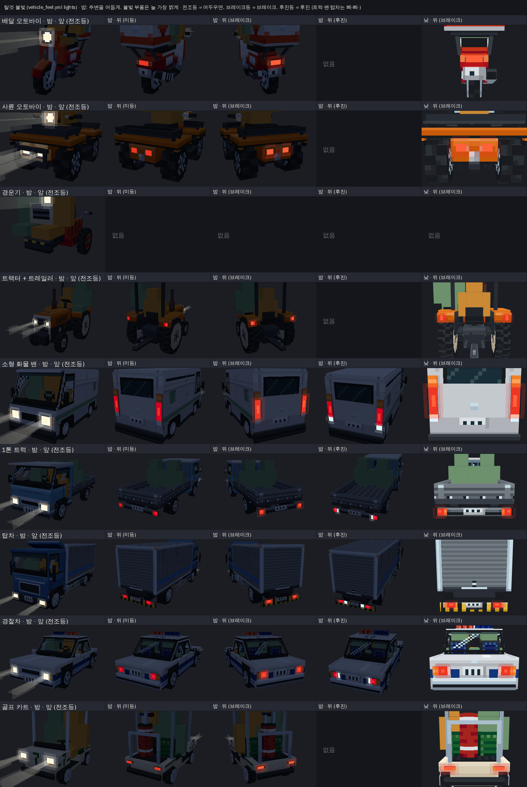

### 뼈 블록 엘리베이터

뼈 블록을 같은 줄(세로)에 층마다 하나씩 놓으면 엘리베이터가 됩니다. 명령어는 없습니다.

- 뼈 블록 위에서 **점프** = 위쪽의 다음 뼈 블록 위로, **웅크리기** = 아래쪽의 다음 뼈 블록 위로. 최대 32블록까지 찾습니다.
- 도착할 뼈 블록 위 **두 칸이 비어 있어야** 합니다(막혀 있거나 용암·불·거미줄 등이면 그 층은 건너뛰고 그다음 뼈 블록으로). 층 사이의 바닥·천장은 상관없습니다.
- 바라보는 방향과 블록 안에서 서 있던 자리는 그대로, 도착하면 멈춰 서고 낙하 피해도 없습니다. 작은 소리와 보라색 입자. 점프 키를 누르고 있어도 0.5초에 한 번만.
- 모든 월드에서 되고, 날기·겉날개·탈것·관전 중에는 동작하지 않습니다. 탈 곳이 없으면 그냥 점프입니다(안내 문구 없음).
- 설정 `config.yml elevator`: `enabled`(true), `block`(BONE_BLOCK, 다른 블록으로 바꿀 수 있음), `max-distance`(32), `cooldown-seconds`(0.5). 권한 `stsv.elevator`(기본 모두).

#### 야생월드 렉 줄이기

예전에는 `/야생월드` 를 쓸 때마다 300~5000블록 밖의 **한 번도 만들어진 적 없는 청크**를 골라 그 자리에서 지형을 만들고(안전하지 않으면 최대 12번), 도착한 뒤에는 시야 거리 전체의 지형을 또 만들었습니다. 지형 생성은 무거워서 누가 야생월드로 갈 때마다 서버가 렉이 걸렸습니다.

이제는 플러그인이 **서버가 한가할 때 미리** 안전한 자리를 찾아 둡니다(`config.yml worlds.wild-spots`).

- **준비된 자리**: 기본 24개. 무작위 자리의 청크를 불러와(처음이면 만들어) 안전한지 보고, 안전하면 그 주변 3x3 청크까지 하나씩 미리 만든 뒤에야 준비된 자리로 넣습니다. **한 번에 청크 하나만**(비동기, 동기 로딩 없음), **1분 평균 TPS 19 이상이고 평균 틱 시간 40ms 미만일 때만**, 청크 하나마다 **2초씩 쉬면서**. 다 차면 쉽니다.
- `/야생월드` 는 준비된 자리 하나를 무작위로 꺼내 **바로** 보냅니다(경고·대기 시간·쿨타임은 그대로). 보내기 직전에 그 자리를 다시 확인해서, 그새 누가 짓거나 파서 위험해졌으면 버리고 다음 자리를 씁니다.
- 준비된 자리가 없으면(서버를 처음 켰을 때, 많은 사람이 한꺼번에 갔을 때) 예전처럼 그 자리에서 찾되, **이미 만들어진 청크를 먼저** 살펴보고 새 지형은 **2번까지만** 만들어 봅니다. 그래도 없으면 "안전한 자리를 찾지 못했습니다"가 나오고 이동하지 않습니다(잠시 뒤 다시).
- 서버를 껐다 켜도 준비된 자리는 남습니다(`plugins/STSV/data/wild-spots.txt`, 지워도 됨). `/관리자 야생초기화` 를 하면 모두 버리고 새 야생월드에서 다시 채웁니다.
- 상태: `/관리자 야생스팟` (또는 `/관리자 보고서`). 접속자가 없을 때 `/관리자 야생스팟 채우기 100` 처럼 빠르게 채워 둘 수 있습니다(0.25초 간격, 그래도 한 번에 하나, 서버가 바쁘면 쉼).

| 설정 (`worlds.wild-spots`) | 기본 | |
|---|---|---|
| `pool` | 24 | 미리 찾아 둘 자리 수. 0 = 끔(예전처럼 매번 찾음) |
| `interval-seconds` | 2 | 청크 하나를 만든 뒤 쉬는 시간(초) |
| `fast-interval-seconds` | 0.25 | `/관리자 야생스팟 채우기` 때 쉬는 시간(초) |
| `min-tps` · `max-mspt` | 19 · 40 | 1분 평균 TPS 가 이보다 낮거나 평균 틱 시간(ms)이 이 이상이면 기다림 |
| `arrival-chunk-radius` | 1 | 자리 주변에 미리 만들 청크 반경(1 = 3x3) |
| `fallback-generate-tries` | 2 | 준비된 자리가 없을 때 새로 만들어 볼 청크 수 (전체 시도는 `wild-random.tries`) |

**서버 쪽 설정** (플러그인 밖, 서버 관리자가 직접. 이름은 Paper 버전에 따라 조금 다를 수 있으니 서버 폴더의 파일을 확인하세요):

- **Chunky 로 야생월드를 미리 만들어 두기 (가장 효과가 큼).** 도착한 사람 주변(시야 거리)과 돌아다니는 곳의 지형까지 미리 만들어지므로 렉이 거의 없어집니다. [Chunky](https://modrinth.com/plugin/chunky) 를 넣고 서버 콘솔에서:
  ```
  chunky world wild
  chunky shape circle
  chunky center <야생월드 스폰 X> <야생월드 스폰 Z>
  chunky radius 5200
  chunky start
  ```
  반경은 `worlds.wild-random.radius`(5000) + 시야 거리만큼(예: 시야 10청크 = 160블록 → 5200). 5000블록 반경은 약 30만 청크라 몇 시간 걸리고 디스크도 수 GB 씁니다. 사람이 적은 밤에 돌리고 낮에는 `chunky pause` / `chunky continue`. 너무 크면 `wild-random.radius` 를 2000~3000 으로 줄이고 Chunky 반경도 같이 줄이세요. **`/관리자 야생초기화` 뒤에는 Chunky 를 다시 돌려야 합니다**(새 시드). 월드 경계(`/worldborder`)를 Chunky 반경에 맞춰 두면 그 밖으로는 지형이 만들어지지 않습니다.
- **야생월드만 시야·시뮬레이션 거리 줄이기**: `spigot.yml` 의 `world-settings` 에 야생월드 이름으로 따로 적습니다. 도착할 때 불러올 청크 수가 거리의 제곱으로 줄어듭니다.
  ```yaml
  world-settings:
    wild:
      view-distance: 6        # 기본은 server.properties 의 view-distance
      simulation-distance: 4  # 몹·작물이 움직이는 거리
  ```
  (야생 지옥·엔드도 같은 방식으로 `wild_nether`, `wild_the_end`.)
- **플레이어 한 명이 지형을 만드는 속도 제한**: `config/paper-global.yml` 의 `chunk-loading-basic` 에서 `player-max-chunk-generate-rate`(기본 -1 = 무제한)를 예를 들어 `40` 으로. 달리거나 겉날개로 날아 새 지형을 마구 만들 때 서버가 버팁니다(대신 먼 지형이 조금 늦게 보임). `chunk-system.worker-threads` 는 보통 기본값(-1)이 좋습니다.

#### 큰 땅 근처 프레임 드랍 줄이기 (3D 모델)

가구·직업 기계·치장은 **디스플레이 엔티티**로 그립니다. 블록은 청크마다 한 번 구워 둔 덩어리로 그리지만, 엔티티는 **매 프레임 하나씩 따로** 그립니다. 그래서 엔티티 수천 개가 있는 땅 근처에서 프레임이 떨어집니다(가구 1개 = 모델 1개 + 클릭 상자 1~6개, 기계 = 모델 1~2개 + 클릭 상자). **커스텀 작물은 이제 진짜 블록**이라(아래 "작물 블록") 아무리 큰 농장도 엔티티가 0개입니다. `crops.render: entities` 로 되돌렸을 때만 작물 1개 = 모델 1개 + 클릭 상자 1개.

- **몇 개가 그려지는지 재기**: 그 땅에 가서 `/관리자 보고서 주변 [반경]`. 종류별 개수, 그 자리에서 실제로 그려지는 수(보이는 거리 안), 모델 면 수 합계가 나옵니다.
- **보이는 거리** (`config.yml display.view-distance`, 블록, 플레이어 비디오 설정 '엔티티 거리' 100% 기준): 작물 32(작물을 엔티티로 그릴 때만), 1칸 소품 32, 큰 가구 48, 기계 64, 경제 서버 국도 표지판 96(`road-signs`). `furniture.view-range` 는 이 전체에 곱하는 배율. 줄일수록 프레임이 오르고 멀리 있는 모델이 일찍 사라집니다.
- **화면 밖 건너뛰기** (`display.frustum-culling: true`): 모델 크기를 클라이언트에 알려 등 뒤·옆의 모델은 그리지 않게 합니다(바닐라 디스플레이 엔티티는 크기를 모르면 화면 밖이어도 늘 그림). 보이는 모습은 같습니다.
- **도는 부품** (`display.animate-range: 32`): 기계의 바퀴·맷돌·나사는 32블록 안에 사람이 있을 때만 돌고(회전 패킷), 아무도 없으면 그 자리에 멈춰 있습니다. 기계 작동은 그대로.
- 바꾼 뒤 `/관리자 리로드` 하면 이미 설치된 가구·작물에도 적용됩니다(청크를 다시 불러올 때도).
- **서버 쪽 설정**: `spigot.yml` 의 `world-settings.default.entity-tracking-range.display`(기본 128)를 `64` 정도로 줄이면 그보다 먼 모델은 클라이언트에 아예 보내지 않습니다(접속·순간이동 때 한꺼번에 오는 패킷도 줄어듦).
- **플레이어 쪽**: 비디오 설정 '엔티티 거리'를 50~75%로(모델 보이는 거리가 그만큼 줄어듦), '엔티티 그림자' 끄기. Fabric 이면 Sodium + ImmediatelyFast(엔티티를 묶어 그림) + Entity Culling(벽 뒤 엔티티를 건너뜀)이 큰 도움이 됩니다. 셰이더(Iris·OptiFine 셰이더)는 엔티티마다 비용이 몇 배라 큰 땅 근처에서는 끄는 편이 좋습니다.

**테스트는 몇 번이든 다시 할 수 있습니다.** 플러그인을 다시 깔 필요 없이 `/관리자 초기화 경제 확인`, `/관리자 초기화 기록 확인` 으로 데이터를 비우면 됩니다. 월드까지 새로 하려면 서버를 끄고 월드 폴더만 지우세요(돈과 기록은 월드와 별개로 `plugins/STSV/data/stsv.db` 에 있음).

#### 작물 블록 (트립와이어)

커스텀 작물(토마토, 옥수수 등 17종, 77단계)은 **진짜 블록**으로 그립니다(`config.yml crops.render: blocks`, 기본). 바닐라 **실(트립와이어) 블록**은 상태가 128가지(연결 방향·당김·끊김 등)인데, 2개는 진짜 실 모양으로 남기고 126개를 작물 단계에 쓸 수 있습니다(지금 77개: `economy` 콘텐츠의 `crop-blocks.yml`, 덧붙이기만 함). 리소스팩이 그 상태를 작물 모양으로 그립니다. 같은 작물도 블록마다 네 방향 중 하나로 무작위로 돌아 서 있고, 밝기는 예전 엔티티 모습과 같게 맞췄습니다(면마다 미리 어둡게 한 텍스처, `docs/previews/crop_blocks.png`). 옥수수처럼 2칸 높이도 그대로입니다. 블록이라 청크와 함께 한 번 구워져 그려지므로 큰 농장 근처에서도 프레임이 떨어지지 않고, 엔티티 패킷도 없습니다. 작물 데이터(나이, 심은 사람 등)는 전처럼 DB 에 있습니다.

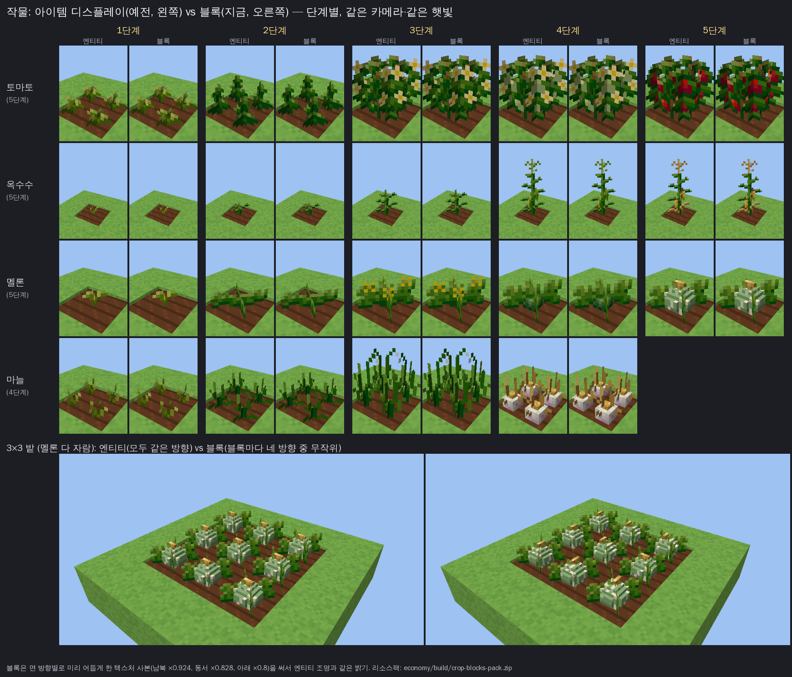

- **기존 작물**: 업데이트 뒤 청크를 불러올 때 DB 의 작물마다 블록이 놓이고(엔티티는 원래 저장되지 않음), 남은 작물 엔티티는 지웁니다. 따로 할 일은 없습니다.
- **클릭**: 우클릭·좌클릭은 예전 클릭 상자와 똑같이 동작합니다(수확, 상태 보기, 뼛가루, 땅 보호, 농부 1×3/3×3 수확·성장 가속). 실 블록 자체의 선택 테두리는 얇거나 반 칸이라, 서버가 시선을 예전 클릭 상자(폭 0.9, 작물 키)와 다시 맞춰 봅니다: 작물 아래 경작지 윗면이나 작물 뒤의 땅을 눌러도 그 앞의 작물이 눌립니다. 왼쪽 버튼을 누른 채 쓸면 익은 것만 수확되고 덜 자란 것은 그대로입니다. 작물 블록을 부숴도 실은 나오지 않고(규칙대로 씨앗·수확물), 가운데 클릭(블록 집기)도 아무것도 주지 않습니다. 작물 사이는 예전처럼 지나다닐 수 있고(충돌 없음), 작물 아래 경작지는 밟아도·말라도 흙이 되지 않습니다.
- **실은 블록으로 설치할 수 없습니다.** 실을 들고 경작지·작물·어디든 우클릭해도 아무것도 설치되지 않고 실도 줄지 않습니다(가끔 액션바에 "실은 설치할 수 없어요 (작물 표시에 쓰임)"). 제작, 활·낚싯대, 양털, 석궁 등 실의 다른 쓰임은 그대로입니다. 디스펜서는 원래 실을 설치하지 않습니다. **트립와이어 고리는 설치되지만 실이 없으니 연결되지 않습니다**(작물 쪽을 향하는 고리는 설치할 수 없음).
- **원래 있던 실**(업데이트 전에 설치한 실, 정글 사원 함정, 새로 만들어지는 지형의 것): 청크마다 처음 불러올 때 한 번 찾아서 **없앱니다**(`crops.stray-tripwire: air`, 기본. 작물 모양으로 잘못 보일 일이 없음). `string` 으로 바꾸면 없애는 대신 평범한 실 한 조각 모양으로 남깁니다(이어진 모양은 사라지고, 부수면 실이 나옴). 청크에 "확인함" 표시를 남겨 한 번만 합니다. 관리자가 `/setblock`, `/place`, 구조물 블록, WorldEdit 로 놓은 트립와이어는 확인한 청크에서는 그대로 남으니 쓰지 마세요.
- **작물 블록은 바뀌지 않게 막습니다**: 밟기, 가위, 옆 블록 변화, 피스톤(밀기·부수기 둘 다 취소), 물·용암, 폭발(작물은 남고, 흙이 날아가면 다음 성장 확인 때 씨앗으로 돌아옴: 예전과 같음), 몹(엔더맨 등), 양동이·디스펜서 물. 혹시 바뀌어도 5초마다 하는 성장 확인 때 제자리로 돌립니다.
- 플레이어가 블록을 놓거나 부수면 게임(클라이언트)이 옆 실의 모양을 스스로 다시 계산해 다른 작물처럼 보일 수 있어서, 그 주변 작물을 다음 틱에 그 플레이어에게 다시 보냅니다.

**서버 쪽 설정 (꼭)**: `config/paper-global.yml`
```yaml
block-updates:
  disable-tripwire-updates: true
```
그리고 서버 재시작. 이게 켜져 있으면 게임 자체가 트립와이어 상태를 바꾸지 않습니다(커스텀 블록 플러그인들이 쓰는 그 설정). 꺼져 있으면 서버 시작 때 경고가 나오고, 플러그인이 이벤트로 막을 수 있는 만큼 막고 5초마다 되돌리지만 잠깐 다른 모양으로 보일 수 있습니다.

**되돌리기**: `crops.render: entities` 로 바꾸고 서버 재시작. 리소스팩이 실을 다시 바닐라 실로 그리고, 청크를 불러올 때 작물 블록을 지우고 예전처럼 엔티티를 띄웁니다(작물은 DB 그대로라 잃는 것 없음). 실 설치 막기·옛 실 지우기도 꺼집니다(이미 지운 옛 실은 돌아오지 않음).

**주의 (실제 서버에서 확인할 것)**: 트립와이어는 반투명 블록과 같은 단계에서 그려져 '화려함' 그래픽에서 물·유리 뒤의 작물 순서가 어색할 수 있음. Sodium·셰이더에서 모양·밝기. 빈손으로 하늘을 배경으로 키 큰 작물(옥수수) 윗부분을 우클릭하면 클라이언트가 아무것도 보내지 않아 반응이 없음(땅이 보이게 내려다보면 됨). 작물 정의를 바꾼 뒤 `crop-blocks.yml` 에 없는 단계는 빈 상태를 자동으로 받지만(경고) 커밋해 두세요.

### 치장 (머리 · 머리 위 · 어깨 · 등 · 꼬리 · 펫 · 발자취 · 처치 효과)

기본 팩 치장 49종(탈 3종 + 46종). 일반·희귀·영웅 38종은 **치장 뽑기**(`/뽑기`, 아래)로 얻습니다(직접 사는 상점 목록은 없어짐, 이미 가진 치장은 그대로). **전설 7종(왕관, 천사의 고리, 천사·악마 날개, 한정 펫 아기 해태·꼬마 구미호·아기 봉황)은 뽑기에도 없고** 주간 순위 1위 보상(주마다 돌아가며, 가진 것은 건너뜀. config 목록에 없는 전설 치장도 뒤에 붙여서 돌림)과 상인 행렬 사건(사건마다 교환권 1장, 250,000 G)으로만 얻습니다. 업적 보상 펫 4종(두더지, 아기 양, 수달, 부엉이)은 뽑기에 없고 업적으로만 얻습니다.

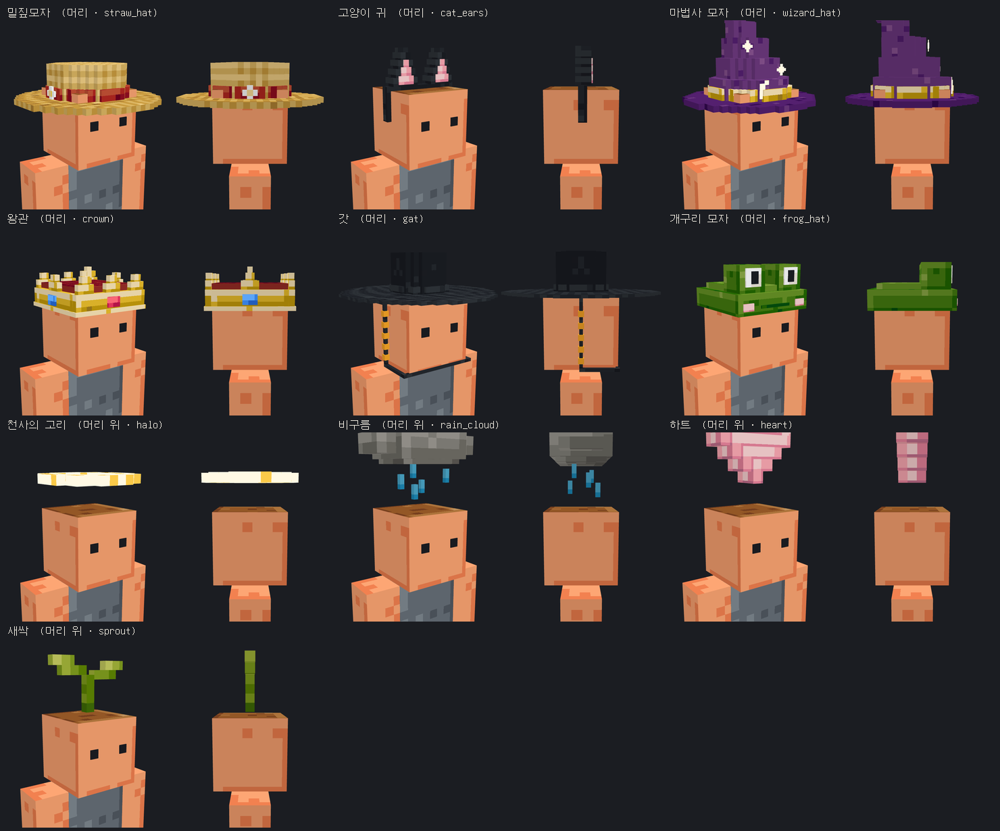
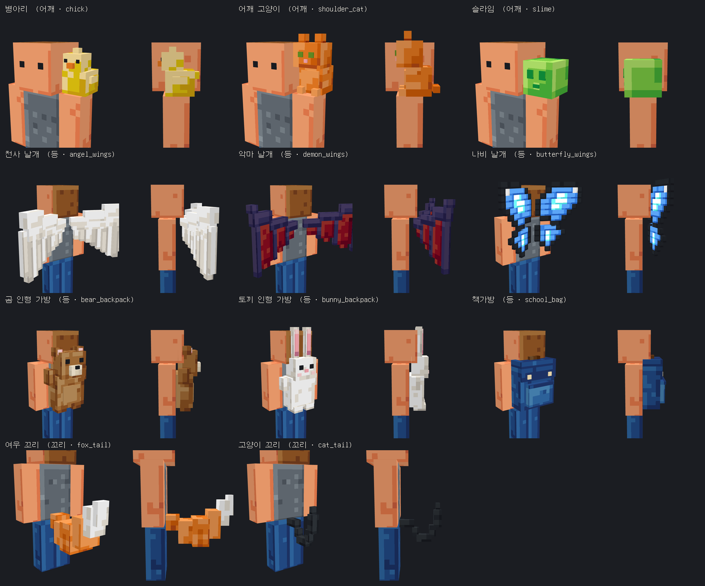

| 부위 | 치장 |
|---|---|
| 머리 | 토마토 탈, 가지 탈, 버섯 탈, 밀짚모자, 고양이 귀, 개구리 모자, 마법사 모자, 갓, 왕관(전설) |
| 머리 위 | 새싹, 하트, 비구름, 천사의 고리(전설) (하트·비구름·고리는 둥실둥실) |
| 어깨 | 병아리, 슬라임, 어깨 고양이 (왼쪽 어깨) |
| 등 | 책가방, 곰 인형 가방, 토끼 인형 가방, 나비 날개, 천사 날개(전설), 악마 날개(전설) |
| 꼬리 | 고양이 꼬리, 여우 꼬리 |
| 펫 | 상점: 강아지, 아기 고양이, 아기 거북이, 아기 토끼, 아기 펭귄, 아기 판다, 꼬마 유령(떠다님), 아기 용(떠다님) · 업적: 두더지(광맥 사냥꾼), 아기 양(목장주), 수달(어류학자), 부엉이(업적 마스터, 떠다님) · 한정(전설): 아기 해태, 꼬마 구미호, 아기 봉황(떠다님) |
| 발자취 | 꽃잎, 음표, 하트, 불꽃, 무지개 |
| 처치 효과 | 하트 뿅, 눈보라, 축포, 영혼 회수, 천벌(피해 없는 번개) |

- 머리: 투구 칸·방어력은 그대로, 다른 사람에게 보이는 머리만 바뀜(전과 같음).
- 나머지: 플레이어를 따라다니는 모델(아이템 디스플레이). 클라이언트에서만 플레이어에 '태워서' 달리기·점프에도 딱 붙어 다님. 서버에서는 태우지 않아 다른 플러그인의 순간이동이 막히지 않음. 웅크리면 상체와 함께 앞으로 기울어짐. 수영·겉날개 비행·잠자기 자세에서는 잠깐 숨김.
- 투명화(물약 포함)·관전·사망 중에는 모든 치장이 안 보임(투구는 원래대로 보임).
- 펫: 내 오른쪽 뒤를 졸졸 따라다님(걸으면 깡충, 떠다니는 펫은 둥실). 멀리 순간이동하면 그 자리에 나타남. 본인에게도 보임 한정 펫은 가끔 빛(해태)·푸른 불씨(구미호)·불씨(봉황)를 흘림.
- 발자취: 걸은 자리, 내 발 0.8칸 뒤에 파티클(꽃잎은 무릎~허리 높이에서 흩날림, 음표는 한 걸음에 3개, 무지개는 1.5초에 한 바퀴라 발자취에 여러 색). 처치 효과: 내가 잡은 몹·플레이어 자리에서 터짐. 둘 다 가까이(발자취 48칸, 처치 효과 64칸) 있으면서 나를 볼 수 있는 모든 사람에게 보임. 파티클 설정이 `최소`인 사람에게도 보이도록 강제로 보냄(펫이 흘리는 빛·불씨도 같음).
- 옷장 화면(`/치장`): 맨 윗줄 **분류 탭** 9개 = 전체 · 머리 · 머리 위 · 어깨 · 등 · 꼬리 · 펫 · 발자취 · 처치 효과. 탭 이름 옆에 `가진 수/전체 수`(예: `펫 6/15`), 제목에도 지금 탭의 수. 탭 안에는 **그 분류의 치장이 전부** 도감처럼 나옴(등급순 일반 → 전설, 같은 등급은 이름순. 가진 것과 없는 것이 제자리에 섞여 있음).
  - 가진 치장 = 원래 모습(착용 중·방금 누른 것은 반짝임). **없는 치장 = 어두운 '?' 카드**, 카드 테두리와 물음표가 등급 색(회색 일반 · 파랑 희귀 · 보라 영웅 · 금색 전설), 이름은 회색, 설명에 얻는 곳(치장 뽑기 / 업적 보상 / 한정: 주간 순위 1위·상인 행렬)과 원래 획득 문구. 전설·한정도 숨기지 않고 카드로 보임.
  - 없는 치장 클릭 = 마네킹에 입혀 보기 + 얻는 곳 안내(예: "치장 뽑기에서 얻을 수 있어요"). 뽑기에서 나오는 치장은 **Shift+클릭 = 치장 뽑기 열기**. 가진 치장 클릭 = 착용/벗기(전과 같음).
  - 아랫줄: 페이지 · **보기**(전부 → 가진 것만 → 없는 것만) · 착용 중 · 벗기 · 안내 · 뽑기 · 내 화면에 표시 · 나가기 · 페이지.
  - '?' 카드는 리소스팩 모델 하나(`stsv:gui/locked`: 어두운 카드 + 회색 테두리·물음표 층, 아이템의 custom_model_data 색으로 칠함)라 치장이 늘어도 팩이 커지지 않음.
  - 마네킹 옆에 펫이 서고, 발자취와 처치 효과도 마네킹에서 보여 줌.

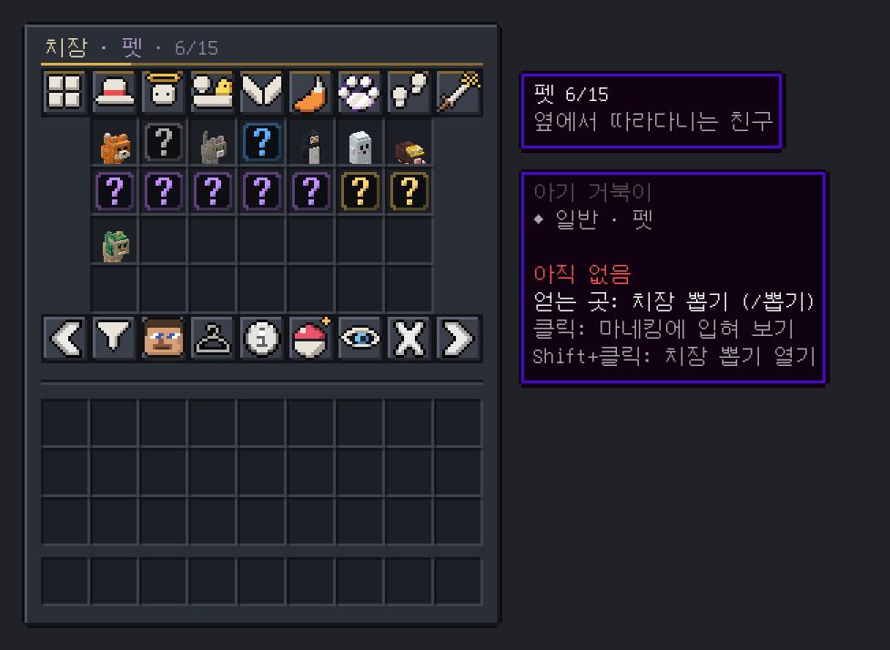
- 자리 미세 조정: `config.yml` 의 `cosmetics.anchors` (서버 전체), 치장마다 `cosmetic.offset` / `scale` / `bob` (`content/stsv/items/cosmetics.yml` 맨 위 설명).
- 모델: `tools/assetgen/models/cosmetics.py`, 미리보기: `python3 tools/assetgen/cosmetics_preview.py`

### 치장 뽑기 (/뽑기)

돈을 내고 치장 하나를 무작위로 얻습니다. 1회 10,000 G, 10회 90,000 G(10% 할인, 희귀 이상 하나 보장). 돈은 사라집니다(돈 회수처).

- 열기: `/뽑기`, 경제 서버 상점 `구매 → 치장 뽑기`(뒤로 = 상점), `/치장` 화면의 뽑기 버튼(옷장을 나가서 엶), 통합 메뉴.
- 나오는 치장: 예전에 상점에서 팔던 일반 12 · 희귀 14 · 영웅 12종. 화면은 옷장과 같은 **분류 탭**(이름 옆 = 모은 수/나오는 수)과 같은 목록(등급순 → 이름순, 가진 것은 그대로, 없는 것은 등급 색 '?' 카드). 뽑기 버튼은 아랫줄 가운데(1회 · 안내 · 10회). **확률은 보여 주지 않습니다**(관리자만 `gacha.yml` 에서 봄).
- 새 치장은 바로 계정에 등록, **이미 가진 치장**(같은 10회 안에서 두 번 나온 것 포함)은 그 치장의 **교환권**(아이템)으로: 거래소·경매·직거래로 사고팔거나, 없는 사람이 우클릭해 등록. 인벤토리가 가득 차면 발밑에 떨어짐(나만 주울 수 있음, 사라지지 않음).
- 뽑는 장면: 효과음 세 번, 마지막에 가장 좋은 등급의 색, 그다음 하나씩 등급 색 제목(일반 짧게, 영웅은 길게 + 소리 + 토템 파티클). 끝나면 채팅에 결과 목록, 뽑기 화면이 다시 열림. 영웅이 나오면 서버 전체에 알림.
- 천장: 영웅 없이 오래 뽑으면 영웅이 나옴(횟수는 `gacha.yml`, 사람마다 DB `cosmetic_gacha` 에 저장). 하루 제한 없음(기본, `daily-limit` 으로 켤 수 있음): 돈 회수처이고, 중복은 교환권으로 남아 손해가 아니며, 두 번 눌러야 뽑혀서 실수로 돈이 나가지 않기 때문.
- 설정: `contents/stsv/gacha.yml` (가격, 등급 비율, 천장, 10회 보장 등급, 하루 제한, 알림 등급, 나오는 치장. 가격을 정한 계산도 그 파일 맨 위). 전설 치장은 넣어도 빠지고 콘솔에 경고. 교환권: `content/stsv/items/cosmetic_vouchers.yml`. 화면: `content/stsv/menus/gacha.yml`.
- 교환권 45장(뽑기 35 + 탈 3 + 전설 7)이 **모두 같은 꼴**: 등급 색 표(꼬리표 회색 일반 · 파랑 희귀 · 보라 영웅, 전설은 검은 표에 금색)에 그 치장 그림이 위로 살짝 보임. 그림은 `tools/assetgen/voucher_art.py` 가 치장 모델(.bbmodel, 메뉴에서 보이는 각도)을 작게 그려서 자동으로 만들고(발자취·처치 효과는 파티클 모양을 둥근 밤하늘 배지에), 탈 3종과 전설 6종은 같은 표 위에 손으로 그린 그림. 새 치장도 교환권만 추가하면 그림이 따라옴(`texture` = 교환권 id). 설명 첫 줄 = 등급 · 분류(예: `◆ 희귀 · 머리 치장`). 한눈에 보기: `docs/previews/vouchers.png`.

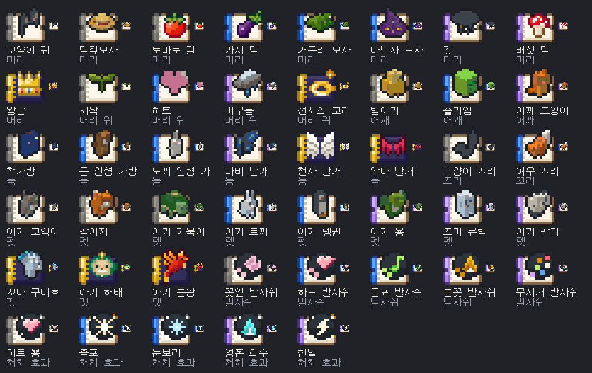
- `/관리자 치장 정보 <플레이어>` 에 천장 카운트와 뽑은 횟수가 나옵니다. 뽑을 때마다 콘솔에 결과 한 줄.

### 칭호 분류 탭 · 칭호 배너 (관리자 테스트 기능)

**분류 탭:** `/칭호` 맨 위 줄. 칭호마다 `contents/<팩>/titles/*.yml` 의 `category`(achievement 업적 · job 직업 · codex 도감 · ranking 랭킹 · shop 상점 · event 이벤트·기타)로 나뉩니다. 없으면 파일 이름으로(achievements.yml → 업적, codex.yml → 도감, 나머지 → 이벤트·기타). 탭 이름 옆 = 가진 수/전체 수. 화면: `content/stsv/menus/titles.yml`.

**칭호 배너:** 칭호와 닉네임을 테마 판 위에 `칭호 ◆ 닉네임` 으로 담아 **채팅 · 탭 목록 · 머리 위**에 보여 줍니다. 판과 불꽃·번개 같은 장식은 16장면(장면당 70ms)으로 계속 움직입니다. 테마 5개: 화염, 번개, 네온, 혈월, 프리즘.

- **누가:** OP 또는 권한 `stsv.title.banner` (기본 OP만). 다른 플레이어에게는 탭이 아예 보이지 않고(배경에도 칸이 없음), 권한을 잃으면 장착한 배너도 보이지 않습니다.
- **쓰는 법:** `/칭호` → 오른쪽 위 **칭호 배너** 탭 → 테마 클릭 = 장착(아이템 설명에 내 칭호·닉네임으로 미리보기), 다시 클릭 또는 아래 **배너 해제** = 해제. DB `title_banner` 에 저장(재접속·재시작 후에도 유지). 배너의 글은 지금 단 칭호(괄호 없이)와 닉네임: 칭호나 닉네임을 바꾸면 배너도 바뀝니다.
- **채팅 배너 (한 줄, 다섯 테마 모두):** 채팅 한 줄은 9px 인데 원래 크기 배너의 칭호 글자(Galmuri9)만 9줄이라 판과 함께 한 줄에 들어가지 않고, 원래 그림을 반 크기로 줄이면 글자가 4.5px 가 되어 읽기 어렵습니다. 그래서 채팅 배너는 테마를 **두 배 해상도로 다시 그립니다**(그림 1픽셀 = 화면 반 픽셀, 게임이 한글 채팅 글자를 그리는 방식과 같음): 판은 채팅 줄 9px 그대로인 그림 18줄(금테 · 안쪽 테 · 글자 14줄 · 안쪽 테 · 금테), 줄 위·아래로 나가는 것이 없어 잘리지 않고 연달아 말해도 금테로 나뉩니다. 글자는 칭호와 닉네임이 같은 글꼴: 한글은 Neo둥근모(서버 기본 채팅 한글과 같은 글꼴, 6.5px. 영문 대문자보다 아주 살짝 작음), 영문·숫자·기호는 Galmuri14 를 굵게(대문자·숫자 7px = 일반 채팅 글자 높이, 소문자 5px. 반 픽셀 해상도 그대로 그려 곡선이 매끄럽고, 대소문자가 섞인 이름도 진짜 소문자라 자연스러움). g j p q y 는 판의 아래 테두리를 끊지 않게 기준선 아래로 반 픽셀만 내려갑니다. 화염의 테두리: 위는 광택이 번졌다 사라지는 금 테와 그 아래 청동 턱, 아래는 잔불 빛을 받는 턱과 어두운 금 테, 양 끝에는 마감 장식이 없고 판이 종이가 타들어가듯 사라집니다(줄마다 깊이가 다른 불규칙한 가장자리, 그 가장자리를 따라 빛나다 공기 중으로 번지는 얇은 불빛, 그 안쪽은 그을린 판, 불길이 지날 때 더 달아오름: `frame_colour`, `burnt`). 불과 테두리는 딱딱한 색 띠가 아니라 매끄러운 색 단계로 칠합니다(열 → 색 `RAMP`, 불꽃 가장자리는 윤곽선 대신 빛이 번지며 사라짐). 화염은 위로 솟는 불꽃 대신 **불길이 판 안쪽을 왼쪽에서 오른쪽으로 훑고 지나갑니다**: 평소에는 판 바닥에 잔불만 깔려 있어 칭호와 닉네임이 그대로 보이고(양 끝의 작은 불꽃만 일렁임), 2초마다 한 번 들쭉날쭉한 불길(높이가 제각각인 불기둥, 사이사이 빈틈, 뜯겨 나간 불 조각: 판을 다 덮지 않음)이 왼쪽 끝에서 일어나 오른쪽 끝까지 달려갑니다(화면 1초에 160픽셀, 양 끝 바깥의 불꽃도 불길이 지날 때 커짐). 이렇게 **불길이 지나가는** 배너(`CHAT_FLOW`)는 표식 색이 다릅니다(빨강 252, 초록 = 255 - 장면, 파랑 = 255 - 늦는 걸음 수): 판의 조각(왼쪽 끝 · 타일 · 조각 · 오른쪽 끝)마다 12장면에 불길이 그 조각을 지나가는 모습이 그려져 있고, 플러그인이 조각이 왼쪽 끝에서 떨어진 만큼(16칸 = 한 걸음 50ms) 늦게 틀라고 표식에 적으면 셰이더가 그대로 틀어서, 배너 길이와 상관없이 불길 하나가 처음부터 끝까지 이어져 달립니다(그래서 이런 배너의 판은 16칸 단위로만 길어짐). 셰이더가 없으면 잔불 상태(0장면)로 멈춰 보입니다. 글자는 원래 배너와 같은 색이고 테두리는 없습니다(글자 테두리 글꼴 `title_chat_o` · `nick_chat_o` 는 테마가 `CHAT_TINT` 로 테두리를 정했을 때만 만들어짐: 지금은 없음). 글꼴 `<테마>_chat` · `title_chat` · `nick_chat`, 크기 `BannerText.Size.CHAT`, 그림 `tools/assetgen/banner_themes/chat.py` 와 테마의 `chat_frame`. 화염은 채팅용으로 새로 그린 그림(지나가기: 그을린 띠, 바닥의 잔불, 2초마다 불길이 왼쪽에서 오른쪽으로 훑고 지나감, 위 가장자리는 그을음과 불씨, 양 끝은 타들어감). **나머지 넷은 원래 배너의 판 그대로를 작게**(뾰족한 양 끝, 테두리 · 안쪽 테 · 색 · 양 끝 장식 모두 원래 배너의 것, 16장면 돌기) 그리고, 원래 배너에서 판 위로 솟던 효과(채팅 한 줄에서는 잘림)를 **판 안쪽으로** 옮겼습니다. 테두리는 테마마다 제 성격대로입니다. 번개: 마디마다 이음매와 리벳이 있는 푸른 강철 레일과 그 안쪽의 도관, 도관을 따라 전하 덩어리가 돌고(위는 오른쪽, 아래는 왼쪽으로) 거기서 판 안으로 짧은 불꽃이 튐. 양 끝 테슬라 구슬을 잇는 큰 방전과 판을 가로지르는 벼락은 한 바퀴에 한 번씩 잠깐 번쩍이고 사라짐(계속 떠 있으면 닉네임을 가려서). 네온: 자홍 바깥 관과 청록 안쪽 관(켜진 관은 속이 희게 달아오르고 32칸마다 고정 클립, 빛이 판으로 번짐, 가끔 깜빡임), 주사선과 굴러가는 밝은 줄, 판 안의 회로 선과 달리는 신호(글자 뒤라 어둡게), 양 끝의 깜빡이는 꺾쇠, 그리고 한 바퀴에 두 번 화면이 깨지는 노이즈: 판의 띠 하나가 옆으로 밀리고 청록 · 자홍 잡음 줄이 찢고 지나가며 **글자도 같이 옆으로 튑니다**(글자는 게임이 그리는 글이라 그림으로는 못 움직임: 네온 채팅 배너의 글자만 표식 색(빨강 251, 초록 = 낱말 속 자리, 파랑 = 칭호/닉네임)으로 보내고 글자 셰이더가 색을 입히고 6 · 13장면에 옆으로 밀며, 글자의 그림자 자리에는 청록 · 자홍 잔상을 세움. 셰이더가 없는 방식에서는 평소 색 그대로). 혈월: 16칸마다 안쪽으로 송곳니가 난 오래된 은 테(아래로 갈수록 그을리고, 피가 흐르는 자리는 붉게 물듦), 양 끝은 미늘 달린 가시, 판 가운데에서 떠오르는 붉은 달(가운데 장식 조각: 그 위를 8자로 나는 박쥐), 판 안에서 맺혀 떨어지는 핏방울. 프리즘: 깎은 유리 모서리(8칸짜리 면마다 빛을 다르게 받고 면 사이에 가는 선), 그 속을 비스듬히 흘러가는 빛띠, 안쪽 테를 달리는 반짝임, 양 끝에서 퍼지는 무지개 살, 반짝이. 이 넷의 판은 16칸 단위로만 길어지고(`grow`: 16칸짜리 칸마다 그린 무늬가 조각에 잘리지 않게), 혈월은 달을 가운데 조각으로 둡니다. 움직이는 방식 셋(`banner_themes/chat.py` 맨 위): **돌기**(16장면을 70ms 씩 계속) · **지나가기**(쉬다가 2초마다 왼쪽 조각부터 차례로) · **여기저기**(조각마다 제 시각에: 지금 쓰는 테마 없음). **탭 목록과 머리 위에도 같은 배너**가 나옵니다(채팅 · 탭 목록 · 머리 위 · 메뉴 미리보기 모두 한 가지 모습. 머리 위는 `name-tag-size` 0.5 일 때 배너의 판 높이가 보통 이름표 한 줄 높이. 네온의 글자 튐은 화면 글자(채팅 · 탭)에서만, 머리 위에서는 색만 입음).
- **글자는 그때그때 조립:** 판은 왼쪽 끝 · 이어 붙이는 가운데(타일과 1·2·4·8… 픽셀 조각) · 가운데 장식 · 오른쪽 끝을 글리프로 잘라 두고, 플러그인이 글 길이에 맞춰 음수·양수 칸 띄우기 글리프로 이어 붙입니다(`BannerLayout`, `BannerText`). 칭호 글자는 Galmuri9(KS X 1001 한글 + 저장소의 글에 쓰인 글자), 닉네임은 7줄 높이 a–z A–Z 0–9 _ + Galmuri9 한글. 글자는 흰색 한 벌로 두고 테마 색을 글자마다 입힙니다(테마마다 글꼴을 따로 만들지 않음). 글꼴에 없는 글자는 빠집니다. 머리 위는 원래 크기 × `name-tag-size`. **채팅·탭 목록은 채팅 전용 판**: 판의 16줄(판 위 1줄 + 판, 가운데 채우기 2줄 뺌)을 반 크기로 = 8px 높이, 9px 채팅 줄(탭 줄)의 위 8px 에만 그려서 위아래 배너와 1px 떨어지고 옆 줄을 덮지 않습니다. 끝 장식(불꽃·번개·화살표 등)은 판 양 끝에 그대로 움직이고, 판 위로 높이 솟는 장식(불꽃 왕관·번개·달)은 머리 위 배너에만 있습니다. 배너 앞뒤의 빈 칸은 잘라서 배너가 그려진 곳에서 바로 시작하고 끝납니다.
- **움직이는 법 (`title-banners.animation`):**
  - `shader`(기본): 리소스팩이 글자 셰이더 `assets/minecraft/shaders/core/text.vsh/.fsh`(26.3의 `core/text`, 채팅·탭·아이템 설명·글자 디스플레이 모두 이 셰이더)를 바꿉니다. 배너 글리프는 16장면이 같은 자리에 겹쳐 있고 글자색이 표식(빨강 253, 초록·파랑 252~255 = 장면 번호)이라, 셰이더가 게임 시간(GameTime)으로 지금 장면만 그리고 나머지는 버립니다. 표식이 없는 보통 글자는 게임 셰이더 그대로. 1~15장면은 알파를 1~24(게임의 글자 컷 0.1 아래)로 저장해 두어서, **셰이더를 쓰지 않는 클라이언트(OptiFine, Iris 셰이더팩 등)는 0장면만 깔끔하게 멈춰 보입니다.** 서버 부담 없음.
  - `server`: 셰이더 없이 서버가 머리 위 배너와 탭 목록 이름을 `server-frame-ticks` 마다 다음 장면으로 다시 보냄(채팅은 멈춤). 리소스팩에는 장면들의 알파를 되돌린 그림이 들어감.
  - `static`: 셰이더 없음, 0장면으로 멈춤.
  - **주의: 코어 셰이더는 마인크래프트 업데이트 때 자주 깨집니다**(셰이더 파일 이름·uniform·include 형식이 바뀜. 이 셰이더는 26.3 기준). 업데이트 뒤 글자가 안 보이거나 리소스팩 오류가 나면 `animation: static`(또는 `enabled: false`) 으로 바꾸고 `/관리자 리로드`. 셰이더만 빠지고 배너는 멈춘 채로 남습니다.
- **글자는 TrueType:** 26.3 클라이언트는 PNG 를 늘 RGBA 로 읽고(한 채널 PNG 는 칸 전체가 불투명 = 글자 뒤 검은 네모, 글자 폭도 칸 폭으로 재서 간격이 벌어짐), 한 화면 층의 글리프를 파이프라인 → 텍스처(순서 없음) 순으로 그립니다. 회색조 파이프라인(컬러 것보다 늘 나중 = 위)을 쓰는 건 TrueType 글리프뿐이라, 글자와 ◆(색마다 한 글리프)는 픽셀 네모로 만든 TTF(`font/title_banner/ttf/`, Hangul 은 칭호·닉네임이 같이 씀)입니다. 크기 16/oversample 1(머리 위)과 8/2(채팅)에서 한 글꼴 픽셀 = 한 텍셀, 진행 폭은 정확히 잉크 + 1px(채팅은 반). TTF 에는 아무것도 안 하는 `prep` 프로그램이 들어 있습니다(명령이 없는 TTF 는 FreeType 이 자동 힌팅해서 한글 획이 픽셀 격자에서 밀림). 머리 위(세상 속)에서는 셰이더가 판을 아주 조금 뒤로 밀어 깊이로 글자를 앞에 둡니다(그래서 배너 이름표는 벽 너머로 보이지 않음).
- **클라이언트와 같은 배치인지:** 플러그인 테스트 `BannerClientLayoutTest` 가 팩 파일 그대로 클라이언트 규칙(비트맵 진행 `(int)(0.5 + 폭 × 배율) + 1`, 칸 띄우기, TTF 진행·위치)으로 모든 테마·이름(한글·숫자·영문·긴 칭호)을 다시 놓아 보고 글리프 하나하나가 레이아웃 자리에 오는지, 채팅 크기가 줄의 [0, 8)px 안인지 확인합니다. `tools/assetgen/banner_render.py` 는 같은 규칙과 FreeType 으로 플러그인이 만든 컴포넌트를 그대로 그려 미리보기를 만듭니다.
- **반투명:** 게임은 알파 0.1 아래 글자 픽셀을 버리므로 옅은 빛(프리즘 유리, 네온 빛 번짐)은 4×4 디더링으로 0.1 이상 또는 0 으로 바꿔 두었습니다. 0.1 이상의 반투명은 그대로 섞여 보입니다.
- **크기:** 리소스팩에 약 740KB(압축, 글꼴 21개 + TTF 6개, 그림 130장 가까이, 셰이더 2개), 클라이언트 메모리 약 5MB(글꼴 그림).
- **새 테마:** `tools/assetgen/banner_themes/<테마>.py`(16장면을 그리는 `frame(G, i)`, 예: `fire.py`) 를 만들고 `tools/assetgen/title_banners.py` 의 `THEMES` 에 한 줄(id, 이름, 메뉴 아이템, 타일 폭, 글자색). `python3 -I tools/assetgen/title_banners.py` (build.py 도 함께 돌림) → `plugin/src/main/resources/pack/title_banners/`. 미리보기: 플러그인 배너 테스트(`./gradlew test --offline -q --tests 'dev.stsv.core.banner.*'`, 컴포넌트를 `plugin/build/banner-preview/` 에 씀) 뒤 `python3 -I tools/assetgen/banner_render.py` (freetype-py 필요) → `docs/previews/title_banners*.png`. 플러그인 코드는 그대로.
- **설정:** `config.yml` 의 `title-banners` (켜기, 움직이는 법, 채팅·탭·머리 위 각각 켜기, 머리 위 크기). 문구: `messages.yml` 의 `banner.*`, `profile.title-tab.*`.

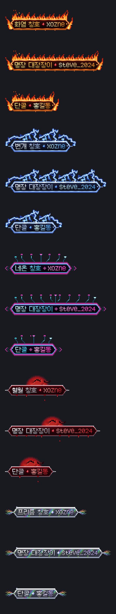
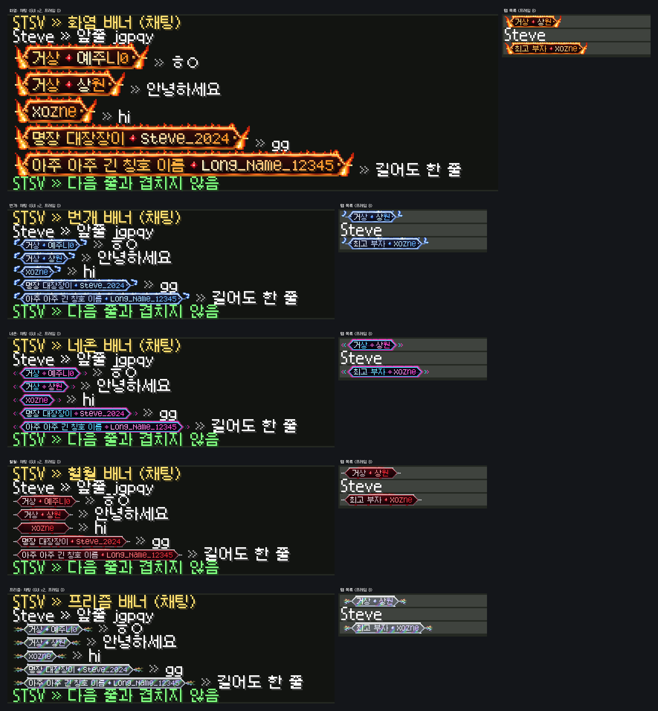
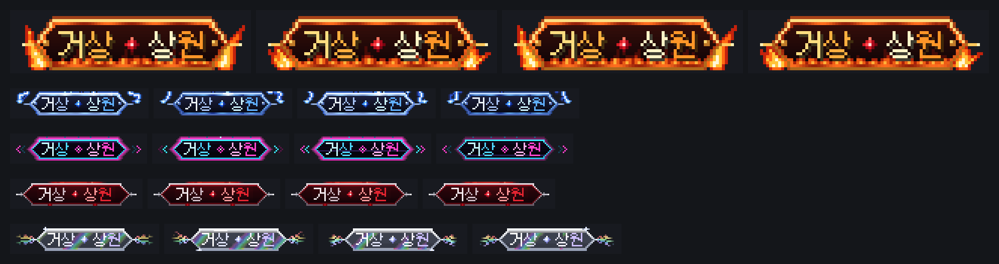

### 감정표현 (/감정표현, 관리자 테스트 기능)

마인크래프트에는 서버가 플레이어의 관절을 움직일 방법이 없습니다(팔·다리 각도는 클라이언트가 걷기·휘두르기에 맞춰 스스로 정하고, 서버에서 각도를 줄 수 있는 것은 갑옷 거치대뿐). 그래서 감정표현은 **플레이어 대신 인형이** 합니다: `/감정표현 트월킹` 을 치면 내 스킨을 입은 관절 인형이 내가 서 있던 자리에, 내 몸이 보던 쪽을 보고 서서 동작을 하고, 나는 그 모습을 조금 떨어진 카메라로 지켜봅니다. 주변 사람에게는 내가 그 동작을 하는 것처럼 보입니다. 첫 감정표현은 **트월킹**(다리를 벌리고 허리를 깊이 숙여 손을 무릎 쪽에 두고, 골반을 1초에 3번쯤 위아래로 튕김).

- **누가:** OP 또는 권한 `stsv.emote` (기본 OP만).
- **쓰는 법:** `/감정표현` (`/emote`) = 목록(이름을 클릭해도 됨), `/감정표현 트월킹` = 하기, **웅크리기** 또는 `/감정표현 그만` = 끝. 하는 중에 다른 감정표현을 치면 바로 바뀝니다. `emotes.max-seconds`(기본 30초)가 지나면 저절로 끝나고, 끝난 뒤 `emotes.cooldown-seconds`(기본 3초) 동안은 다시 할 수 없습니다. 땅에 서 있을 때만 됩니다(탈것 · 물 · 불 · 낙하 중, 피해를 입고 10초 안, 투명 상태, 치장 화면 안에서는 안 됨: 치장과 같은 규칙).
- **하는 동안의 나:** 치장 화면과 같은 방식입니다. 관전 모드가 되어 나만 보이는 카메라(표시 엔티티)에 붙습니다. 카메라는 감정표현마다 정해 둔 쪽(트월킹: 왼쪽 뒤 비스듬히 3.6칸)에서 인형을 보고, 그쪽이 벽이면 다른 쪽으로 돌거나 가까이 당깁니다(둘 곳이 없으면 시작하지 않음). 관전 모드라 맞지 않고, 밀리지 않고, 다른 플레이어에게 보이지 않습니다. 끝나면 **게임 모드 · 서 있던 자리와 보던 방향 · 비행 여부**가 그대로 돌아옵니다. 접속을 끊거나, 죽거나, 플러그인이 꺼져도 마찬가지고, 다른 것이 나를 옮기면(텔레포트 요청, 명령어) 감정표현만 끝나고 그곳으로 갑니다. 관전 메뉴의 '플레이어에게 이동'은 막혀 있습니다. 서버가 그대로 죽은 경우에는 플레이어에 적어 둔 기록(`emote_return`)으로 다음 접속 때 되돌립니다.
- **인형 = 글자 표시 엔티티:** 몸을 머리 · 가슴 · 골반 · 팔 2 · 허벅지 2 · 정강이 2, 상자 9개로 나누고 **상자의 면 하나가 글자 표시 엔티티(text display) 하나**입니다(코어 셰이더를 쓰지 않음). 면의 글은 그 면의 스킨 픽셀: 픽셀 하나가 네모 글리프 하나, 글자색이 픽셀 색, 줄바꿈이 다음 줄. 26.3 클라이언트는 글자의 뒷면을 그리지 않고 깊이를 기록하므로(코드에서 확인: 글자 파이프라인의 컬링 기본값 켜짐, 깊이 쓰기 켜짐) 바깥을 보는 면 여섯이 속이 찬 상자로 보입니다. 엔티티들은 한자리에 가만히 있고 **변환(위치 · 회전)만** 바뀌며, 그 사이는 클라이언트가 이어 줍니다.
  - 글리프는 리소스팩의 글꼴 `stsv:emote`: 가로 · 세로 10px(글자 줄 간격과 같음), 진행 폭도 정확히 10px 인 TrueType 네모 한 개(비트맵 글리프는 폭 + 1px 씩 가서 틈이 생김)와, 투명 픽셀용으로 같은 폭의 빈 칸. 한 면 안에서는 이웃 글리프가 꼭짓점을 그대로 같이 쓰므로 틈도 겹침도 없습니다. 면과 면 사이(서로 다른 엔티티)는 계산 오차만큼 어긋날 수 있어 모든 면을 0.4% 크게 그려 살짝 겹칩니다.
  - 스킨의 둘째 겹(모자 · 겉옷 · 소매 · 바지)은 0.5 / 0.25픽셀 띄운 면으로 따로 그리고, 아무것도 없는 면은 만들지 않습니다. 팔이 가는 스킨(slim)과 옛 64×32 스킨(왼팔 · 왼다리 = 오른쪽을 뒤집은 것)도 클라이언트와 같은 규칙으로 읽습니다.
  - 허리 · 무릎처럼 굽는 곳은 두 상자가 2픽셀씩 서로 겹쳐 있어(잘린 끝은 옆줄 색으로 막음) 굽혀도 구멍이 보이지 않습니다. 골반 상자 아래 2줄은 두 다리의 윗줄입니다(엉덩이).
  - 글자 표시 엔티티에는 방향에 따른 명암이 없어서, 면마다 서 있는 자세 기준으로 밝기를 미리 곱합니다(위 1.0 · 앞 0.86 · 뒤 0.8 · 옆 0.7 · 아래 0.55).
  - 리소스팩의 칭호 배너 셰이더는 글자색이 표식(빨강 250~253 에 초록 · 파랑이 255 가까이: `BannerText.reserved`)인 글리프를 배너 장면으로 보고 거의 다 버립니다. 스킨 픽셀이 우연히 그 색이면 빨강을 254로 바꿔 보냅니다.
- **동작은 데이터:** `contents/stsv/emotes.yml` (파일 맨 위에 설명). 관절마다 각도 `[pitch, yaw, roll]`, 몸 전체 위치, 장면(`keyframes`)과 그 사이 빠르기(`ease`), 한 바퀴 길이, 되풀이 여부, 카메라 자리. `legs: planted` 면 발을 정한 자리에 붙여 두고 허벅지 · 정강이를 알아서 굽힙니다(트월킹: 골반만 움직여도 다리가 따라 굽음). 새 감정표현은 이 파일에 하나 더 적고 `/관리자 리로드`. 미리보기 `python3 -I tools/assetgen/emotes.py --preview --fixture` → `docs/previews/emote_<id>.png` (게임을 켜지 않고 클라이언트 규칙대로 그린 그림: 견본 스킨, 보내는 자세마다 한 칸, 위 = 카메라 쪽, 아래 = 옆). `--fixture` 는 같은 계산의 숫자를 `plugin/src/test/fixtures/emote/rig.json` 에 적고, 플러그인 테스트가 자기 계산과 맞춰 봅니다(그림과 게임이 달라지지 않게).
- **보내는 양(어림):** 인형 하나 = 엔티티 54개(둘째 겹이 없는 스킨) ~ 108개. 처음 보일 때 면의 글을 한 번 보냅니다: 같은 색이 이어지면 한 덩어리로 묶어, 기본 인형 약 11KB, 보통 스킨 30~60KB, 모든 픽셀 색이 다른 최악 약 120KB(압축 전). 그 뒤로는 **움직인 면의 변환만**: 트월킹은 골반과 다리의 면 30~60개 × 틱당 약 40바이트 = 보는 사람 한 명에 초당 25~50KB. `emotes.view-distance`(기본 48칸) 안의 플레이어에게만 보냅니다.
- **한계:**
  - **내 화면은 1인칭이 아닙니다.** 하는 동안 카메라로 인형을 지켜볼 뿐, 걸어 다니거나 다른 일을 할 수 없습니다(움직이려면 웅크려서 끝내기).
  - **스킨은 서버가 `textures.minecraft.net` 에서 받아 옵니다**(처음 한 번, 그 뒤로는 메모리에 둠). 서버에서 그 주소로 나갈 수 없거나 스킨이 없는 계정이면 단색 기본 인형으로 보여 주고 알려 줍니다.
  - **갑옷 · 손에 든 것 · 치장은 인형에 보이지 않습니다**(스킨만).
  - **명암이 고정**이라 인형이 숙이거나 돌아도 면의 밝기는 그대로입니다. 주변 밝기(밤, 동굴)는 반영됩니다.
  - 팔꿈치가 없습니다(팔은 통짜). 반투명 스킨 픽셀은 반 이상 불투명하면 불투명하게, 아니면 없는 것으로 그립니다.
  - 리소스팩이 없는 클라이언트에는 인형이 네모 글자 더미로 보입니다.
  - **실제 클라이언트로는 아직 보지 못했습니다.** 클라이언트 코드와 FreeType(2.13 · 2.14)으로 확인한 규칙대로 만들었지만, 면 모서리의 틈, 색, 성능은 게임에서 확인이 필요합니다. 그래서 관리자 전용입니다.
- **설정:** `config.yml` 의 `emotes` (`enabled`, `max-seconds`, `cooldown-seconds`, `view-distance`). 문구: `messages.yml` 의 `emote.*`. 코드: `dev.stsv.core.emote` (`EmoteModule` 세션 · 명령어, `EmoteRig` 뼈대, `PuppetModel` 상자와 면, `PuppetSkin` 스킨, `EmoteSpec` emotes.yml).

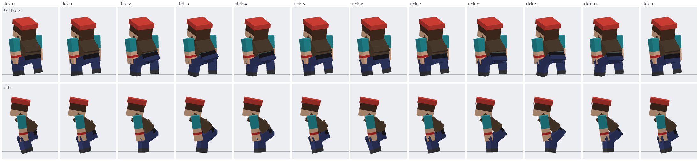

### 업적 (/업적)

업적 112개, 쉬움 10점 · 보통 25점 · 어려움 50점 · 매우 어려움 100점. 보상은 골드, 아이템, 칭호(업적 칭호 54개), 치장(펫 포함)이 섞여 있습니다. 전설 치장은 업적으로 주지 않습니다(주간 순위 1위·상인 행렬 전용).

| 분류 | 쉬움 | 보통 | 어려움 | 매우 어려움 |
|---|---|---|---|---|
| 생활 | 첫 발걸음, 첫 벽돌, 삽질 시작, 다음엔 조심 (숨김) | 단골, 건축가, 굴착기, 저승 단골 (숨김) | 터줏대감, 대건축가, 대지를 가르는 자 | 산증인, 도시를 세운 자 |
| 전투 | 첫 사냥 | 사냥꾼, 묵직한 한 방, 보스 사냥 | 몬스터 헌터, 보스 헌터 | 학살자, 보스 학살자, 보스의 악몽 |
| 채광 | 첫 광석, 반짝이는 발견 | 광부 수습, 광부 Lv10 | 광맥 사냥꾼, 보물 감별사 | 지하의 왕, 명장 광부 |
| 농사 | 첫 수확, 목장 시작 | 농부의 하루, 농부 Lv10 | 대농, 목장주 | 들판의 주인, 명장 농부 |
| 낚시 | 첫 입질, 도감 채우기 | 낚시꾼, 어류 관찰가, 어부 Lv10 | 바다의 친구, 어류학자 | 전설의 강태공, 도감 완성, 명장 어부 |
| 직업 | 첫 생산, 한 우물 | 공방 주인, 숙련공, 대장장이 Lv10, 요리사 Lv10, 연금술사 Lv10 | 장인, 달인, 다재다능 | 명장, 팔방미인, 명장 대장장이, 명장 요리사, 명장 연금술사 |
| 경제 | 첫 장사, 용돈 벌이, 종잣돈, 내 땅 | 단골 납품업자, 장사꾼, 넓은 땅 | 물류왕, 부자 | 거상, 재벌, 영주 |
| 도감 | 도감 첫 장 | 수집가, 광물 도감 | 도감 반을 넘다, 미식 도감 | 살아있는 도감 |
| 미션 | 오늘의 할 일, 개근 첫날, 한 주의 목표 | 성실한 일꾼, 한 달 개근, 알찬 한 달 | 일벌레, 반년의 약속 | 일 년 개근 |
| 거래·투자 | 첫 의뢰, 첫 투자, 첫 거래소 판매, 낙찰! | 믿음직한 일꾼, 개미 투자자 | 해결사, 큰손, 거래소 단골 | 경매의 신 |
| 수집 | 칭호 모으기, 꾸미기 시작, 업적 사냥 시작 | 칭호 부자, 패셔니스타, 업적 수집가 | 명찰 수집가, 업적 마스터, 도전자 | 스타일 아이콘, 불가능은 없다, 살아있는 전설 |

- 정의: `contents/<팩>/achievements/<분류>.yml` (형식은 파일 맨 위 설명). 기록(`stat:`)은 플레이 시간, 블록, 처치, 그리고 경제 서버가 세는 채광·수확·낚시·발견·번식·기계 생산·상점 판매(개수·금액)·의뢰·주식 거래·거래소 판매·경매 낙찰·미션(일일·주간, 모두 끝낸 날·주). 값(`value:`)은 칭호·치장·업적 수, 업적 점수, 잔액, 직업 레벨, 순자산, 땅 청크, 도감 등록 수(물고기 종류, 분류별).
- **기록 업적은 그 업적이 생긴 뒤부터 셉니다:** 플레이어마다 업적별로 처음 확인한 순간의 기록을 출발점으로 저장하고, 그 뒤 늘어난 만큼만 진행도가 됩니다(예전 플레이 시간·블록·처치는 안 셈. 나중에 새 업적을 추가해도 그 업적은 추가된 뒤부터). 레벨·순자산·땅·보유 칭호처럼 '지금 상태'를 보는 업적은 지금 값 그대로. 처음부터 다시 세려면 `/관리자 초기화 업적`(달성 기록과 출발점 모두 지움).
- **지금은 달성할 수 없는 업적:** 묵직한 한 방, 보스 사냥, 보스 헌터, 보스 학살자, 보스의 악몽(`boss_damage`·`boss_kills` 기록). 보스 시스템을 지워서 이 기록을 세는 곳이 없습니다. 정의와 칭호는 남겨 두었습니다.

### 메뉴 만들기 / 바꾸기

메뉴는 `contents/<팩>/menus/*.yml` 하나와 (선택) 배경 PNG 하나입니다. 형식 설명은 `content/stsv/menus/wardrobe.yml` 맨 위에 있습니다.
배경을 쓰면 리소스팩을 빌드할 때 폰트가 자동으로 만들어집니다(직접 폰트 파일을 쓸 필요 없음).

### 메뉴 모양 (모든 메뉴 공통)


치장·프로필·칭호·통합 메뉴와 경제 서버의 메뉴 18개가 모두 같은 모양입니다: 어두운 차콜 판, 제목 아래 금색 선, 목록 칸은 들어간 칸, 버튼은 튀어나온 타일.

| 파일 | 내용 |
|---|---|
| `tools/assetgen/stsv_assets/menu_theme.py` | 배경 그리기 (모든 메뉴 공통). 칸 위치는 각 메뉴 yml 의 layout 에서 읽음 |
| `tools/assetgen/stsv_assets/ui_icons.py` | 버튼 아이콘 한 벌 (밝은 선 + 어두운 테두리, 돈 = 금색, 상승·사기 = 빨강, 하락·팔기 = 파랑) |
| `content/stsv/menus/*.yml` | 칸 배치, 버튼, 문구, 배경 지정 (`background: stsv:gui/<이름>`) |
| `content/stsv/assets/minecraft/lang/*.json` | 상자 화면의 "인벤토리" 글자를 비움 (어두운 판 위에서 안 보이는 회색 글자라서. 다른 상자에서도 안 보임) |

메뉴 yml 에서 쓸 수 있는 그림용 설정: `inset` (버튼 글자를 물건 칸 모양으로), `graph: true` (위 두 줄에 그래프 화면), `flow: true` (줄 사이 빈칸에 화살표).
상자 칸 (줄 r, 열 c)의 18×18 테두리는 x = 7 + 18c, y = 17 + 18r, 플레이어 인벤토리 칸의 테두리는 y = 30 + 18×줄 수 부터입니다(아이템은 그 1px 아래 31 + 18×줄 수, 핫바는 테두리에서 58 아래).
코어 그림은 `cd tools/assetgen && python3 -c "import gui; from pathlib import Path; gui.write(Path('../../content/stsv'))"` (또는 `build.py`),
경제 서버 그림은 `python3 economy_build.py` 로 다시 만듭니다. 칸 배치를 바꾸면 그림도 다시 만드세요(`WardrobeGuiTest`, 경제 `ContentTest` 가 어긋남을 잡습니다).
미리보기(`docs/previews/core_menus.png`, `economy_menus.png`, 거래소·경매 화면 `trade_menus.png`)는 배경 위에 버튼 아이콘, 내 정보 머리, 목록의 예시 물건까지 그려서 실제 화면처럼 검토할 수 있습니다(`stsv_assets/menu_preview.py`). 메뉴 제목은 패널(176px)을 넘지 않아야 합니다: 테스트(`MenuActionsTest`)가 긴 자리표시자 값을 넣어 폭을 재고, 모든 버튼 동작이 실제로 처리되는지도 확인합니다.

## 서버 설정

리소스팩은 **마인크래프트 접속 포트로 함께 배포**됩니다(`resource-pack.host.mode: same-port`, 기본).
포트를 따로 열거나 주소를 적을 필요가 없고, 플레이어가 접속할 때 입력한 주소로 받아 갑니다.

- 서버 앞에 Velocity/BungeeCord 같은 프록시나 TCPShield 같은 디도스 방어가 있으면 다운로드 요청이 서버까지 오지 않습니다.
  이때는 `mode: separate-port` 로 바꾸고 `port`(기본 8163)를 외부에 여세요.
- 포트포워딩으로 외부 포트와 서버 포트가 다르면 `public-url` 에 외부 주소를 적으세요. 예: `http://mc.example.com:25565`
- 받기에 실패하면 서버 로그에 그 플레이어가 받으려 한 주소가 나옵니다.
