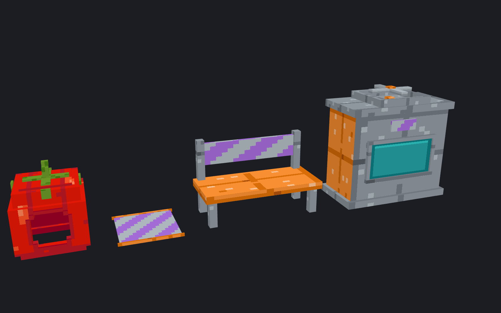
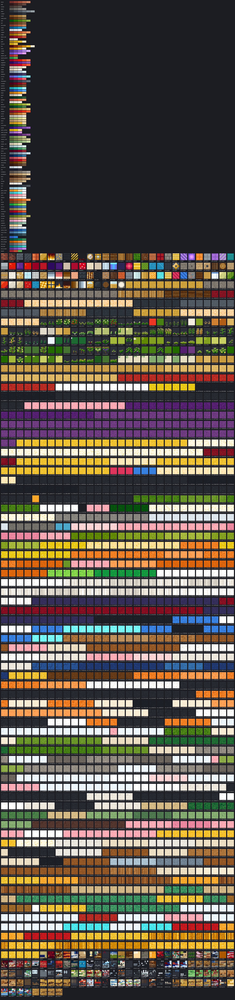

# STSV 아트 스타일 가이드

**목표: 누가, 언제 만들어도 같은 서버의 리소스처럼 보일 것.**
퀄리티보다 일관성이 우선입니다. 아래 규칙은 `tools/assetgen`에 코드로 박혀 있어서, 규칙대로 만들면 자동으로 지켜집니다.



*현재 들어 있는 모델은 모두 **테스트 전용**입니다(주황/회색 격자 = 테스트 색). 실제 콘텐츠는 이 규칙으로 새로 만듭니다.*



## 1. 색 (팔레트 v3: 공식으로 생성, 깔끔하고 선명하게)

> v3 변경: v2가 게임에서 탁해 보여서 **채도 ×1.35**, 그림자 쪽 채도 감소를 절반으로 줄임(어두운 부분도 색이 살아 있음),
> 가장 어두운 단계의 밝기 하한(0.24)을 둬서 거무튀튀한 색을 없앰, 텍스처 **노이즈 절반**.
> `test_*` 재질(주황, 회색, 청록, 보라)은 테스트 전용입니다. 실제 콘텐츠에 쓰지 않습니다.

색은 손으로 고르지 않습니다. `tools/assetgen/stsv_assets/palette.py`의 `MATERIALS`에서 재질마다 **숫자 몇 개**만 정하면, 공통 공식이 색 단계(램프)를 만듭니다.

```python
#  이름          색상(hue)  채도    중심 밝기  밝기 폭  단계  포인트색
"leaf":       (134,     0.118,  0.54,     0.32,   5,   False),
```

공식이 모든 재질에 똑같이 적용하는 규칙:
1. **밝기 사다리 공유**: OKLCH(사람 눈 기준으로 균일한 색 공간)에서 계산합니다. 잎의 3단계와 벽돌의 3단계가 같은 밝기로 보입니다.
2. **같은 빛 아래**: 어두운 쪽은 남보라로, 밝은 쪽은 따뜻한 노랑으로 최대 10도 기울입니다. 서로 관련 없는 물건도 같은 햇빛을 받는 것처럼 보입니다.
3. **양 끝은 채도를 낮춤**: 그림자와 하이라이트가 탁해지지 않게 합니다.

### 바닐라 기준값 (26.3 블록 텍스처를 측정)
| 구분 | 밝기(L) | 채도(C) | 예 |
|---|---|---|---|
| 자연 재질 | 0.40 ~ 0.75 | 0.05 ~ 0.10 | 참나무, 돌, 흙, 이끼, 벽돌 |
| 염색/금속 | 0.45 ~ 0.65 | 0.11 ~ 0.16 | 양털, 구리 |
| 보석/빛 | 0.55 ~ 0.90 | 0.16 ~ 0.21 | 금, 에메랄드, 자수정 |

- **기본 재질은 바닐라 범위 안에서** 만듭니다(바닐라 친화형).
- `accent=True`인 **포인트 재질**(불, 조명, 마법, 금, 경고색)만 바닐라보다 강하게 해도 됩니다. 한 모델 면적의 10~15%를 넘기지 않습니다.
- 새 재질을 추가했다면 반드시 **비교 장면을 렌더링해서 확인**합니다(4장 참고).

## 2. 텍스처

| 규칙 | 값 |
|---|---|
| 해상도 | 16×16 (바닐라와 같은 픽셀 밀도) |
| 빛 방향 | 왼쪽 위. 위/왼쪽 가장자리는 +1단계, 아래/오른쪽 가장자리는 -1단계 |
| 노이즈 | 한 단계 이내의 흔들림만, 소수 픽셀에만 |
| 외곽선 | 2D 아이콘만. 주 재질 램프의 가장 어두운 색 |
| 재현성 | 생성 함수마다 시드 고정 → 다시 빌드해도 픽셀 하나 안 바뀜 |

표면 텍스처(벽돌, 철판 등)는 **이어 붙여도 이음새가 안 보이게(타일링)** 만듭니다. 모델의 UV는 자동으로 0~16 범위에 맞춰 잘리기 때문에, 큰 면에서도 무늬가 자연스럽게 이어집니다.

## 3. 3D 모델

| 규칙 | 값 |
|---|---|
| 단위 | 16 = 1블록 |
| 정면 | 북쪽 면(-Z). 플레이어가 설치하면 정면이 플레이어를 바라봄 |
| 범위 | 바닐라 제한 -16 ~ 32 (최대 3×3×3 블록 공간) |
| 최소 두께 | 0.5 (그 이하는 게임에서 깜빡거리거나 안 보임) |
| 좌표 | 정수 또는 0.5 단위를 우선 |
| 회전 | 한 축만, -45 / -22.5 / 0 / 22.5 / 45도 |
| 발광 | 열원, 조명만 `glow=True` (불꽃, 램프, 화면) |
| 요소 수 | 가구/기계 120개 이하 권장. 그릴 때 드는 비용(면 개수)의 상한은 [9. 렌더 예산](#9-렌더-예산) |
| 얇은 부품 | 두께 4 이하인 다리, 기둥, 난간은 결만 있는 텍스처(`wood_grain` 등) 사용. 이음새 있는 판자 텍스처를 쓰면 지저분해 보임 |

### 자동 검사 (빌드할 때 걸리면 빌드 실패)
| 검사 | 왜 필요한가 |
|---|---|
| **뚫린 상자 금지** | 마인크래프트는 면을 바깥쪽에서만 그립니다. 면을 지워서 구멍을 내면 안쪽이 투명하게 보입니다(화분 테두리 버그). 테두리, 굴뚝, 화분처럼 속이 빈 부분은 **벽 4개로** 만듭니다. 면을 지우는 것은 다른 부품이 그 면을 완전히 덮을 때만 허용됩니다. |
| **겹친 면 금지** | 같은 위치, 같은 방향의 면 두 개가 보이면 게임에서 깜빡입니다(z-fighting). 부품끼리 관통시키지 말고 맞닿게 만듭니다. |
| **투명 텍스처는 얇은 판에만** | 두께 있는 상자에 투명 픽셀이 있으면 속이 비어 있어서 뒤쪽 풍경이 그대로 비칩니다(관목 구멍 버그). 틈새 표현은 가장 어두운 색으로 칠하고, 진짜 구멍은 두께 0.5 이하의 판에만 씁니다. |
| **이어지는 무늬는 좌우 대칭** | 자동 UV는 윗면과 북/동쪽 면 사이에서 텍스처를 좌우 반전합니다. 방석 띠처럼 면을 넘어 이어져야 하는 선은 대칭 위치(예: 7~8번 픽셀)에 둡니다. 해당 텍스처는 `textures.ALIGNED`에 등록합니다. |

얇은 옆면에 무늬의 가로줄이 걸리면 `side_v=(시작, 끝)`으로 옆면에 쓸 텍스처 줄을 지정합니다(의자 방석 참고).

**디테일을 넣는 순서**: 실루엣 → 재질 구분(벽돌/철/구리) → 기능을 설명하는 부품(투입구, 계기판, 배관) → 사용감(그을음, 경고 줄무늬).

## 4. 작업 흐름

1. `tools/assetgen/models/<이름>.py`에 모델을 코드로 작성합니다. `build()`가 `Model`을 반환하게 합니다.
2. `build.py`의 `MODELS` 목록에 이름을 추가합니다.
3. `python3 build.py --render`를 실행하면 아래 결과물이 생성됩니다.
   - `content/stsv/models/<이름>.bbmodel`: 플러그인이 읽는 원본 파일
   - `docs/previews/<이름>.png`: 3방향 미리보기
4. 미리보기를 보고 수정을 반복합니다. `docs/previews/lineup.png`에서 **기존 모델들과 나란히** 놓고 어울리는지 확인합니다.
5. `content/stsv/items/*.yml`에 아이템을 등록합니다. 서버에서는 `/관리자 리로드`로 바로 반영됩니다.

**꾸미기 가구** (`models/furniture_japanese.py`, 아이콘 `furniture_icons.py`): 인벤토리에는 2D 아이콘(`icon: <id>_icon`), 설치하면 3D 모델이
보입니다. 등불은 `furniture.light`로 진짜 빛을 냅니다. `python3 furniture_preview.py`가 `docs/previews/furniture_japanese*.png`
(세 방향 시트, 아이콘, 방·정원 장면)와 `docs/previews/furniture_scale.png`(모든 가구를 같은 축척으로 플레이어·블록 옆에 세운 크기 비교),
`docs/previews/furniture_footprints.png`(위에서 본 칸과 모델 범위, 놓는 방향 4가지)를
만들고, `python3 furniture_preview.py --pieces <폴더>`는 가구마다 네 방향 확대 그림을 만듭니다.
**칸 가운데에**: 칸에 딱 맞지 않는 크기(이불 1.5×2.5칸 등)는 차지한 칸들의 가운데에 두어 양쪽 여백을 같게 합니다(놓는 방향과 상관없이,
`JapaneseFurnitureTest`가 검사). 벽에 거는 족자만 뒤가 벽에 붙습니다. 3칸보다 큰 것(도리이)은 실제 크기로 그려 구운 뒤 줄이고
(`BModel(scale=…)`) 아이템 디스플레이가 다시 키웁니다(`furniture.scale`): 픽셀 크기는 다른 가구와 같습니다.
**크기**: 플레이어(1.8칸) 옆에서 실물처럼 읽히게 합니다. 큰 물건(문, 병풍, 석등)은 실물 크기(1칸 ≈ 1 m), 작은 소품(다기, 술병, 풍경)은
바닐라 소품처럼 실물의 2~3배로 키워서 잘 보이게 합니다. 얼굴처럼 읽혀야 하는 것(다루마, 마네키네코)은 평평한 그림판으로 만들지 않고
1px 칸으로 깎아(`bake.voxels`) 입체로 만듭니다: 둥근 몸·머리, 쑥 들어간 얼굴판이나 튀어나온 주둥이·코, 도드라진 눈썹·수염. 얼굴에도
빛을 굽되(위에서 오는 빛, 눈썹·수염 아래 그림자, 몸과 만나는 가장자리는 어둡게) 눈·입 같은 선은 진한 색 그대로 두어 멀리서도 읽히게 합니다.
그림이 여러 상자에 걸치는 경우(후스마, 기모노) 정면에서 보면 모델의 +x가 **왼쪽**입니다.

**구운(baked) 모델** (`stsv_assets/bake.py`, 일본풍 가구 전부): 면마다 16×16 텍스처를 따로 만들지 않고, 모델 전체를 보면서 면을 한 장씩
그려 **모델당 텍스처 한 장(아틀라스)** 에 모읍니다.
- 픽셀 격자가 모델 공간에 하나뿐이라 모든 면의 픽셀 크기가 같고(16px = 1블록), 결·판자·돌·그림이 상자 경계와 모서리를 넘어 이어집니다.
- 빛을 텍스처에 굽습니다: 윗모서리 하이라이트, 처마 아래 접촉 그림자, 높은 부품의 위아래 명암, 부품이 맞닿는 곳과 바닥·벽 근처의
  앰비언트 오클루전. 방향별 명암(위 1.0, 앞뒤 0.8, 옆 0.6)은 게임이 따로 넣습니다.
- 색은 언제나 팔레트 램프의 단계입니다. 그림자/하이라이트가 램프 끝을 넘으면 `palette.ladder()`가 같은 밝기 간격으로 한두 단계 이어 줍니다.
- 안 보이는 면(다른 부품에 덮인 면, 바닥에 닿은 밑면)은 모두 1픽셀을 함께 씁니다. 아틀라스 크기는 16의 배수(밉맵 단계 유지),
  각 그림에는 1px 테두리 여백(번짐 방지)이 있습니다. 투명 구멍이 있는 얇은 판(잎, 끈)은 별도의 `_cutout` 아틀라스,
  움직이는 면(등불의 일렁임, 잉어가 헤엄치는 물)은 정사각형 프레임의 `_anim` 아틀라스에 들어갑니다.
- `Paint(램프, 단계, 무늬, decal=...)`의 decal은 모델 좌표(`c.p`)로 그림을 그립니다. 원통(`cyl`)의 둥근 끝이나 여러 상자에 걸친 그림도
  좌표만 맞추면 저절로 이어집니다.
- `voxels(m, 이름, {(x, y, z): 라벨}, paint)`는 1px 칸들을 같은 라벨끼리 적은 상자로 합쳐 둥근 몸통·머리를 깎습니다(다루마 약 90개,
  마네키네코 약 50개 요소). 이렇게 깎은 둥근 부품은 decal이 그 물체 자체의 법선으로 명암을 칠하고(`Paint(grad=0, rim=…)`로 상자마다의
  위아래 명암·모서리 빛을 끄거나 줄임), `ctx.i`(텍셀 바로 안쪽 칸)로 라벨을 찾아 색을 정합니다.

### Blockbench로 손볼 때
`.bbmodel`을 Blockbench에서 직접 수정했다면, 그 모델은 **"손으로 관리하는 모델"**이 됩니다.
`build.py`의 `MODELS`에서 그 모델을 빼서 다음 빌드 때 덮어쓰이지 않게 하세요. 텍스처는 계속 팔레트 색만 쓰면 됩니다.

## 5. 전용 동작이 있는 아이템 (활, 쇠뇌, 낚싯대, 방패, 검, 갑옷)

**동작은 새로 만들지 않고 바닐라 것을 그대로 물려받습니다.** 모양만 우리 것으로 바꿉니다.

| 종류 | 기본 재료(material) | 손에 드는 자세/동작 | 우리가 만드는 것 |
|---|---|---|---|
| 검, 도구 | iron_sword 등 | `handheld: true` (바닐라 handheld 자세) | 2D 아이콘 1장 |
| 활 | bow | 부모 `minecraft:item/bow` | 대기 + 당김 3단계 |
| 쇠뇌 | crossbow | 부모 `minecraft:item/crossbow` | 대기 + 당김 3단계 + 화살/폭죽 장전 |
| 낚싯대 | fishing_rod | 부모 `minecraft:item/handheld_rod` | 평소 + 던졌을 때 |
| 방패 | shield | 바닐라 방패 표시값 복사 | 3D 모델 (평소 / 막기) |
| 갑옷 | iron_helmet 등 | 바닐라 장착 | 아이콘 + 64×32 착용 텍스처 2장 |

- 아이콘 방향은 바닐라와 같게 그립니다. 검과 낚싯대는 오른쪽 위를, 활과 쇠뇌는 왼쪽 위를 향합니다. 그래야 부모 모델의 잡는 각도가 맞습니다.
- 아이템 정의(`assets/stsv/items/*.json`)는 바닐라와 **속성과 기준값까지 똑같은 구조**로 만듭니다. `tools/assetgen/check_vanilla.py`가 바닐라 정의와 비교해서 확인합니다.
- `docs/previews/special_items.png`: 모든 상태(당김 단계 등)를 한 장에 모은 점검용 시트
- `docs/previews/armor_worn.png`: 착용 텍스처를 마네킹에 입힌 3D 렌더

### 3D 손 아이템 (검, 낚싯대, 음식 등)
- 2D 아이콘과 같은 자리를 차지하게 만듭니다. 검과 낚싯대는 **세워서 만든 뒤 z축 -45도로 기울여** 끝이 오른쪽 위를 향하게 합니다.
- 표시값은 `stsv_assets/presets.py`의 바닐라 값(HANDHELD, HANDHELD_ROD, GENERATED)을 그대로 씁니다. `check_vanilla.py`가 일치 여부를 확인합니다.
- 3D 낚싯대는 끝을 2D 낚싯대 끝 위치(오른쪽 위 모서리)에 맞춥니다. 낚싯줄은 게임이 그 위치에서 그립니다.

## 6. 움직이는 모델

| 방법 | 쓰는 곳 | 비용 |
|---|---|---|
| 애니메이션 텍스처 (`textures.ANIMATED`, 구운 모델은 `Paint(frames=...)`) | 화면, 불꽃, 벨트, 물, 등불 일렁임, 헤엄치는 잉어 | 엔티티 0 |
| 회전 부품 (`furniture.parts` + `spin`) | 팬, 바퀴, 풍차 | 부품당 엔티티 1 |
| 관절 애니메이션 | 보스, NPC | 부위당 엔티티 1 (아직 미구현) |

회전 부품 모델은 **(8, 8, 8)을 중심으로** 만듭니다. 그 점을 축으로 돕니다.

## 7. 치장 (모자, 탈)
- 머리 치장은 조각한 호박처럼 착용합니다. 모델은 0~16 범위이고, 정면(얼굴)은 북쪽입니다.
- 머리(8픽셀)가 안에 들어가도록 **안쪽을 1.5~14.5 정도 비워 둔 껍데기**로 만들고, 얼굴 구멍은 북쪽 면에 냅니다.
- 모든 탈은 공통 껍데기 함수 `_head_shell()`을 씁니다(토마토, 가지, 버섯). 그래서 착용 위치와 얼굴 구멍이 항상 같습니다. 그 위에 모양만 쌓습니다.

## 8. 이름 규칙

- 파일, id: 영문 소문자와 `_` (`smelter`, `gold_chunk`)
- 텍스처 키: 재질 이름 (`brick`, `steel_dark`, `copper`)
- 아이템 표시 이름: 한국어. 색은 그 아이템의 주 재질 램프에서 가져옵니다.

## 9. 렌더 예산

가구, 기계, 치장, 펫, 탈것은 모두 **디스플레이 엔티티**로 그려집니다. 블록은 청크 메시에 한 번 구워지지만, 디스플레이는 클라이언트가
**매 프레임 모델의 면(사각형)을 하나하나 다시** 보냅니다. 그래서 큰 기지의 프레임은 "그려지는 모델 수 × 모델의 면 개수"로 정해지고,
**면 개수가 곧 비용**입니다. 작물은 블록(트립와이어 상태)이라 여기에 들어가지 않습니다.

### 자동으로 줄이는 것 (리소스팩을 만들 때, 모든 모델에)
플러그인이 팩을 만들 때(`PackBuilder` → `FaceReducer`) 변환한 3D 모델마다 **모양을 바꾸지 않고** 면을 줄입니다. 앞으로 만드는 모델
(파이썬 생성기든 Blockbench든)도 따로 할 일 없이 똑같이 줄어듭니다.
1. **안 보이는 면 지우기**: 바로 앞이 닫힌 불투명 상자 속인 면(다른 부품에 파묻힌 면, 맞닿은 면)을 지웁니다. 같은 각도로 회전한
   부품끼리도 서로 가립니다. 바닥을 향한 밑면은 남깁니다(가구를 허공·유리 위에 놓을 수 있으므로).
2. **덩어리 다시 자르기**: 계단식 원통·구(북, 등롱, 다루마, 솥)처럼 같은 종류의 상자가 모인 덩어리를, 서로 겹치는 더 적은 상자로
   다시 덮습니다. 새 면은 원래 표면을 **텍셀 그대로** 옮겨 그립니다(겹치는 면은 같은 텍셀이라 깜빡이지 않음).
3. **나란한 상자 합치기**: 단면이 같은 상자가 나란히 붙어 있으면 하나로 합치고 옆면 그림을 이어 붙입니다.

새 면의 그림은 모델마다 아틀라스 한 장(`<모델>_merged`, 16의 배수 크기)에 들어가며 16px = 1블록 그대로입니다. 반 픽셀 경계에서
만나던 부품은 그 부분만 2~4배 촘촘한 픽셀로 옮겨 반쪽 텍셀까지 그대로 둡니다. 결과(2026-11, 전 → 후): 직업 기계 3강 평균 668 → 504면(회전 부품 포함),
일본풍 가구 평균 202 → 138면, 작물을 뺀 전체 3D 모델 −27%. 모든 출하 모델은 `FaceReducerTest`가 원래 모델의 모든 텍셀과 비교합니다.

### 예산 (팩에 들어간 뒤의 면 개수)
| 종류 | 예산 | 지금 가장 무거운 것 |
|---|---|---|
| 1칸 가구·소품 | 300 | 다루마 264 |
| 여러 칸 가구 | 440 | 노다테 우산 380 |
| 직업 기계 기본 / 1강 / 2강 / 3강 | 400 / 460 / 640 / 720 | 증류기 342 / 조리대 403 / 가공대 553 / 조리대 653 |
| 기계 회전 부품 | 160 | 압착기 나사 3강 120 |
| 치장 (머리·머리 위·어깨·등·꼬리) | 300 | 나비 날개 269 |
| 펫 | 200 | 구미호 176 |
| 탈것 몸체 (바퀴 빼고) | 600 | 리어카 246 |
| 탈것 바퀴 (하나) | 80 | 승용차·트럭 바퀴 42 |
| 탈것 부품 (경광등 모양 하나, 짐칸 짐 단계 하나) | 240 | 리어카 짐 가득 166 |
| 탈것 트레일러 몸체 (하나) | 400 | 소달구지 수레 148 |
| 탈것 끄는 동물의 다리·머리 (하나) | 160 | 소 머리 102 |
| 그 밖의 3D 모델 | 300 | |

예산 표는 한 곳(`plugin/src/main/java/dev/stsv/core/pack/RenderBudget.java`)에 있습니다. 숫자를 고치면 바로 적용됩니다.
꼭 더 무거워야 하는 모델은 종류 전체의 예산을 올리지 말고 `RenderBudget.EXCEPTIONS`에 이유와 함께 한 줄 넣습니다.
`RenderBudgetTest`가 출하되는 모든 모델을 실제 팩으로 만들어 세고, 넘으면 `모델: 면 N개 > 예산 M (종류)`로 실패합니다.

### 만들 때 지킬 것
- **큰 상자 몇 개 + 구운 텍스처**: 디테일(판자 이음새, 무늬, 그림자, 테두리)은 상자를 쪼개지 말고 텍스처에 그립니다(`bake.py`의 decal).
  상자 하나는 면 6개, 1px 장식 상자 하나도 면 6개입니다.
- **작은 큐브 더미 금지**: 0.5~1px 상자를 줄지어 늘어놓은 장식(점선, 리벳, 글자)은 텍스처로 그립니다. 멀리서는 보이지도 않으면서
  가장 많은 면을 먹습니다.
- **속에 숨은 부품 금지**: 다른 부품에 완전히 파묻힌 상자는 지워지긴 하지만, 처음부터 만들지 않는 것이 깔끔합니다.
- **같은 종류는 같은 격자에**: 맞닿는 부품은 정수(또는 0.5) 좌표에서 만나게 하면 자동 합치기가 잘 됩니다. 1.35처럼 어중간한 단위로
  찍은 픽셀 그림(나비 날개)은 합쳐지지 않습니다.
- **아틀라스 하나**: 구운 모델은 모델당 아틀라스 한 장을 씁니다. 늘어나는 면마다 새 텍스처 파일을 만들지 않습니다.
- **둥근 것**: `cyl`/`voxels`로 계단식으로 만들면 2번(다시 자르기)이 겹치는 상자 몇 개로 바꿔 줍니다. 단면 줄 수가 적을수록 가볍습니다.

### 재는 법
- 게임 안: `/관리자 보고서 주변 [반경]` — 주변 디스플레이를 종류별로 세고, 그려지는 것의 **면 합계**를 보여 줍니다(팩에 들어간 모델 기준).
- 테스트: `cd plugin && ./gradlew test --offline` — `RenderBudgetTest`(예산), `FaceReducerTest`(같은 모양인지 텍셀 단위로).
- 모델별 숫자와 전/후 그림: `STSV_MODEL_DUMP=<폴더> ./gradlew test --offline --tests 'dev.stsv.core.pack.ModelDumpTest'` 가
  `<폴더>/faces.csv`(모델, 줄이기 전 면, 후 면), `packs.txt`(팩 크기), `before/`·`after/`(render.mjs 미리보기 JSON)를 씁니다.
  `node tools/assetgen/render/render.mjs <폴더>/after/<ns>__<모델>.json out.png`로 그대로 그려 볼 수 있습니다.
