# STSV 경제 서버 (STSV-Economy)

STSV 공통 플러그인 위에서 도는 첫 번째 콘텐츠: 시즌 없이 **계속 운영하는** 마인크래프트 경제 서버.
관리자 상점·시세·수요 고시, 거래소·경매·직거래, 직업 6개와 기계, 청크 단위 땅(함께 살기, 땅 금고)·재산세, 의뢰 게시판·주간 공동 의뢰, 일일·주간 미션,
사건, 주간 순위와 기념비, 과시 소비, 일일 경제 보고서가 들어 있습니다.

처음 켠 날이 1일차입니다. 하루는 05시에, 한 주는 월요일 05시에 바뀝니다. 끝나는 날은 없습니다.

## 설치

1. `plugins/` 에 `stsv-core-0.57.1.jar` 와 `stsv-economy-3.61.0.jar` 를 함께 넣습니다 (경제 플러그인은 코어가 필요).
2. 서버를 켜면 경제 콘텐츠 팩이 `plugins/STSV/contents/economy/` 에 설치되고, 아이템·기계 모델·메뉴 배경이 리소스팩에 들어갑니다.
3. 돈과 모든 기록은 코어의 저장소(`plugins/STSV/data/stsv.db` 또는 MySQL)에 있습니다. 월드와 별개입니다.
4. 예전 4주 시즌판(1.x)을 쓰던 서버라면 한 번 `/관리자 초기화 경제서버 확인` 으로 날짜를 1일차부터 다시 시작하는 것을 권합니다.

## 처음 준비 (운영자)

관리 명령어는 모두 코어의 `/관리자` 아래에 있습니다 (`/관리자` 만 치면 목록).

| 할 일 | 명령어 |
|---|---|
| 스폰 마을 보호 | 마을 가운데에서 `/관리자 땅 서버 <반지름>` (청크 수, 예: 3 = 7×7청크). 서버 땅만 풀려면 `/관리자 땅 서버해제 <반지름>` (플레이어 땅은 그대로), 누구 땅이든 풀려면 `/관리자 땅 해제 <반지름>` |
| 시세판 | 세울 곳에 서서 `/관리자 위치 시세판` (1분마다 갱신되는 홀로그램: 시장가 = 기준가 × 수요 고시·사건 배수. 수요 고시·사건 품목과 24시간 동안 시장가가 바뀐 품목 중 큰 10개. 각자의 매입가는 `/시세`) |
| 주식판 | `/관리자 위치 주식판` (산업 지수, 오늘 많이 오른·내린 회사) |
| 기념비 자리 | `/관리자 위치 기념비1`, `기념비2`, ... (주간 1위가 `/기념비` 로 세움) |

## 관리와 테스트

- `/관리자 날짜`: 오늘이 며칠째·몇 주째인지. `/관리자 날짜 다음날`: 하루를 넘기고 05시 처리를 바로 실행 (월요일이 되면 주간 결산과 수요 고시도)
- `/관리자 사건 시작 <종류> [시간] [키=값]` · `종료 <종류>` · `목록`: 사건 바로 시작/끝내기 (종류는 아래 사건 표의 영어 이름)
- `/관리자 사건 다음 [분]`: 다음 사건까지 남은 시간 / 테스트용으로 다음 사건을 N분 뒤로
- `/관리자 수요고시`: 이번 주 수요 고시를 새로 뽑기
- `/관리자 순위 결산`: 이번 주 순위를 지금 마감 (1위에게 기념비 건립권과 전설 치장, 집계 다시 시작)
- `/관리자 기념비 지급 <플레이어>` · `목록`
- `/관리자 직업 <플레이어> <직업>`, `/관리자 직업 경험치 <플레이어> <값>`, `/관리자 직업 레벨 <플레이어> <1~30>` (지금 직업)
- `/관리자 낚시 등급 <흔함|보통|희귀|전설|진주> [플레이어] [횟수]` · `물고기 <이름> [플레이어] [횟수]` · `취소` · `확인`: 다음 입질을 그 등급·그 물고기로 (테스트. 보물·쓰레기 입질도 바뀜, 물고기를 정하면 사는 곳·때와 상관없음)
- `/관리자 경매 시작 <시작가> [분]` · `종료 <번호>` · `취소 <번호>`
- `/관리자 주식 상장 <이름> <산업> <발행수> <시작가>` · `상장폐지 <회사>` (보유자에게 현재가로 정산) · `가격 <회사> <가격>` · `뉴스 <회사> <+/-%> [내용]` · `정지 <회사>` · `재개 <회사>` · `성격 <회사> <변동성|민감도|배당> <값>` · `움직이기 [횟수]` (주가를 N번 바로 움직임, 기본 6번 = 1시간어치, 가장 많이 오른·내린 회사를 알려 줌)
- `/관리자 보고서 [일차]`: 서버 상태(TPS, 틱 시간, 메모리, 청크, 엔티티)와 경제 보고서
- 처음부터 다시: `/관리자 초기화 경제서버 확인` (경제 서버 기록, 1일차부터) + `/관리자 초기화 경제 확인` (돈) + `/관리자 초기화 기록 확인` (통계·칭호).
  운영자가 정한 위치와 운영자 땅(스폰 마을)은 남습니다.
- `/관리자 땅 정보`: 서 있는 땅의 소유자, 구성원, 금고, 하루 세금, 미납 일수
- `/관리자 출발지 설치 <이름>` · `목록` · `제거 <이름>` · `다시꾸미기 <이름>`: 아래 "출발 터미널"
- `/관리자 하역장 설치 <이름> [육지|항구]` · `목록` · `가격 <이름> <퍼센트|기본>` · `제거 <이름>` · `다시꾸미기 <이름>` · `후보 <거리>` · `기록 [이름]`, `/관리자 국도 <하역장> [기준점|여기서|새로|이어짓기]` · `<하역장> 미리보기 [기준점|여기서]` · `<하역장> 되돌리기` · `되돌리기 중지` · `기준점 [설정|보기|초기화]` · `중지` · `상태` · `표지판 정리 <하역장>` · `표지판 다시세우기 [하역장|전체]` · `난간고치기 [하역장|전체]` · `터널보수 [하역장|전체]` · `눈치우기 [반경]`: 아래 "하역장", "국도"
- `/관리자 미션 정보 <플레이어>` · `완료 <플레이어> <일일1~3|주간1~3>` (보상까지 지급) · `새로뽑기 <플레이어>` (오늘·이번 주 미션을 지우고 다시 뽑기, 다시 뽑기 횟수·보너스도 처음부터)

## 플레이어 명령어

모든 기능은 **통합 메뉴**(웅크린 채 F = Shift+F, 또는 `/메뉴`) 한 곳에서 열 수 있습니다. 경제 서버가 켜져 있으면 코어의 통합 메뉴 대신 경제 판(`menus/hub.yml`)이 열립니다:

| 줄 | 버튼 (우클릭 = 다른 동작) |
|---|---|
| 맨 위 | 건축월드로 · 야생월드로(무작위 위치. 지옥·엔드는 야생월드의 포털로, 거기서는 죽어도 아이템 유지) · **가운데 내 정보**(머리: 지금 월드, 잔액, 직업 Lv, 내 땅, 칭호, 업적 점수 → 프로필) · 텔레포트 요청(클릭 `/tpa`, 우클릭 `/tpahere`) · 야간 투시(켜기·끄기) |
| 사고팔기 | 상점 · 시세 · 거래소(우: 판매 등록) · 경매(우: 경매 등록) · 직거래(`/거래 ` 입력 안내) · 우편함 · 주식(우: 뉴스) |
| 일하고 키우기 | 직업(우: 직업 순위) · 미션 · 의뢰 · 도감 · 땅(우: 경계 보기) · 사건(진행 중인 사건, 클릭 = /납품, 우: /기부 입력 안내) · 기념비 |
| 나와 기록 | 치장 · 치장 뽑기 · 칭호 · 업적(우: 업적 순위) · 명예의 전당 · 순위(우: 순자산 순위) |
| 돈 | 잔액(우: 부자 순위) · 송금 · 수표 (`/송금 `, `/수표 ` 입력 안내) |

자동 테스트(`HubMenuTest`)가 버튼마다 명령어가 있는지, 코어 판의 버튼을 모두 담는지, plugin.yml 의 플레이어 명령어가 모두 버튼으로 있는지 확인합니다.

| 명령어 | 내용 |
|---|---|
| `/상점 [구매\|판매]` | 관리자 상점: **구매 · 판매 → 카테고리 → 품목**. 구매 = 도구(수선 책 포함), 기계, 씨앗·묘목, 생활 용품, 가구(코어의 일본풍 꾸미기 가구 30종, 500 ~ 20,000 G, 사기만 하고 되팔 수 없음), 탈것(1~3세대: 지게 30,000 · 리어카 100,000 · 짐자전거 150,000 · 소달구지 250,000 · 배달 오토바이 400,000 · 경운기 500,000 G, 한 번에 1대, 되팔 수 없음. 4·5세대·특수·이벤트 탈것은 관리자 지급만), 치장 뽑기(코어의 `/뽑기` 화면을 엶, 치장은 더 이상 직접 팔지 않음), 칭호 (+ 사건 중 상인 행렬). 판매 = 광물, 농산물, 수산물, 원목·전리품, 보석·금속, 식재료, 요리·술: 품목마다 내 매입가(시장가·기준가 함께)와 가진 수량, 품목 클릭 = 그 물건 팔기, 내 인벤토리 클릭 = 팔기(좌 묶음, 우 1개, 쉬프트 전부), 전부 팔기(전체·카테고리). |
| `/시세 [품목]` | 내 매입가, 시장가의 24시간 변화, 수요 고시(★)·품귀·폭락·(내 값이) 바닥가 표시 (품목 없이 = 상점 판매 화면, 콘솔은 시장가). 품목은 id(바닐라는 영어: `diamond`), 커스텀 물건 이름(`루비`) 또는 판매 분류 이름(`광물`)으로 찾음 — 서버는 바닐라 물건의 한국어 이름을 모름(번역은 각자 게임에서) |
| `/거래소` · `등록 [가격]` · `내목록` · `검색 <이름>` | 등록해 두면 접속하지 않아도 팔림. 7% 수수료, 10건, 48시간. 가격 없이 `등록` = **판매 등록 화면**(아래) |
| `/거래소 주문 [개당 가격] [수량]` · `주문목록` · `내주문` | **구매 주문**: 살 사람이 값을 먼저 걸고(전체 값을 맡김), 파는 사람이 물건을 넘기면 바로 대금. 가격 없이 `주문` = **주문 화면**, 가격만 = 손에 든 만큼 (아래 구매 주문) |
| `/경매` · `등록 [시작가]` · `입찰 <번호> [금액]` · `취소 <번호>` | 30분 공개 입찰, 서버 공지, 막판 1분 연장, 10% 수수료, 보증금 100G. 시작가·금액 없이 = **경매 등록 / 입찰 화면** |
| `/거래 <플레이어>` · `수락` · `거절` | 직거래 창: 양쪽 물건+돈, [준비]→[확정], 무엇이든 바뀌면 다시 |
| `/직업` · `정보` · `순위 [직업]` · `<직업 이름>` | 광부, 농부, 어부, 대장장이, 요리사, 연금술사 (아래 직업 참고) |
| `/주식` · `<회사>` · `뉴스` · `알림` · `사기 <회사> <수>` · `팔기 <회사> <수\|전부>` | 가상 회사 42개 (아래 주식 참고) |
| `/도감` | 도감: 상점이 사는 모든 물건 301종(광물, 농산물, 수산물, 원목·전리품, 보석·금속, 식재료, 요리·술 탭). 처음부터 전부 보이고, **그 물건 1개를 내야 등록**(칸 클릭, 또는 도감을 연 채 내 인벤토리 물건 클릭, 탭별 모두 등록). 분류를 다 채우면 칭호, 전부 채우면 [살아있는 도감]. 물고기는 사는 곳·때·크기와 내 낚시 기록도 표시 |
| `/땅` · `구매 [확인]` · `포기` · `보기` | 서 있는 청크(16×16)를 차지 / 포기, 주변 땅 경계 보기. **건축월드에서만** 살 수 있음. 한 사람당 2청크 무료, 그다음은 500G부터 한 청크마다 50G씩 비싸짐. 재산세는 아래 |
| `/땅 초대 <플레이어>` · `수락` · `거절` · `추방 <플레이어>` · `나가기` · `양도 <구성원>` · `해체 [확인]` | 함께 살기: 구성원은 소유자처럼 짓고 부수고 상자·기계·작물을 씀. 구성원의 무료 2청크가 그 땅에 더해짐 |
| `/땅 금고` · `입금 <금액>` · `출금 <금액>` | 땅 금고: 누구나 입금(기록 남음), 출금은 소유자만. 재산세는 금고에서 먼저, 모자라면 소유자 지갑에서 |
| `/의뢰` | 오늘의 의뢰 8건(하루 3건까지), 이번 주 공동 의뢰 (달성하면 최소량 이상 낸 사람 모두에게 보상: 목표의 0.5%와, 낸 물건의 의뢰 값이 보상만큼 되는 양 중 큰 쪽) |
| `/미션` | 나만의 일일 미션 3개·주간 미션 3개(아래 미션 참고). 미션 우클릭 = 다른 미션으로 바꾸기 |
| `/순위` · `자산` | 이번 주에 번 돈(월요일 05시부터 순자산이 늘어난 만큼, 다른 플레이어에게 받은 돈은 빼고) 상위 10명과 내 순위, 지난주 1위 / 순자산 순위 |
| `/우편함` | 못 받은 물건(만료·낙찰·가득 찬 인벤토리) |
| `/기념비 <문구>` | 주간 1위가 받은 건립권으로 스폰에 거대한 머리와 비문 (무료) |
| `/납품` | 긴급 납품 사건: 인벤토리의 주문 품목을 냄 (빨리 낼수록 개당 비쌈) |
| `/기부 <금액>` | 세무 조사 기간: 합계 5,000G 이상이면 [기부왕] 칭호 |
| `/돈`, `/송금`, `/수표` | 코어 경제 (잔액, 2% 송금, 수표) |
| `/닉네임 <이름>` · `해제` · `색` | 코어 한글 닉네임과 닉네임 색 (처음 무료, 바꾸기 5,000 G, 색 2,000 G, 그라데이션 5,000 G). 순위, 거래소·경매, 직거래, 땅, 공지 등 이름이 나오는 곳에 닉네임이 나오고, `<플레이어>` 를 받는 명령어(`/거래`, `/땅 초대` ...)는 닉네임도 받음. 자세한 것은 [코어 README](../README.md) |

### 거래소 · 경매: 명령어 없이 메뉴로

**판매 등록**(거래소의 '판매 등록', 통합 메뉴 거래소 우클릭, `/거래소 등록`) · **경매 등록**(경매장의 '경매 등록', 통합 메뉴 경매 우클릭, `/경매 등록`) · **입찰**(경매장에서 물건 클릭, `/경매 입찰 <번호>`)은 같은 모양의 가격 화면입니다.

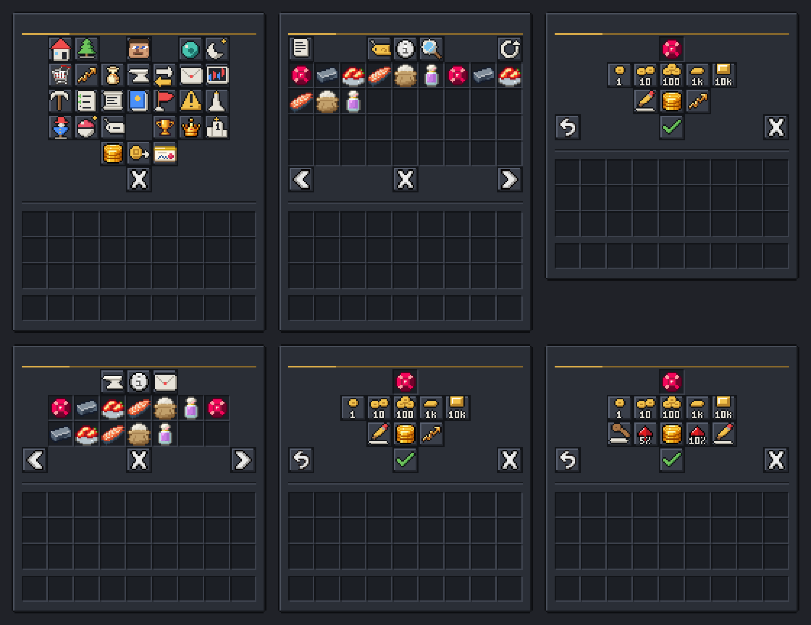

- 맨 위 칸 = 팔 물건. 처음엔 손에 든 묶음이고, **아래 내 인벤토리에서 다른 물건을 클릭**하면 바뀝니다(묶음 전체가 올라감). 입찰 화면에서는 경매 물건과 지금가·입찰 수·남은 시간.
- 가격: **±1 · ±10 · ±100 · ±1,000 · ±1만 G** 버튼(좌클릭 +, 우클릭 −, Shift = 10배), **직접 입력**(메뉴가 닫히고 채팅창에 `1500`, `1,500`, `3만`, `2만5천` 처럼 입력. 다른 사람에게는 안 보임, `취소` 또는 60초가 지나면 그만둠), **시세로 맞추기**(상점이 사 주는 값 × 개수). 처음 값도 상점 시세(없으면 100G).
- 가운데 금 버튼에 계산이 나옵니다: 거래소 = 수수료 7%와 **받을 돈**, 만료 시간, 내 등록 수 / 경매 = 최소 시작가, **보증금**(지금 내고, 팔리면 돌려받고, 유찰되면 잃음), 시간, 진행 중인 경매 수 / 입찰 = 지금가, 최소 입찰가, 맡길 돈과 입찰 뒤 잔액.
- 입찰 화면의 빠른 버튼: **최소 입찰가**, **최소 +5%**, **최소 +10%**, 직접 입력. 최소 입찰가보다 낮게는 내려가지 않고, 그사이 누가 더 높게 부르면 자동으로 올라갑니다.
- **확인**(초록 체크)을 눌러야 등록·입찰됩니다. 할 수 없으면(물건 없음, 등록 10건 다 참, 경매 자리 없음, 보증금·잔액 부족, 이미 최고 입찰자) 확인 버튼이 회색이 되고 이유가 이름에 나옵니다. 내 경매를 열면 확인 자리가 **경매 취소**(입찰 전만)입니다.
- 거래소 목록 위 줄: 내 등록품/전체 · 판매 등록 · 잔액 · **검색**(채팅으로 입력, 우클릭 = 검색 지우기) · 새로고침. 아래 줄 가운데 양옆 = **탭**: 판매 목록 · 구매 주문(지금 탭이 반짝임). 경매장 위 줄: 경매 등록 · 정보 · 우편함.

### 거래소 구매 주문 (사는 사람이 값을 먼저)

"밀가루 500개를 개당 12 G에 삽니다" 처럼 **사는 사람이 주문을 걸고**, 그 물건을 가진 사람(다른 직업)이 언제든 넘겨 주고 바로 돈을 받습니다. 사는 사람은 접속해 있지 않아도 됩니다.

- **주문 넣기**: 거래소 아래 **구매 주문** 탭 → **구매 주문 넣기**(또는 `/거래소 주문`). 살 물건(손에 든 것 / 아래 내 인벤토리 클릭 / 맨 위 칸 클릭 = **상점이 사는 물건 목록**에서 검색해 고르기), 개당 값(판매 등록과 같은 가격 버튼, **상점 매입가로 맞추기**), 수량(±1 · ±64, Shift = 10배, 클릭 = 채팅으로 입력). 금 버튼에 맡길 전체 값, 잔액 → 주문 뒤 잔액, **상점 매입가(개당)**와 지금 최고 주문가가 나오고, 상점 매입가보다 낮으면 빨간 경고(팔 사람이 적음). 명령어로 바로: 물건을 들고 `/거래소 주문 <개당 가격> [수량]`(수량 없이 = 든 만큼).
- **맡긴 돈(에스크로)**: 주문하는 순간 **수량 × 개당 값 전부**가 잔액에서 빠져 맡겨집니다(경매 입찰금처럼). 순자산·주간 순위에는 그대로 셉니다.
- **넘기기(판매)**: 구매 주문 탭에서 남의 주문을 **두 번 클릭 = 한 묶음**, **Shift 두 번 클릭 = 가진 만큼**(남은 수량까지). 첫 클릭에 넘길 개수와 받을 돈이 보이고, 같은 클릭을 한 번 더 해야 넘깁니다. 물건이 먼저 내 인벤토리에서 빠지고, 주문이 확정되면 바로 **맡긴 돈에서 대금**(거래소와 같은 수수료 7%, 파는 사람이 냄, 수수료 면제 사건 중 0%). 물건은 **사는 사람의 우편함**으로 갑니다. 여러 사람이 나눠 채울 수 있고(부분 체결), 사는 사람이 접속해 있으면 바로, 아니면 다음 접속 때 알림.
- **같은 물건 기준**: 상점이 사는 것과 같습니다. 커스텀 물건은 id 로, 바닐라는 이름 바꾸기·인챈트·설명·닳음이 없는 것만, 관리자 상점에서 산 물건은 안 받습니다. **물고기 크기는 따지지 않습니다**(어느 크기든 같은 값): 넘길 때 **작은 것부터** 빠지고 트로피 크기는 마지막.
- **취소·만료**: 내 주문 클릭 = 취소, **남은 맡긴 돈을 바로 돌려받음**. `orders.hours`(7일)가 지나면 저절로 만료되고 남은 돈 환불(접속해 있지 않았으면 다음 접속 때 알림).
- **제한** (`trade.yml` 의 `orders`): 1인 동시 주문 `max-orders` 10건, 개당 최소 `min-price` 1 G, 한 주문 최대 `max-amount` 3,456개(64 × 54). 주문할 수 있는 물건은 **상점이 사는 물건만**(그래서 수표·탈것·치장·교환권·가구는 안 됨).
- **부정 방지**: 내 주문은 내가 채울 수 없음(DB 에서도 막음). 주문 하나는 DB 의 조건부 갱신 한 번으로만 채워지고(남은 수량을 넘으면 거절), 그 체결 기록과 사는 사람의 우편이 **같은 트랜잭션**에 들어갑니다: 두 사람이 동시에 넘겨도(서버가 둘이어도) 맡긴 돈보다 많이 나가지 않습니다. 거절되면 빠졌던 물건은 그대로 돌려받습니다(인벤토리, 자리가 없으면 우편함). 확정된 뒤 돈이 움직이기 전에 서버가 멈추면 다음 시작 때 대금·환불을 마저 치릅니다.
- **상점 시세와 무관**: 구매 주문에 넘기는 것은 상점 판매가 아니라서 **내 상점 매입가(곡선)를 내리지 않고**, 판매 소득세·하루 한도도 없습니다.
- **기록**: 체결마다 서버 로그 한 줄과 DB(`eco_buy_fill`: 주문, 사는 사람, 파는 사람, 물건, 수량, 대금, 수수료, 시각), 장부 사유 `buy_order_escrow`(맡김) · `buy_order_settle` + `buy_order_sale`(대금, 경매 낙찰처럼 사람 사이 이동) · `buy_order_fee`(수수료) · `buy_order_refund`(환불). 체결은 업적·미션의 거래소 판매(`market_sold`)로도 셉니다(아래 같은 기준).

### 업적·미션에 세는 거래 (짜고 치는 거래 방지)

`market_sold`(거래소에서 팔린 수, 구매 주문에 넘긴 것 포함: 미션 '거래소에서 5번 팔기', 업적 첫 거래소 판매·거래소 단골)와 `auctions_won`(경매 낙찰: 업적 낙찰!·경매의 신)은 **제값에 한 거래만** 셉니다(`trade.yml` 의 `credit`):

- 가격이 `min-price`(100G) 이상이고, 상점이 같은 물건에 주는 값(기준가 × 개수)의 `shop-ratio`(1배) 이상일 때만 (상점이 안 사는 물건은 100G만).
- **같은 두 사람 사이에서는 `pair-hours`(24시간)에 한 번만**: 같은 구매자에게 여러 번 팔거나 같은 판매자의 경매를 여러 번 낙찰받아도 하루 1번. 기록은 DB에 남아 재시작해도 그대로.
- 거래 자체는 언제나 됩니다(세지만 않음). 서버 경매(대경매)는 늘 셉니다(주간 낙찰 제한이 따로 있음).
- 판매·경매 등록 화면의 금 버튼 맨 아래에 그 물건의 인정 기준이 나옵니다.


## 상점 매입가 (시세)

- **매입가는 사람마다 따로입니다.** 내가 판 만큼 내 값만 내려가고, 다른 사람이 아무리 팔아도 내 값은 그대로입니다. 접속 인원도 상관없습니다.
- 개당 값 = 기준가 × max(25%, (1 + S/Q)^−0.5) × 배수(수요 고시 1.5배·품귀·폭락·고가 매입상).
  S = 내가 그 물건을 판 양(매시간 12%씩, 매일 05시에 절반으로 줄어듦), Q = 1인 적정량 q × 6(`depth`).
- **많이 팔면 손해지만 막히지는 않습니다**: 팔수록 값이 계속 조금씩 내려갈 뿐 어느 순간 멈추지 않습니다.
  S = Q 에서 기준가의 71%, 3Q 에서 50%, 8Q 에서 33%, 15Q 를 넘게 팔아야 바닥(25%). 나눠서 팔수록(시간을 두고) 이득입니다.
  예) 442G·q 4 짜리 물건: 1묶음 한 번에 약 19,500G (예전 12,700G), 10묶음 약 94,800G, 27묶음 한 번에 약 215,000G.
  27묶음을 7일에 나눠 팔면 약 347,600G (예전에는 어떻게 팔아도 약 306,900G).
- 한 번에 여러 개를 팔면 한 개마다 S 가 하나씩 늘어 뒤의 것일수록 조금씩 쌉니다(한 번에 팔든 나눠 팔든 합계는 같음). 하루 한도(`cap`)는 그대로 (다이아몬드·네더라이트 파편만. 커스텀 작물은 한도 없음: 밭에서 나는 만큼 다 팔림).
- 예: 기준가 10G·q 32 짜리 물건(Q 192). 아직 안 판 사람은 10G. 32개를 한 번에 팔면 약 308G를 받고 내 값은 9.3G,
  다시 32개를 팔면 약 287G, 내 값은 8.7G. 2,880개를 넘게 팔아야 바닥가 2.5G. 그동안 다른 사람은 그대로 10G에 팝니다.
- 커스텀 작물은 곡선이 짧고(q 3: 64개를 팔면 기준가의 64%) 바닥도 따로 5%입니다(판매 줄의 `floor: 0.05`). 밭에서 한꺼번에
  쏟아지는 작물을 끝없이 같은 값에 팔 수 없게: 작물 값은 2026-11 농부 재조정에서 약 3.6배, 레시피 개수는 1·2·4·8·16·32·64.
  18시에 64개를 팔았다면 다음 날 05시 뒤에는 S 가 약 8 이 되어 내 값이 9.8G 로 돌아와 있습니다.
- **판매 소득세** (`income-tax`): 그날(05시부터) 상점에 판 금액 중 30,000G 를 넘는 부분 10%, 60,000G 를 넘는 부분 20%,
  100,000G 를 넘는 부분 30%. 넘는 부분에만 붙어서 적게 파는 사람은 내지 않고, 더 팔아서 손에 쥐는 돈이 줄어드는 일은 없습니다
  (하루 50,000G 판매 → 2,000G, 80,000G → 7,000G, 150,000G → 26,000G). 판매 알림에 낸 세금이 함께 나옵니다.
- **시장가** = 기준가 × 배수: 최근 그 물건을 안 판 사람이 받는 값. 시세판, 24시간 변화, 콘솔의 `/시세` 가 이 값이라
  수요 고시나 사건이 시작·끝날 때만 움직입니다. 판매 화면의 품목 설명에는 내 매입가 · 시장가 · 기준가, 내 판매 기록(S) / 적정(Q), 오늘 판 개수 / 한도가 나옵니다.

## 땅

- **건축월드 / 야생월드** (코어 `config.yml worlds`, 코어 README 참고):
  - **건축월드**: 땅은 여기서만 삽니다(`/땅 구매`). **내가 소유하거나 구성원인 땅에서만 블록을 부수고 놓을 수 있습니다** — 주인 없는 청크도 보호됩니다(부수기, 놓기, 양동이, 불, 괭이·삽·도끼로 땅 바꾸기, 뼛가루, 액자·갑옷 거치대, 작물 심기·수확, 가구·기계 설치·회수). 주인 없는 곳에서도 문·상자·작업대 쓰기, 동물 만지기, 보트·수레는 됩니다. 폭발·번지는 불·바깥에서 흘러드는 물과 용암·피스톤도 건축월드의 블록은 못 바꿉니다. 처음 2청크는 무료라서 새 플레이어도 바로 `/땅 구매` 로 시작할 수 있고, 자원은 야생월드에서 캡니다. 막히면 액션바에 "건축월드에서는 내 땅에서만…" 안내.
  - **야생월드와 그 지옥·엔드**(야생월드의 포털로만 감, 건축월드에서는 못 감): 보호가 전혀 없습니다(누구나 캐고 짓고 부숨). `/땅 구매` 는 "건축월드에서만" 안내로 거절. **직업 기계는 설치할 수 없습니다**(초기화로 사라지지 않게 건축월드에만). 운영자가 `/관리자 야생초기화` 로 세 월드를 함께 새로 만들 수 있습니다. **야생 지옥·엔드에서 죽으면 아이템과 경험치가 그대로 남습니다**(코어 `worlds.keep-inventory`, `/땅` 안내에도 표시).
  - **그 밖의 월드**(예: 이제 쓰지 않는 서버 기본 지옥·엔드): 새로 살 수는 없지만, 예전에 산 청크는 지금처럼 보호되고 세금도 그대로입니다.
  - **데이터는 지우지 않습니다.** 야생월드(또는 그 지옥·엔드)로 정한 월드에 예전 청크가 있었다면 그 청크는 보호하지 않고 `/땅`·경계 보기에도 안 나오지만 기록·청크 수·세금은 남습니다(설정을 되돌리면 다시 보호). 정리하려면 운영자가 그 자리에서 `/관리자 땅 해제 [반지름]` 으로 풀어 주세요(소유자는 건축월드에서 새로 삼).
  - 운영자(`stsv.economy.land.bypass`, 기본 OP)는 어디서나 됩니다.
  - **탈것 세우기·배 띄우기**는 따로: 남의 땅, 서버 땅(마을·하역장·터미널), `roads.avoid` 상자만 안 되고 **주인 없는 건축월드 땅과 야생월드는 됩니다**(`LandAccess.vehicleSpot`, 코어 README "탈것"). 타고 지나가는 것은 어디든. 탈것·지게는 상점에서 산 사람에게 묶이고(귀속), 거래소·경매·직거래에는 올릴 수 없습니다(`/탈것 양도`).
- 단위는 **청크**(16×16, 높이 전체)입니다. 서 있는 청크에서 `/땅 구매`. 청크 수 상한은 없습니다.
- **무료 청크**: 한 사람당 2개. 구성원이 되면 그 사람의 2개가 그 땅에 더해집니다(3명이 살면 6개).
  무료 청크는 한 사람당 한 곳에서만 셉니다: 구성원인 땅이 있으면 거기, 아니면 자기 땅.
- **청크 값**: 무료를 넘는 청크는 500G, 그다음은 550G, 600G… (돌려받지 않음).
- **재산세** (매일 05시, 누진): 무료를 넘는 청크 하나당 100G. 땅 전체가 **10청크 + 구성원 1명당 5청크**를 넘으면 넘는 청크는 2배(200G),
  **25청크 + 구성원 1명당 10청크**를 넘으면 3배(300G). 혼자 사는 땅: 5청크 300G · 10청크 800G · 20청크 2,800G · 30청크 5,300G · 40청크 8,300G 하루.
  세금은 **땅 금고**에서 먼저 나가고, 모자라면 소유자 지갑에서 나갑니다. 금고가 3일치보다 적으면 사는 사람 모두에게 알림.
- 3일 연속 못 내면, 낼 수 있게 될 때까지 가장 최근에 산 청크부터 보호가 풀립니다.
- 소유자: 청크 구매·포기, 초대·추방, 금고 출금, 양도, 해체. 구성원: 짓기, 부수기, 상자, 문, 기계, 작물, 금고 입금. 그 밖의 사람은 아무것도 못 합니다.
- 예전(2.0 이하) 직사각형 구역은 처음 켤 때 겹치는 청크로 바뀝니다 (예전 신뢰 목록은 넘어오지 않음).

## 사건

한 번에 하나씩 저절로 일어납니다. **사건이 끝나고 6시간 뒤**에 다음 사건이 시작하고, 바로 전과 같은 종류는 나오지 않습니다.
다음 사건이 새벽 1시~9시에 시작하게 되면 24시간짜리 사건만 나옵니다(아무도 없을 때 짧은 사건이 지나가 버리지 않게).
수요 고시 품목과 진행 중인 다른 사건의 품목은 사건이 고르지 않습니다. 진행 중인 사건은 오른쪽 사이드바에 남은 시간과 함께 보입니다(보스바 없음).

| 사건 | 이름 | 시간 | 하는 일 |
|---|---|---|---|
| 품귀 | shortage | 24시간 | 중간 가격대 품목 하나의 매입가 3배 |
| 시장 폭락 | crash | 24시간 | 최근 가장 많이 팔린 품목의 매입가 절반 |
| 풍년 | harvest | 24시간 | 농부·어부 효과 2배 |
| 세무 조사 | tax_audit | 24시간 | 재산세 2배, `/기부` 5,000G 이상이면 [기부왕] 칭호 |
| 광산 호황 | mining_boom | 6시간 | 광부·대장장이 효과 2배 |
| 수수료 면제 | fee_free | 6시간 | 거래소·경매·`/송금` 수수료 0% |
| 긴급 납품 | urgent_order | 3시간 | 상인이 직업으로 모으는 한 품목을 대량 주문(희귀·전설 물고기와 최소 주문이 너무 비싼 품목은 빼고). `/납품` 으로 인벤토리의 그 물건을 냄. 첫 개는 기준가 2배, 마지막 개는 1배로 점점 내려감(빨리 낼수록 비쌈). 다 모이면 일찍 끝나고 가장 많이 낸 3명 공지 |
| 고가 매입상 | premium_buyer | 2시간 | 품목 2~3개를 상점 시세의 2배로, 품목마다 64개까지 삼 (`/시세` 에 남은 수량 표시) |
| 상인 행렬 | merchant | 2시간 | 상점 구매 카테고리에 상인 행렬이 생기고 한정 상품 + 전설 치장 교환권 1장(사건마다 7종 중 하나: 왕관·고리·날개 2종·한정 펫 3종, 250,000 G, 선착순) |

사건마다 길이, 배수, 나오는 비율(weight), 6시간 간격과 새벽 시간은 `events.yml` 에서 바꿉니다. 주가가 움직이는 "실적 발표"는 주식 단계에서 들어갑니다.

## 주식

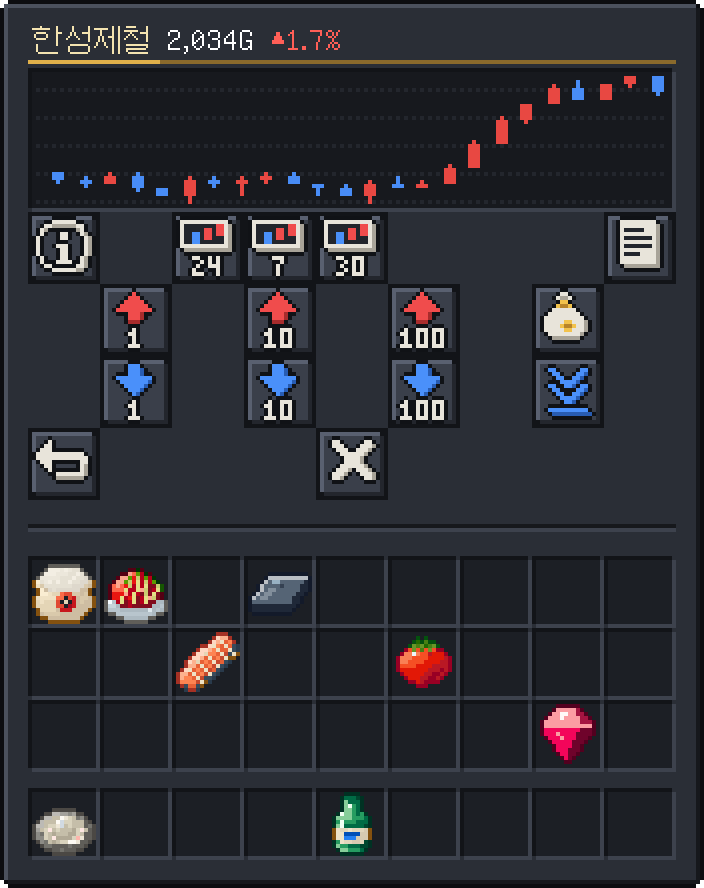

- **회사 42개:** 광업·농업·수산·철강·식품·제약 6개 산업 × 7개. ★1 대형 안정주(시작가 1,000~2,000G, 하루 ±2% 안팎, 배당 많음), ★2 보통, ★3 소형 급등락주(50~200G, 배당 없음).
- **주가는 10분마다:** 회사 고유의 흔들림 + 산업 지수 × 회사 민감도 + 제자리로 돌아가는 힘(너무 오르면 천천히 내려오고 반대도). 하루 변동은 전날 05시 종가 ±20%, 닿으면 서버 공지(상한가·하한가).
- **회사 뉴스:** 하루 5번쯤 한 회사가 ±5~10%. "[단독] 한성제철, 조선소와 철판 장기 계약… 매수세 몰려 ▲8.2%"처럼 머리말·원인·결과를 따로 뽑아 조합하고, 최근 30번 쓴 원인은 다시 쓰지 않음. `/주식 뉴스`
- **산업 지수:** 매일 05시에 전날 상점 판매·의뢰 납품액이 최근 7일 평균보다 많았는지로 하루 ±3%까지. 그 산업 주식을 가진 사람의 활동은 빼고 셉니다(자기 주식을 자기가 못 올림). 사건도 움직임: 품귀 +, 시장 폭락 -, 풍년(농업·수산) +, 광산 호황(광업·철강) +.
- **실적 발표 (사건):** 산업 하나를 골라 그 회사들이 회사마다 따로 5~15% 오르거나 내림.
- **사고팔기:** 1·10·100주, 팔 때는 전부도. 수수료 1%(첫 매수 무료, 수수료 면제 사건 중 0%), 산 주식은 10분 뒤부터 팔 수 있음, 한 회사 발행량의 30%까지.
- **배당:** 매주 월요일 05시, 지난주 **정말 사라진 돈**(세금·수수료·상점 판매 등)의 15%를 업종 활동과 회사 크기에 따라 1주당으로 나눠 줍니다(돈을 새로 찍어내 물가를 올리지 않게). 땅 금고에 넣은 돈과 주식을 산 돈은 사라진 돈이 아니라 **맡겨 둔 돈**(원장 `ESCROW`)이라 세지 않습니다: 금고에서 세금으로 나갈 때, 주식 수수료로 나갈 때만 사라진 돈이 됩니다. ★★★(크게 움직이는) 회사는 배당이 없습니다. 회사 설명에 지난번 1주당 배당과 내 예상 배당이 나옵니다.
- **주간 주식왕:** 그 주 주식 수익(지금 가치 + 판 돈·배당 - 주초 가치 - 산 돈) 1~3위에게 [주식왕]·[큰손]·[슈퍼개미] 칭호. 그 주에 1,000G 이상 투자한 사람만.
- **알림:** 내 주식이 산 값보다 ±10%, ±20% 움직이면 채팅으로(`/주식 알림`으로 끄고 켬).
- **화면 `/주식`:** 산업 탭, 오른 순·내린 순·많이 산 순, 내 주식(가치·손익). 회사를 누르면 봉 그래프(10분: 10분 봉 16개, 24시간: 2시간 봉 12개, 7일: 하루 봉 7개)와 현재가 점선·가격표, 사기·팔기. 그래프는 리소스팩 글꼴로 창 제목에 그려서 모드가 필요 없습니다.
- `/주식 <회사>`: 채팅에 현재가, 오늘 등락, 24시간 최저~최고(회사 화면의 24시간 그래프와 같은 자료), 내 보유(평가·손익).
- 회사마다 고유 로고(산업 색 배지 + 상징, `docs/previews/stock_logos.png`). 등락 색은 한국식: 상승·이익 빨강, 하락·손실 파랑.

## 낚시

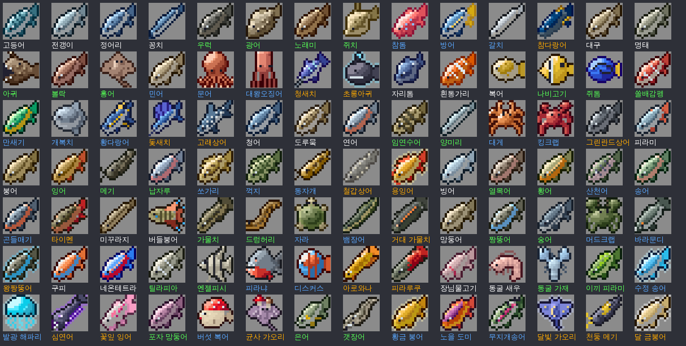

- **낚는 법은 바닐라 그대로:** 찌가 물에 잠기는 순간 우클릭하면 낚아 올립니다(늦으면 놓침, 미니게임 없음). 입질까지 기다리는 시간도 바닐라
  (5~30초, 미끼(Lure) 한 단계마다 5초 덜, 그다음 물고기가 찌까지 1~4초, 하늘이 막힌 곳은 더 걸림). **어부**는 기다리는 시간이 레벨에 따라
  32 → 50% 줄어듭니다(`jobs.yml bite`, 미끼 III이면 바닐라 평균 7.5초 → Lv30 3.75초). 걸린 것이 물고기면 아래 98종 중 하나(그 물·그 때·등급),
  보물·쓰레기는 그대로 바닐라. 낚으면 화면 가운데에 물고기 그림·이름·크기(리소스팩 글꼴).
- **2026-11 낚시 링(타이밍 미니게임)을 없앴습니다.** 링이 한 마리에 4~7초 걸리던 만큼 어부의 입질을 빠르게 해서(`bite` 10 → 32%)
  어부가 한 시간에 낚는 수는 링 때와 거의 같습니다(미끼 III, parity 모델: Lv1 377 → 374, Lv15 403 → 402, Lv30 434 → 436마리).
  링에서 놓치던 희귀·전설(Lv1 약 7%·20%)이 이제 다 낚이니 어부 희귀·전설 입질은 6~36% → 5~35.5%, 완벽 판정의 크기 보너스(+3%·+10%)가
  없어진 대신 어부 Lv20 크기 보너스가 +10 → +17%(Lv20 어부가 흔히 내던 완벽 2번 +6% 를 더한 값). 어부가 아닌 사람은 바닐라 속도로
  한 시간에 약 300마리(링 때 약 365마리): parity 모델에서 낚시만 해서는 어느 직업의 자기 일보다 한참 적게 법니다(직업 평균의 -58 ~ -95%).
- **물고기 98종:** 바다, 깊은 바다, 따뜻한 바다, 차가운 바다, 강, 차가운 강·호수, 늪, 맹그로브, 정글, 동굴 지하수(땅속 깊은 물), 버섯 섬, 그리고 시간·날씨(밤, 새벽, 해질녘, 비, 뇌우, 보름달)에만 무는 물고기. 대구·연어·복어는 바닐라 아이템, 참돔·참다랑어·철갑상어는 예전 발견품 그대로.
- **아무 물고기나 등급별로 손질 (2026-11):** 낚시는 무엇이 걸릴지 고를 수 없어서, 손질대는 물고기 종류마다 따로 다른 손질감을 만들지
  않고 **등급마다 하나**만 만듭니다. 손질 결과가 4가지뿐이라 인벤토리가 어지럽지 않고, 요리사는 이 넷만 사면 모든 생선 요리를 합니다.

| 등급 | 손질 결과 (기준가) | 손질대 레시피 (같은 등급 안에서 값이 비슷한 것끼리 묶어 섞어 넣기) | 열리는 단계 |
|---|---|---|---|
| 흔함 | 생선살 15G | 3G 물고기(피라미·빙어·미꾸라지) 4 → 1, 5~6G 물고기(대구·연어·복어·고등어·열대어 등 20종) 2 → 1 | 기본 |
| 보통 | 고급 생선살 28G | 9~11G 2 → 1, 12~17G 4 → 3, 18~23G 1 → 1 | 기본 |
| 희귀 | 특선 생선살 46G | 42~45G 2 → 3, 53~60G 1 → 2, 68~75G 2 → 5, 83~98G 1 → 3, 105~120G 4 → 15 | 1강 |
| 전설 | 진귀한 생선살 216G | 375~450G(참다랑어·철갑상어) 1 → 3, 630~750G 1 → 5, 780~900G 1 → 6 | 2강 |

  어느 묶음이든 가장 비싼 물고기를 넣어도 재료값의 1.2배 이상(어부가 흔히 낚는 크기로도), 가장 싼 것을 넣어도 1.76배 이하입니다
  (`machines.yml` 의 `groups` 와 `fish_bench`). 연마 진주(진주 → 2강)는 그대로. 크기가 아주 큰 희귀·전설은 그대로 파는 쪽이 나을 수 있습니다
  (재료 칸에서는 크기가 지워짐). 새 물고기를 더하면 등급·값에 맞는 묶음에 넣습니다(`RulesTest` 가 모든 물고기가 손질되는지 확인).
- **조리대의 생선 요리는 이 넷만 씁니다:** 생선살 → 생선구이·생선전·모둠 생선구이·생선 지리·생선찌개·매운탕·생선조림·어묵탕·
  생선구이 정식·떡볶이·건어물 볶음, 고급 생선살 → 생선 양념구이·매운 생선찜, 특선 생선살 → 물회·해물찜·보쌈, 진귀한 생선살 → 특선 생선 초밥. 날 물고기는 받지 않습니다.
- **예전 손질감 22종** (생선 필렛·연어 필렛·북어·손질한 복어·훈제 연어·모둠회·숙회·참치 회·어묵·캐비아·해물 한상·새우살·과메기·굴비·삭힌 홍어·
  젓갈·간고등어·까나리 액젓·광어회·건어물·새우젓·어묵 반죽)은 이제 만들 수 없지만 **가진 것은 예전 값 그대로 상점에 팔 수 있습니다**
  (`shop.yml sell.legacy`: 판매 화면에서 내 인벤토리의 그 물건을 누르거나 '가진 것 전부 팔기'). 상점 탭·도감·하역장 완제품 목록에는 나오지 않습니다.
- 희귀·전설 입질: 어부 5→35.5% (2026-11 손질대를 등급별 손질로 바꾸며 22 → 36%), 다른 직업 1% (그 중 1/20이 전설). 바다에서 희귀 입질의 15%는 진주. 나머지는 흔함 65 : 보통 35.
- **크기:** 낚을 때마다 정해지고(작은 쪽이 흔함), 어부 Lv20 +17%, 최대 크기의 115%까지. **희귀·전설 물고기는 크기가 아이템에 남고**(겹치지 않음) 상점이 크기에 따라 0.7~1.5배로 삼. 흔함·보통은 그냥 겹쳐지는 아이템. 기계 재료 칸에 넣으면 크기가 지워져(가장 작은 크기 값, 70%) 같은 종류끼리 쌓입니다. 큰 물고기는 팔고, 작은 것을 요리하세요.
- **도감 `/도감`:** 물고기도 다른 물건처럼 한 마리를 내야 등록됩니다(낚기만 해서는 등록 안 됨, 새 어종을 낚으면 알려 줌). 서식지 하나를 다 등록하면 그 칭호([바다 낚시꾼] 등 12개), 모든 물고기를 등록하면 [강태공]. 예전에 낚은 물고기는 처음 켤 때 한 번 등록된 것으로 옮겨 둠.
- **이번 주 최대어:** 그 주에 가장 긴 물고기가 바뀔 때마다 공지, 월요일에 지난주 최대어 발표.
- **통통배에서 낚기:** 통통배에 타고(어느 자리든) 낚으면 어부는 희귀·전설 입질이 Lv1 +2% → Lv30 +4% 더 (`jobs.yml boat-rare`, Lv30 35.5% → 39.5%). 다른 직업은 그대로.
- **통통배 그물 끌기 (코어 작업기, 코어 README "작업기"):** 운전석에서 Ctrl 로 그물을 내리고 **바다**(바다·깊은·따뜻한·차가운 바다, 맹그로브, 버섯 섬)를 3블록/초 이하로 가면
  평균 45초에 한 마리, 그 물의 **흔함·보통 물고기**(시간대 물고기 없이, 통발처럼)가 어창으로 (`FishingModule#netCatch`). 보통 35%(+ 어부 `trap-uncommon`),
  어부는 레벨의 두 마리 보너스와 통발 경험치. 희귀·전설·진주·특별 재료는 없음: 한 시간에 80마리쯤(낚싯대는 300마리쯤)이고 손이 비지 않으므로 낚시보다 훨씬 적음.
  parity·BalanceTest 모델에는 넣지 않았습니다(탈것은 관리자 지급 아이템).
- **트랙터 수확기 (코어 작업기):** 우클릭 수확과 같은 길(보호, 수확 경험치, 농부 수확 보너스, 특별 재료)로 거두고 떨어진 것은 트레일러 짐칸으로 갑니다.
  농부 Lv10·20 의 줄·3×3 수확은 기계 수확에서는 퍼지지 않습니다(`CropModule#collecting`). 작업기는 국도·하역장·출발 터미널에서는 일하지 않습니다(`RoadModule#toolsKeepOff`).

### 통발 · 가두리 (많이 놓고 자주 돌보면 많이 법니다)

| | 통발 `economy:fish_trap` | 가두리 `economy:fish_pen` |
|---|---|---|
| 얻기 | 상점 `구매 → 기계` 400G, 조합대 (철 4 · 실 4 · 낚싯대) | 상점 3,000G, 조합대 (철 블록 2 · 통나무 4 · 실 2 · 통) |
| 놓는 곳 | 물속 1칸 (그 칸이 물이어야 함) | 물속 2×2칸 (네 칸 모두 물) |
| 하는 일 | 15분마다 그 물의 **흔함·보통 물고기** 한 마리 (희귀는 드물게, 전설·시간대 물고기는 없음). **8마리 차면 멈춤** | 넣어 둔 물고기(흔함·보통 한 종류, 2마리 이상)가 **사료 하나에 25%씩** 불어남 (60분마다, 32마리까지). 사료가 없으면 멈춤 |
| 쓰기 | 우클릭: 꺼내기 (빈 통발은 다음 물고기까지 남은 시간) | 물고기·생선 사료를 들고 우클릭: 넣기 (사료 16개까지) · 빈손 우클릭: 16마리를 남기고 꺼내기 · 웅크리고 우클릭: 전부 |
| 어부 | `jobs.yml trap-speed` 25 → 50% 빨리 (통발 Lv1 약 11분 · Lv30 7.5분, 가두리 45 → 30분), 통발 보통 물고기 25% → 40~55%, 희귀 0.3% → 1~3% (`trap-uncommon`, `trap-rare`) | 같은 `trap-speed` 로 빨리 불어남 |

- 아무나 놓을 수 있지만 어부가 훨씬 낫습니다: 하루 3시간 돌보는 통발 하나가 어부 Lv1 약 280G, Lv30 약 450G, 다른 직업 약 170~200G (parity 모델, 아래).
- **내 땅(주인·구성원)이나 야생월드에만**, 한 청크에 통발·가두리 합쳐 8개(가두리 2개)까지. 꺼내기·부수기는 주인과 그 땅 사람만. 부수면 안에 든 물고기·사료가 떨어집니다. 야생월드가 초기화되면 그 안의 통발·가두리는 우편함으로 돌아옵니다(안에 든 것은 사라짐).
- **놓인 동안 따로 돌지 않습니다:** 누가 우클릭하거나 부술 때 지난 시간만큼 한꺼번에 셉니다 (통발은 최대 8마리, 가두리는 넣어 둔 사료 수만큼만 계산하니 오래 비워 둬도 계산은 짧음). 그래서 청크가 꺼져 있어도 시간은 흐르지만, 가득 차면 멈추니 자주 비울수록 많이 모입니다. 주인의 직업·레벨은 꺼낼 때 기준.
- 통발·가두리에서 꺼낸 물고기는 어부 경험치 1 (낚시는 3), 특별 재료(산호·용연향·전복)는 낚싯대로만 나옵니다.
- **생선 사료**는 가공대(농부)에서 콩 32 + 옥수수 16 → 4개 (7G): 농부가 어부에게 팔 거리.

## 직업

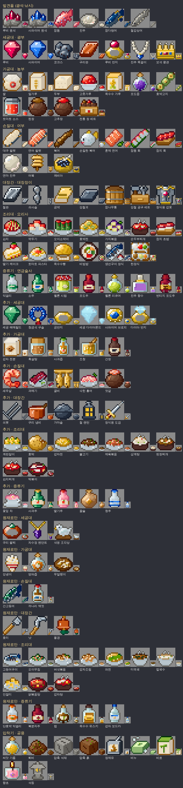

- 직업은 하나, **레벨은 직업마다 따로** 남습니다 (Lv1~30). 바꾸기는 언제든(기다리는 시간 없음), 값은 **바꿀 직업의 내 레벨**에 따라 Lv1 1,000G · Lv10 2,000G · Lv20 3,000G · Lv30 5,000G (사이는 고르게, 처음 고르기는 무료, `jobs.yml change-cost`). 바꿨다 돌아오면 그 레벨 그대로. 효과는 지금 직업의 것만.
- 레벨 n 까지 누적 경험치 = 40(n-1)² + 60(n-1): Lv2 100, Lv10 3,780, Lv20 15,580, Lv30 35,380. Lv30 뒤 경험치는 숙련(직업 순위)으로 쌓임.
- 경험치: 그 직업의 일(광석 캐기, 수확, 낚시, 도구·갑옷 제작, 요리, 양조, 의뢰)과 **직업 기계** (만든 물건 기준가 5G 당 1). 놓은 블록은 경험치 없음.
- 직업 기계 효과는 결과·재료 **한 개마다** 따로 굴립니다: 결과 4개짜리 레시피는 결과 1개짜리의 4배만큼 덤이 나오고, 재료도 한 개마다 아낍니다. 그래서 어느 레벨에서든 모든 레시피가 같은 비율로 늘어나 레시피 사이의 효율 순서는 그대로입니다 (Lv30: 광부·대장장이·어부 1.59배, 요리사 1.62배, 연금술사·농부 1.35배).
- 발견품: 광부는 광석에서 루비·사파이어 원석(3→12%), 어부는 희귀·전설 입질(5→35.5%, 위 낚시 참고). 다른 직업이면 1%.
- **어부의 수입:** 낚싯대는 한 번에 한 마리라 시간을 늘리는 것 말고는 늘릴 수 없었습니다. 통발·가두리는 놓은 만큼, 돌보는 만큼 늘어납니다(위 낚시).
  `tools/parity` 모델(2026-11)은 낚시 한 시간 중 낚싯대가 실제로 도는 몫을 45분으로 봅니다(물 사이 이동, 겹치지 않는 희귀 물고기 정리, 헛챔질:
  광부·농부의 한 시간에는 걷는 시간이 이미 들어 있음). 낚싯대만으로는 어부가 평균보다 아래(3시간 Lv1 -6%, Lv15 0%, Lv30 -13%)이고,
  통발 14~32개와 가두리 0~4개를 매시간 돌보면(하나에 6초·20초, 그 시간은 낚싯대에서 빠짐) 평균 근처(+13%, +12%, -4%)가 됩니다.
  2026-11 손질대가 등급별 손질(생선살 4가지)만 하게 되면서 어부의 연쇄 손질(훈제 연어 → 해물 한상 등)이 사라지고, 손질 결과가 4가지로 모여
  상점 매입가가 빨리 내려가므로(물건마다 따로 내려감), 고레벨 어부의 희귀·전설 입질을 22 → 36%로 올려 하루 수입을 맞췄습니다
  (3시간 Lv1 -7%, Lv15 -3%, Lv30 -10%: 평균 대비 +6%, +10%, -10%). 생선살은 조리대의 모든 생선 요리에 들어가 요리사가 어부에게 사 갈 거리입니다.
- **특별 재료** (`jobs.yml specials`): 누구나 얻지만 그 직업이면 훨씬 자주(레벨이 오를수록 더). **관리자 상점은 사지 않습니다**: 다른 직업의 비싼 레시피에 들어가니 필요한 사람에게 거래소·직거래로 파세요 (아이템 설명에 거래 참고가와 쓰는 곳).

| 특별 재료 | 얻는 곳 (자주 얻는 직업) | 참고가 | 쓰는 곳 |
|---|---|---|---|
| 산삼 | 작물 수확 (농부) | 160G | 연금술사 인삼주 · 요리사 산삼 삼계탕 |
| 황금 이삭 | 작물 수확 (농부) | 70G | 요리사 황금 인절미 · 연금술사 황금 청주 |
| 누에고치 | 작물 수확 (농부) | 60G | 광부 명주 진주 목걸이·용연향 노리개 · 대장장이 운철검 |
| 붉은 산호 | 낚시 (어부) | 90G | 광부 산호 브로치 · 대장장이 산호 자개함 |
| 용연향 | 낚시 (어부) | 260G | 연금술사 용연향 향수 · 광부 용연향 노리개 |
| 전복 | 낚시 (어부) | 40G | 요리사 전복죽 · 대장장이 산호 자개함 |
| 운철 | 광석 캐기 (광부) | 180G | 대장장이 운철검 · 연금술사 운철 단약 |
| 수정 원석 | 광석 캐기 (광부) | 45G | 광부 세공 수정 → 대장장이 수정 랜턴 · 연금술사 수정병 빈티지 |

| 직업 | 레벨 따라 | Lv10 | Lv20 | Lv30 |
|---|---|---|---|---|
| 광부 | 광석 추가 드롭 5→80%, 원석 3→12% | 세공 결과 하나마다 15% 확률로 +1 | 세공 재료 하나마다 15% 확률로 아낌 | 세공 결과 +1 확률 15% → 35% |
| 농부 | 커스텀 작물 수확량 +20→80% (바닐라 작물 +1→3개), 특별 재료 | 한 줄(1×3) 수확, 주변 작물 성장 가속 | 3×3 한 번에 수확, 가공 결과 하나마다 15% 확률로 +1 | 가공 결과 +1 확률 15% → 35% |
| 어부 | 희귀·전설 입질 5→35.5%, 입질 대기(바닐라) 32→50% 단축, 통발·가두리 25→50% 빨리·통발 보통 40→55%·희귀 1→3%, 통통배에서 희귀·전설 +2→4% | 손질 결과 하나마다 15% 확률로 +1 | 진주·참다랑어·철갑상어 두 마리씩, 크기 +17%, 손질 재료 하나마다 15% 확률로 아낌 | 손질 결과 +1 확률 15% → 35% |
| 대장장이 | 도구·갑옷 제작 재료 절약 5→30% | 대장간 결과 하나마다 15% 확률로 +1 | 대장간 시간 절반, 재료 하나마다 15% 확률로 아낌 | 대장간 결과 +1 확률 15% → 35% |
| 요리사 | 조리 시간 레벨당 -1% | 2인분 (15%) | 재료 하나마다 15% 확률로 아낌 | 요리 하나마다 20% 확률로 +1 |
| 연금술사 | 증류 시간 레벨당 -1% | 증류 결과 하나마다 15% 확률로 +1 | 숙성 시간 30% 단축 | 증류 결과 +1 확률 15% → 35% |

## 직업 기계

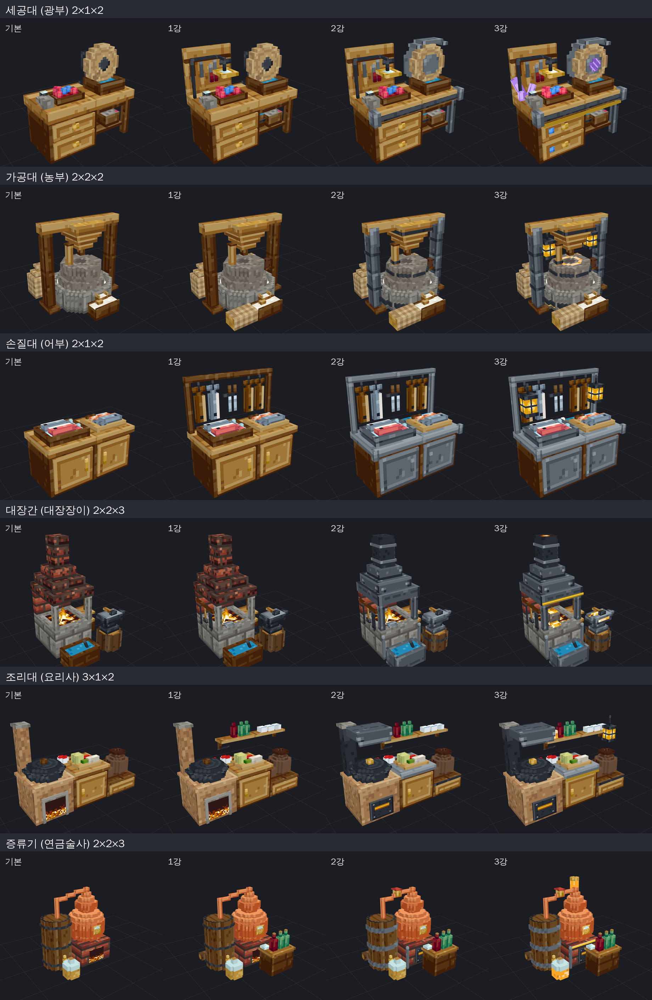

| 기계 | 직업 | 크기 (폭×깊이×높이) | 만드는 것 |
|---|---|---|---|
| 세공대 | 광부 | 2×1×2 | 원석 → 보석, 코크스, 구리판, 세공 에메랄드, 청금석 구슬, 금반지, 구리 팔찌, 자수정 펜던트 / 1강 대량 세공, 루비 반지, 세공 다이아몬드, 사파이어 브로치, 석영 조각상 / 2강 진주 목걸이, 다이아 반지 / 3강 보석 왕관 / 새: 세공 수정 (수정 원석), 1강 산호 브로치, 2강 명주 진주 목걸이·용연향 노리개 |
| 가공대 | 농부 | 2×2×2 | 쌀, 밀가루, 두부, 고춧가루, 옥수수 가루, 감자 전분, 흑설탕, 사과즙, 강냉이, 양파즙, 무말랭이 (32분), 생선 사료 (가두리 먹이) / 1강 포도즙, 호박고지, 토마토 소스, 대량 빻기(밀 64 → 밀가루 4), 조청 (4분), 간장 2병 (숙성 10분) / 2강 된장 6개 (숙성 16분), 고추장 2개 (숙성 15분) / 3강 전통 장 세트 |
| 손질대 | 어부 | 2×1×2 | 아무 물고기나 등급별로: 흔함 → 생선살, 보통 → 고급 생선살 (값이 비슷한 것끼리 묶어 2 → 1, 4 → 3 등) / 1강 희귀 → 특선 생선살 / 2강 전설 → 진귀한 생선살, 연마 진주 (위 낚시의 표) |
| 대장간 | 대장장이 | 2×2×3 | 철판, 쇠사슬, 금박, 쇠못, 구리 냄비, 호미 / 1강 강철괴, 참나무통, 가마솥, 철 랜턴, 낫, 풍경 / 2강 강철 공구 세트, 장식용 도검 / 3강 장식용 갑옷 / 새: 무쇠 팬, 무쇠 화로, 칼집, 1강 금박 자물쇠·수정 랜턴, 2강 산호 자개함, 3강 운철검 |
| 조리대 | 요리사 | 3×1×2 | 김치, 깍두기, 오이소박이, 가지볶음, 호박전, 생선전, 순두부찌개, 계란말이, 호떡, 감자전, 불고기, 제육볶음, 생선구이, 오이무침, 버섯볶음, 감자조림, 파전, 미역국 / 1강 특선 생선 초밥, 딸기 케이크, 토마토 파스타, 옥수수빵, 생선조림, 매운탕, 삼계탕, 된장찌개, 김치찌개, 칼국수, 인절미, 닭볶음탕, 감자탕 / 2강 비빔밥, 생선구이 정식, 해물찜, 생선 양념구이, 떡볶이 / 3강 한정식 / 새: 모둠 생선구이·생선 지리 (어부가 많이 잡는 생선), 황금 인절미, 잡채, 1강 생선찌개·매운 생선찜, 산삼 삼계탕, 전복죽 / 어부의 생선살로: 어묵탕, 1강 물회·건어물 볶음, 2강 보쌈 (생선 요리는 모두 손질대의 등급별 생선살을 씀) |
| 증류기 | 연금술사 | 2×2×3 | 막걸리 5병 (숙성 12분), 소주, 멜론 시럽, 꽃잎 차, 사과주 4병 (사과즙으로, 숙성 12분), 단호박 막걸리 4병 (쌀·밀·단호박, 숙성 12분) / 1강 포도주 5병 (포도즙 4개로, 숙성 27분 30초), 멜론 리큐어, 딸기주 1병 (숙성 10분), 꿀술 3병 (숙성 29분), 복분자주 2병 (숙성 15분), 럼 2병 (숙성 25분) / 2강 진주 향수, 청주 2병 (숙성 28분), 옥수수 위스키 (숙성 10분)·감자 보드카 (숙성 12분) / 3강 빈티지 포도주 3병 (포도주 4병·참나무통, 숙성 1시간 16분) / 새: 식혜, 1강 멜론 리큐어는 숙성으로, 2강 인삼주·황금 청주 (숙성), 3강 운철 단약·용연향 향수·수정병 빈티지 (포도주 5병·세공 수정, 숙성 1시간 22분) |
| **압착기** | **공용** | 2×1×2 | 남는 물건을 눌러서 (묶음 안의 것은 아무거나, 섞어도 됨): 씨앗 32 (바닐라 씨앗 전부 + 커스텀 작물 씨앗 15종) → 씨앗 기름, 묘목·잎·풀·고사리·덩굴·켈프·해초·썩은 살점·독감자·거미 눈 20 → 퇴비, 돌(조약돌·심층암·흑암·안산암·섬록암·화강암·응회암·네더랙) 64 → 압축 석재, 흙(흙·거친 흙·뿌리 내린 흙) 64 → 압축 흙 / 1강 씨앗 기름 4 + 석탄 → 정제유 / 2강 비누 (정제유 + 뼛가루), 비료 (퇴비 + 뼈) / 3강 향초 (정제유 + 실 + 꽃, 4분), 석등 (압축 석재 8 + 횃불 4, 5분) |

- 기계는 조합대에서 누구나 만들거나 상점(`구매 → 기계`: 압착기 200G, 세공대·가공대·손질대 300G, 조리대 400G, 증류기 500G, 대장간 800G)에서 사고, **누구나 씁니다**. 그 기계의 직업인 사람이 돌리면 빨라지고(요리사·연금술사 레벨당 -1%, 대장장이 Lv20 절반) 경험치와 직업 효과를 받습니다. 재료를 넣은 사람이 그 줄의 운영자.
- 줄: 재료 3칸 + 결과 1칸. 상태 칸을 눌러 만들 것을 고르거나(우클릭 = 자동), 그냥 재료를 넣으면 알아서 고릅니다. 결과 칸이 차면 멈춤. 아무도 안 봐도 계속 돌아갑니다.
- 관리자 상점에서 산 물건은 기계에 넣을 수 없고 상점에 되팔거나 의뢰에 낼 수도 없습니다(그걸로 만든 것, 산 씨앗으로 심어 덜 자랐을 때 뽑은 씨앗 포함, 다 자라 수확한 것은 보통 물건). 그래서 상점은 심거나 놓았다 캐면 표시가 없어지는 감자·당근·사탕수수·석탄과 작물을 키우는 뼛가루를 팔지 않습니다. 가구는 이 표시가 붙지 않습니다(상점이 사지 않고 기계·의뢰에도 쓰이지 않음): 설치했다 회수한 것과 그대로 겹쳐집니다.
- **강화**는 설치한 사람만: 1강 5,000G (그 직업 Lv10), 2강 20,000G (Lv20), 3강 50,000G (Lv30). 같은 종류의 기계를 또 강화할 때 값을 올리는 설정(`machines.yml upgrade.repeat`, 예: 0.5 = 두 번째 대 1.5배)이 있지만 지금은 꺼져 있습니다(0). 압착기는 1,000G / 4,000G / 10,000G (직업 레벨 없이). 줄 1→2→3→4개 (대장간 2→3→3→4, 조리대 2→2→3→4, 증류기 2→3→3→4, 가공대 1→2→4→4개: `machines.yml` 기계마다 `lanes`), 속도 +0/15/30/50%, 새 레시피와 새 모습(1강 부품, 2강 그 직업다운 공방 꾸밈, 3강 빛나는 부분). 레벨은 직업을 바꿔도 남으니 다시 그 직업일 필요는 없습니다.
- 회수(때려서 부수기)해도 강화 단계가 아이템에 남습니다. 넣어 둔 재료와 결과는 바닥에 떨어짐. 남의 땅의 기계는 그 땅 사람만.
- 숙성 레시피는 10분 이상 걸리고 그만큼 한 번에 많이 나옵니다: 재료값을 빼고 숙성 1분에 원재료만 3~10G, 기계 생산품을 쓰면 12~25G (재료값의 2.6~3.6배, 원재료만 숙성은 그 기계의 가장 낮은 것 이하). 연금술사 Lv20은 숙성 시간 30% 단축.
- **원재료만으로 만드는 물건**: 기계마다 다른 기계의 생산품 없이 밭·광산·바다에서 난 것만으로 만드는 물건이 있습니다(기계 하나로 되는 대신 효율은 낮음: 재료값의 1.2~1.6배, 1분에 버는 양도 그 기계의 기계 생산품 레시피보다 적음). 세공대 자수정 펜던트·석영 조각상, 가공대 강냉이·양파즙·무말랭이, 손질대 등급별 손질 전부, 대장간 호미·낫·풍경, 조리대 오이무침·버섯볶음·감자조림·미역국·닭볶음탕·감자탕, 증류기 복분자주·럼·옥수수 위스키·감자 보드카(모두 숙성 12~25분, 재료값의 2.5~2.6배).
- 시간은 15초(쇠못)부터 1시간 22분(수정병 빈티지)까지. 조리대·세공대는 빠른 것이 많고, 손질대는 등급이 높을수록 오래(전설 9~18분), 증류기는 숙성 때문에 대부분 10분 이상입니다.
- 레시피 목록은 한 화면 36칸, 넘치면 ◀ ▶ 로 넘깁니다 (조리대).
- 자동 선택은 줄에 든 재료의 **종류**로 고르므로, 새 레시피는 같은 기계에서 재료 종류가 겹치지 않게 짰습니다(예: 손질대는 물고기 묶음마다 레시피 하나, 한 물고기는 한 묶음에만). 철괴만 넣으면 되는 철판·쇠사슬·쇠못처럼 겹치는 것은 상태 칸에서 고르세요.
- **압착기**(공용): 직업이 없어서 누구나 같은 속도, 경험치·직업 효과는 없고, 강화는 골드만(직업 레벨 필요 없음). 생산품은 일부러 싸고(씨앗 기름 8G, 퇴비 4G, 압축 석재 5G, 압축 흙 3G, 정제유 49G) 판매 카테고리 `원목·전리품` 에 있습니다. 강화하면 그걸로 더 비싼 것을 만듭니다(2강 비누 34G·비료 12G, 3강 향초 83G·석등 68G: 직업 기계 배율의 아래 끝 - 0.1 까지). 많이 팔면 값이 금방 내려갑니다.
- 생산품에는 **제작: 이름** 이 붙습니다(레벨은 붙이지 않아서 같은 사람이 만든 같은 물건은 계속 겹쳐짐. 예전 '(직업 LvN)' 태그는 접속·상자 열기·줍기 때 자동으로 바뀜). 상점 기준가 = 재료값 × 가공 배율 (원재료만 1.2~1.6, 기계 생산품 하나 1.75~1.85, 둘 이상 2.15~2.3; 숙성은 위). 이 기준과 모순이 없는지 `BalanceTest` 가 빌드마다 검사합니다 (손해 보는 레시피, 같은 재료로 더 느리고 덜 버는 레시피, 강화하면 열리는 더 나쁜 레시피, 자동 선택이 더 나쁜 쪽을 고르는 경우).
- 직업끼리 하루 수입(1·3·6시간 × Lv1·10·15·20·30)은 `tools/parity` 모델이 콘텐츠에서 계산합니다. `BalanceTest` R17·R18 이 빌드마다 지금 콘텐츠로 다시 계산해 같은 레벨·시간에서 직업 평균의 ±15% 안인지(`parity.json` 의 예외는 이유와 함께 35%까지), 시간이 늘면 더 버는지 확인하고, 저장된 `economy/src/test/resources/balance/parity.json` 과 숫자가 다르면 실패합니다. 값·레시피·직업 효과를 바꾸면 `python3 tools/parity/mk_parity.py` 로 다시 만드세요 (python3 + PyYAML; 없으면 저장된 표의 콘텐츠 해시가 맞아야 통과).
- 숫돌과 맷돌은 무언가 만드는 동안만 돌고, 작동 중에는 불꽃·김·거품·쇳소리 같은 효과가 납니다.

## 미션

의뢰(물건 납품)와 달리 **활동 목표**입니다. 사람마다 따로 뽑히고, 보상은 끝내는 순간 바로 들어옵니다.

- **일일 미션 3개** (매일 05시) · **주간 미션 3개** (월요일 05시). 그날(그 주) 처음 접속했을 때 뽑힙니다.
- 지금 직업이 있으면 1개는 **직업 미션**(광부: 광석 캐기·세공대·광부 경험치, 농부: 수확·번식·가공대, 어부: 낚시·손질대·희귀 어획, 대장장이·요리사·연금술사: 자기 기계·경험치), 나머지는 누구나 할 수 있는 미션(몹 처치, 블록, 상점 판매, 의뢰, 주식, 직업 기계(압착기는 안 셈), 플레이 시간 등). 같은 종류(예: 상점 판매 개수와 수입)는 한 번에 하나만.
- 미션을 **받은 순간부터** 늘어난 만큼만 셉니다 (예전 기록은 안 셈).
- 보상: 골드 + **끝낸 순간의 직업** 경험치(일일 150G·40, 주간 1,200G·400 정도). 미션 보상으로 받은 경험치는 '직업 경험치 모으기' 미션에 안 셉니다.
- 3개를 다 끝내면 **보너스**: 일일 400G + 경험치 50, 주간 3,000G + 경험치 300 + 경험치 병 16개(인벤토리가 차면 우편함). 주간 보너스는 서버에 알림.
- **다시 뽑기**: 일일·주간 각각 1번, 아직 안 끝낸 미션을 우클릭. 직업 미션은 같은 직업의 다른 미션으로.
- 사이드바에 `미션 1/3 · 주간 0/3` (config `hud.missions`).
- 업적 분류 **미션**: 끝낸 미션 수, 모두 끝낸 날·주 수 (칭호 [성실한 일꾼], [일벌레], [일 년 개근]).
- 미션 목록·목표·보상은 `missions.yml` (형식은 파일 맨 위 설명). 세는 기록에 `job_xp`(직업 경험치), `made_<직업>`(그 직업 기계로 만든 수)이 새로 생겼습니다.

## 작물

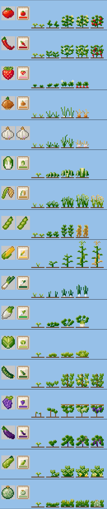

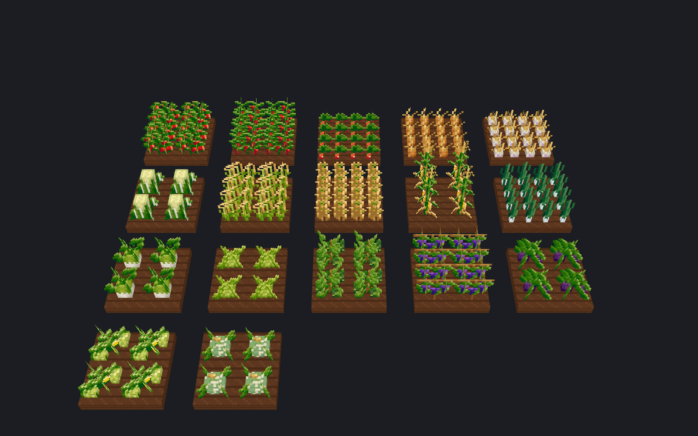

| 작물 | 씨앗 | 수확 뒤 |
|---|---|---|
| 토마토, 고추, 딸기, 상추, 오이, 포도, 가지, 애호박, 멜론 | 관리자 상점 | 그 자리에서 다시 열림 (멜론은 덩굴이 남아 조금 오래 걸림) |
| 양파, 배추, 벼(볍씨), 옥수수, 파, 무 | 관리자 상점 | 수확물에 섞인 씨앗 하나로 바로 다시 심김 |
| 마늘, 콩 | 수확물을 그대로 심음 | 수확물 하나로 바로 다시 심김 |

- **자라는 방식은 바닐라 작물과 같습니다**: 빛 9 이상, 경작지 4칸 안에 물이 있거나 비가 오면 빨리(젖은 경작지), 같은 작물을 줄지어 심으면 빨리, 한 덩어리로 빽빽하면 느리게, 뼛가루를 주면 1단계(저절로 7단계 자랄 때마다 한 번, 한 번까지만 모아 둠, 상점에서 산 뼛가루는 안 됨). 플레이어 근처(시뮬레이션 거리)에서만 자랍니다. 젖은 밭에서 밀과 비슷하게 약 24분 (배추는 조금 빠르고 옥수수는 조금 느림, 다시 열리는 작물은 처음 약 27분(멜론 약 34분, 포도 약 48분), 그 뒤로는 4~7단계마다).
- **다 익은 작물은 우클릭으로 수확**하고 바로 다시 심깁니다. 바닐라 밀·당근·감자·비트도 똑같습니다(웅크리면 원래대로). 씨앗이 안 나왔으면 가방에서 하나 씁니다.
- 수확은 바닐라 작물과 같은 판정을 받습니다: 손에 든 도구의 **행운**(커스텀 작물은 주 수확물 한 개마다 레벨 × 15% 확률로 하나씩 더, 바닐라 작물은 레벨마다 4/7), 수확할 때의 허기, 땅 보호,
  농부의 **직업 경험치**와 수확량 보너스(커스텀 작물은 주 수확물 한 개마다 20→80% 확률로 하나 더, 바닐라 작물은 1→3개 더), Lv10 한 줄(1×3) 수확과 성장 가속, Lv20 3×3 수확, 그리고 특별 재료(산삼·황금 이삭·누에고치: 농부는 훨씬 자주). (바닐라 작물도 수확할 때 경험치 구슬은 나오지 않습니다)
- 상점에서 산 씨앗으로 심은 작물은 덜 자랐을 때 뽑으면 '상점에서 산' 표시가 붙은 씨앗이 나옵니다 (다 익어 수확한 것은 보통 물건).
- 덜 자란 작물을 우클릭하면 몇 단계인지, 빛이 모자란지, 흙이 젖었는지 알려줍니다. 때리면 뽑힘(씨앗 반환). 익은 작물은 때려도 우클릭처럼 수확하고 다시 심깁니다 — 없애려면 한 번 더 때리세요.
  왼쪽 버튼을 누른 채 밭을 쓸면 익은 작물만 차례로 수확되고 덜 자란 것(방금 다시 심은 것 포함)은 그대로 둡니다. 덜 자란 작물은 따로 한 번 클릭해야 뽑힙니다.
- 작물은 **진짜 블록**으로 보입니다(코어 `crops.render: blocks`, 리소스팩이 실(트립와이어) 블록의 상태마다 작물 단계 모양을 그림, 같은 작물도 네 방향 중 무작위로 돌아 서 있음).
  예전 모습(엔티티)과 같은 밝기로 맞춰 두었습니다: `docs/previews/crop_blocks.png`. 클릭 범위는 예전 클릭 상자와 같습니다(작물 아래 경작지 윗면을 눌러도 작물).
  그래서 **실은 블록으로 설치할 수 없습니다**(우클릭해도 아무 일 없고 실도 그대로, 액션바 안내). 실의 다른 쓰임(제작, 활·낚싯대, 양털 등)은 그대로입니다. 자세한 것은 코어 README "작물 블록".
- 크리에이티브 모드: 우클릭 수확은 똑같이 수확물이 나옵니다. 부수면 바닐라처럼 아무것도 나오지 않습니다(커스텀 작물도 같음).
- 작물이 있는 경작지는 밟아도 망가지지 않습니다(바닐라 작물 포함). 남의 땅에서는 심기·뼛가루·수확·뽑기 모두 막힙니다.
- 물뿌리개, 비료, 해충, 시듦, 스프링클러, 화분, 품질 별은 없습니다.

작물 정의는 `contents/economy/crops/crops.yml` (모양 수, 성장 단계 수, 다시 열리는 단계, 키, 수확물). 엔진은 코어 공통 기능이라 다른 콘텐츠도 `crops/*.yml` 만 쓰면 됩니다.
그림은 `tools/assetgen/economy_crops.py` 에 손으로 그린 픽셀 그대로 들어 있고, `python3 tools/assetgen/economy_build.py` 로 텍스처·모델·미리보기(`docs/previews/crops.png`)를 다시 만듭니다
(`--render` 를 붙이면 밭 모습 `docs/previews/crops_3d.png` 도).

모델은 바닐라 작물처럼 경작지에 1픽셀 박혀 서고, 방향별 명암 없이 앞뒤가 같은 그림입니다.

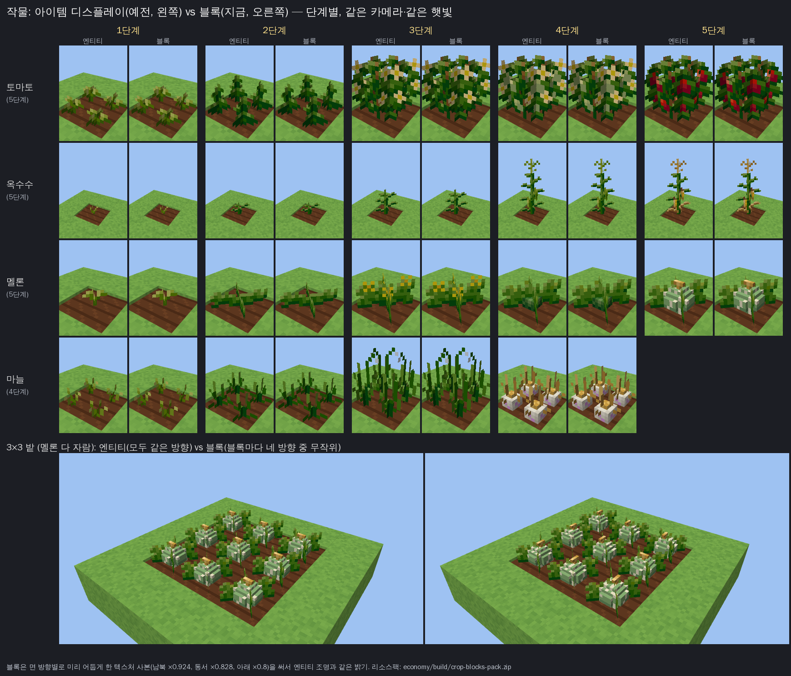

블록 모양은 리소스팩을 만들 때 각 단계의 모델에서 자동으로 만들어집니다(4방향 × 단계). 어느 단계가 실 블록의 어느 상태인지는
`contents/economy/crop-blocks.yml` 에 적혀 있고 **덧붙이기만** 합니다(이미 있는 줄은 고치지 않음: 심어 둔 작물의 모습이 바뀜).
작물이나 단계를 더하면 `python3 tools/assetgen/economy_build.py`(또는 `crop_blocks.py`)가 새 줄을 붙입니다. 상태는 126개(지금 77개 사용).
미리보기 다시 만들기: `cd economy && ./gradlew test` 뒤 `python3 tools/assetgen/crop_blocks.py --preview`.
- 줄지어 자라는 작물(토마토, 고추, 딸기, 양파, 마늘, 벼, 콩, 파, 포도): 밀처럼 # 모양 판 4장. 양파·마늘·파·딸기·콩은 판이 만나는 네 곳에 한 포기씩, 한 칸에 2x2.
- 한 포기씩 서는 작물(배추, 무, 상추, 옥수수, 오이, 가지, 애호박, 멜론): 꽃처럼 대각선 판 2장, 한 칸에 한 포기.
- 무 뿌리, 양파·마늘 알, 파 흰 줄기, 배추 통, 상추 속, 딸기·오이·가지 열매, 땅에 누운 애호박, 그물무늬 멜론은 판에 그리지 않고 입체(상자)로 만듭니다.

오른쪽 사이드바: 잔액, 직업과 레벨(다음 레벨까지 %), 진행 중인 사건과 남은 시간. 경매는 보스바로 보입니다.

## 출발 터미널

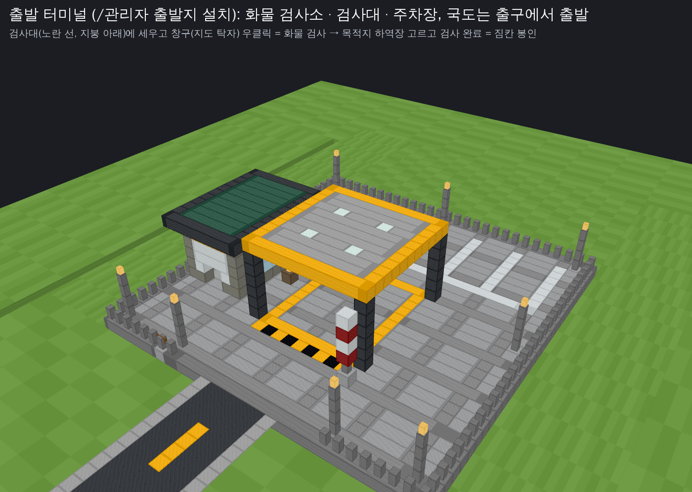

운송은 **출발 터미널**에서 시작합니다. 짐을 싣고 터미널의 **검사대**에 세워 **화물 검사**를 받으면 짐칸이 **봉인**되고, 고른 하역장에 도착해야만 팔립니다. 하역장 판매는 이제 **검사받은 운송만** 됩니다(예전의 "실은 곳에서 6,000블록 + 주행계" 조건을 대신함).

- **검사받기**: 탈것(리어카·기차의 아무 칸 포함)을 **검사대**(노란 선 안, 지붕 아래)에 멈춰 세우고 **화물 검사소 창구**(지도 제작대)를 우클릭, 또는 검사대 안에서 **짐칸을 웅크리고 우클릭**. 지게는 메고 검사대 안에 서서 창구를 우클릭. 짐칸을 열 수 있는 사람(주인, 허락받은 사람, 땅 구성원, 관리자)이 할 수 있습니다.
- **화물 검사** 화면: 짐 목록(하역장이 사는 완제품, 종류별 개수 × 단가 = 합계, 고른 목적지의 매입가로; 고르기 전에는 기본 매입가로), 탈것·주인·무게, 하역장이 사지 않는 칸 수, **목적지 하역장**(같은 월드의 하역장들, 가까운 순: 하역장마다 **매입가(기준가의 몇 %, 따로 정하지 않았으면 "기본")와 이 짐을 거기서 팔면 받을 값**, 터미널에서 직선 거리와 달려야 할 거리, `docks.min-distance` 보다 가까우면 표시; 하나뿐이면 저절로 고름), **짐칸 열기**(봉인 전 마지막 확인), **검사 완료**(고른 하역장과 그곳에서의 값). 누르면 짐칸이 그 사이 바뀌지 않았는지, 아직 검사대 안에 멈춰 있는지, 그 하역장 매입가가 그사이 바뀌지 않았는지(바뀌었으면 다시 검사) 다시 보고 **봉인**합니다: 짐 목록(manifest), 값, 그때의 매입가, 목적지, 그때의 주행계가 DB(`stsv_eco_cargo_trip`)에 남습니다.
- **약속된 값**: 봉인할 때 **그 하역장의 그때 매입가**로 값이 정해집니다. 그 뒤 운영자가 매입가를 바꿔도(`/관리자 하역장 가격`) **이미 봉인된 운송은 봉인 때 값 그대로** 받습니다(검사 완료 버튼·봉인 메시지·봉인된 화물 화면·하역장 판매 화면에 적혀 있음). 바뀐 매입가는 그 뒤 새로 검사하는 짐부터.
- **봉인**: 봉인된 짐칸(지게)은 **열 수 없습니다**(코어의 `cargoSeal`: 짐칸·지게를 열면 "검사필 화물: 봉인됨"). 짐이 있으니 회수도 안 됩니다. 재시작·청크 언로드·도중에 세워 두기에도 봉인은 그대로. 길에서 **짐칸을 웅크리고 우클릭**하면 봉인된 화물 화면(목적지, 짐, 값, 달린 거리)이 열리고 **주인은 운송 취소**를 할 수 있습니다(무효가 되고 봉인이 풀림).
- **사지 않는 물건**: 같이 실어도 되지만 값은 없습니다(원재료·도구를 일부러 빼지 않아도 되게. 검사 화면에 칸 수로 보이고, 함께 봉인되었다가 판 뒤 짐칸에 남음).
- **도착**: 목적지 하역장의 하역 구역에서 판매(아래 "하역장"). 조건: ① 그 하역장으로 봉인된 운송, ② 짐이 봉인 때와 같음(짐이 바뀐 시각과 짐 목록을 다시 확인, 다르면 **운송 무효**·봉인 풀림), ③ 검사 뒤 달린 거리(주행계)가 **터미널→하역장 직선의 80% 이상**. 값은 **검사 때 보인 값** 그대로, **목록에 있는 것만** 빠지고 돈은 탈것 주인에게. 판매 기록(`stsv_eco_dock_sale`)의 거리 = 터미널→하역장 직선, 주행 = 검사 뒤 달린 거리.
- **여러 곳**: 터미널은 여러 개 지을 수 있고(각자 서버 땅), 운송마다 출발 터미널과 목적지 하역장이 정해집니다.
- 배(통통배)는 아직 검사대에 들어갈 수 없습니다(항구형 터미널은 나중에).

**짓기 (운영자)**: 출발지로 쓸 곳에서 **안쪽(검사대 쪽)을 보고** `/관리자 출발지 설치 본사`. 29×30블록 바닥(아래는 땅까지 돌, 위 14블록은 비움), 화물 검사소(창·창구·표지판), 검사대(노란 선, 정지선, 지붕과 조명, 출구 쪽 차단기), 뒤쪽 주차장(흰 칸), 가로등, 울타리, 출구(앞 가운데, 폭 13), 출구 옆 표지판과 떠 있는 이름. 닿는 청크는 서버 땅, DB(`stsv_eco_terminal`)에 남음. **국도 기준점이 그 출구로** 바뀌어, 다음 `/관리자 국도 <하역장>` 은 출구에서 곧게 20블록 나간 뒤 길을 찾습니다. 하역장과 `docks.min-distance`(6,000)보다 가까우면 경고(터미널·하역장 어느 쪽을 지어도). `목록` · `제거 <이름>`(기록·서버 땅·장식만, 지형은 그대로) · `다시꾸미기 <이름>`(땅은 그대로 블록·모델만 다시).
미리보기: `cd economy && ./gradlew test` (TerminalTest 가 `economy/build/docks/terminal.json` 을 씀) 뒤 `python3 tools/assetgen/terminal_preview.py` → `docs/previews/terminal.png`.

## 하역장

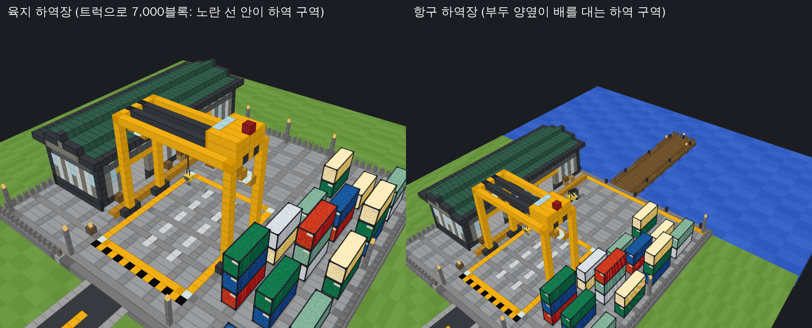

출발 터미널에서 멀리(약 7,000블록, 트럭으로 편도 15분쯤) 운영자가 지은 **하역장**에 **검사받고 봉인해 실어 온 완제품**을 팝니다(위 "출발 터미널"). 겉날개를 막지 않아도 되는 이유: **탈것 짐칸(또는 지게)에 든 짐만** 셉니다.

- **사는 것 = 완제품**: 직업 기계(압착기 포함)의 레시피가 만드는 것 중 상점이 사는 것(`machines.yml` 의 결과 ∩ `shop.yml` 판매, 지금 148종. 예전 손질감은 빠짐). 광석·작물·물고기·원목·전리품·발견품·특별 재료 같은 **원재료는 사지 않습니다**. 레시피를 더하면 저절로 따라옵니다(`DockGoods`, `DockTest` 가 실제 콘텐츠로 확인). 상점에서 산 표시가 있거나 이름을 바꾼 물건도 사지 않음(상점 판매와 같은 규칙).
- **값 = 기준가 × 그 하역장의 매입가**: 하역장마다 운영자가 정합니다(`/관리자 하역장 가격 <이름> <퍼센트>`, 기준가의 1~300%: 가까운 곳은 조금 싸게, 먼 곳은 웃돈). 따로 정하지 않은 하역장은 **기본 매입가** `config.yml docks.price-ratio`(기본 0.9 = 90%), `기본` 으로 되돌림. 운송은 **봉인 때의 매입가로 정한 값**을 받습니다(위 "약속된 값"). 그 밖에는 **고정**: 수요 고시·사건·고가 매입상과 상관없고, 내가 상점에 판 양(곡선)도 보지 않고, 하역장에 판 것은 **상점 곡선·시장가·판매 소득세·주식 활동 어디에도 들어가지 않습니다**. 하루 한도도 없습니다. 판 돈은 `dock_sell` 로 기록되는 서버 수입(순위의 "번 돈"에는 들어감).
- **조건**: 출발 터미널에서 **이 하역장으로 검사·봉인된 운송**이고, 짐이 봉인 때 그대로(다르면 운송 무효), 검사 뒤 **달린 거리가 터미널→하역장 직선의 80% 이상**(위 "출발 터미널"). `docks.min-distance`(기본 **6,000**블록)는 이제 터미널과 하역장 사이의 최소 거리(설치 때 경고). 탈것은 짐이 있으면 아이템으로 회수할 수 없어 짐이 순간이동할 수 없고, 지게는 입은 사람이 걸은 거리(다른 곳에서 다시 입으면 짐이 바뀐 것으로 봄). 코어 README "적재 무게 · 하역장".
- **어디서**: 탈것(리어카·기차의 아무 칸·배 포함)이 **하역 구역**(바닥의 노란 선 안, 항구는 부두 양옆의 물도) 안에 멈춰 있을 때 **짐칸을 웅크리고 우클릭**, 또는 구역 앞 왼쪽의 **하역 창구**(지도 제작대)를 우클릭(구역 안에서 내가 쓸 수 있는 가장 가까운 탈것, 지게를 지고 구역 안에 서 있으면 그 지게). 지게는 구역 안에서 웅크리고 빈손 우클릭.
- **하역장 판매** 화면: 팔 물건(종류별 개수 × 단가 = 합계, 봉인 때의 매입가로), 탈것·주인, 검사 정보(출발 터미널 → 하역장, 검사 뒤 달린 거리와 필요한 거리), 짐 무게, 사지 않고 남는 칸, 이 하역장의 지금 매입가(기준가의 몇 %, "기본" 표시)와 "이 짐은 봉인 때 정한 값 그대로", **판매 확정**(검사 때의 값, 조건이 안 되면 회색 + 이유: 검사 안 받음 · 다른 하역장 · 짐이 다름 · 거리 모자람), 닫기. 확정하면 그 사이 짐칸이 바뀌지 않았는지, 아직 구역 안인지, 목록이 봉인 때와 같은지 다시 보고, 목록의 완제품만 짐칸에서 빼고 돈을 냅니다(사지 않는 물건은 짐칸에 남고 봉인이 풀림).
- **누가 팔고 누가 받나**: 짐칸을 열 수 있는 사람(주인, `/탈것 권한` 으로 허락받은 사람, 주인이 사는 땅의 구성원, 관리자)이 팔 수 있고, **돈은 언제나 탈것 주인에게** 갑니다(짐은 주인 것: 운전만 맡긴 사람이 돈을 가져가지 않음). 주인이 접속해 있으면 누가 얼마에 팔았는지 알림. 지게는 지고 있는 사람.
- **부정 방지**: 인벤토리에서는 못 팖(짐칸만). 검사받지 않은 짐은 안 됨. 봉인된 짐칸은 열 수 없고, 짐이 봉인 때와 다르면(짐이 바뀐 시각 또는 목록) 무효. 터미널에서 검사한 뒤 순간이동하면 주행계가 모자람. 지게를 진 채 순간이동(명령어·`/tpa`·진주, 8블록 넘게)하거나 다른 월드로 가면 그 자리에서 **운송이 바로 무효**(봉인 풀림, 안내). 봉인할 때 그 짐칸(지게)을 열어 두고 있던 사람의 화면은 먼저 닫히고, 그사이 짐이 바뀌었으면 봉인하지 않음. 짐이 있으면 회수 불가(짐째 순간이동 불가). 모든 판매는 DB(`stsv_eco_dock_sale`: 시각, 하역장, 탈것, 주인, 판 사람, 물건, 금액, 거리, 주행계)와 서버 로그에 남음: `/관리자 하역장 기록 [이름]`.

**하역장 짓기 (운영자, 명령어만으로)**

0. 먼저 출발 터미널(`/관리자 출발지 설치`) 또는 국도 기준점(`/관리자 국도 기준점 설정`)을 정합니다. 없으면 건축월드 스폰에서 잽니다.
1. `/관리자 하역장 후보 7000`: **국도 기준점**(없으면 건축월드 스폰, 메시지에 어느 쪽인지 나옴)에서 7,000블록 떨어진 8방향을 살핍니다(청크를 비동기로 몇 개씩(`docks.scout-concurrent` 4, 접속자가 있으면 `scout-concurrent-online` 2) 불러와 높이 지도를 읽음: 새 땅이면 생성. 서버가 바쁘면(`docks.max-mspt`) 쉬었다 감. 몇 분 걸리고 진행이 채팅에). 방향마다 **물을 건너는 횟수·물 위 거리·가장 긴 물·가파른 곳 %·오르내림·터 높낮이·육지/항구 가능**을 좋은 순으로 보여 줍니다.
2. 고른 곳으로 가서 **입구에서 안쪽을 보고** 섭니다(항구는 물가에서 물을 보고). `/관리자 하역장 설치 서해 항구` (또는 `육지`).
   그 자리를 기준으로 45×42블록(항구는 부두까지 69블록 길이) 바닥을 고르고(아래는 땅까지 돌로 채움, 위 22블록은 비움), 창고·하역대·갠트리 크레인·컨테이너 야적장·가로등·울타리·하역 구역 노란 선·입구 표지판·떠 있는 이름, 항구는 나무 부두(기둥은 바닥까지, 배 대는 틈 3곳씩)를 짓습니다. 지어 놓은 것(바닥·창고·크레인·가로등)은 블록, 옮겨 다니는 것(크레인 갈고리·지게차·짐 팔레트·**컨테이너 전부**)은 디스플레이 모델(`tools/assetgen/models/docks.py`). 컨테이너는 한 모델(골판 벽, 모서리 주물, 2×6×2.5블록)의 여섯 색, 2.5블록 간격으로 1~3단 쌓고, 안에 **보이지 않는 벽(barrier)**을 그 높이까지 채워 사람도 탈것도 지나가지 못함. 한 틱에 `docks.build-blocks-per-tick`(1,000)블록씩(기초 기둥은 채운 칸마다 셈) 나눠 놓아 서버가 멈추지 않고, 서버 평균 틱 시간이 `docks.max-mspt`(35 ms) 이상이면 그 틱엔 쉼(80% 이상이면 절반만).
   하역장이 닿는 청크는 **서버 땅**이 됩니다(플레이어 땅이 끼어 있으면 짓지 않음). 하역장은 DB 에 남고 재시작해도 그대로.
3. `/관리자 국도 서해`: 아래 "국도". 끝.
4. (원하면) `/관리자 하역장 가격 서해 110`: 이 하역장만 매입가를 따로(먼 곳 웃돈, 가까운 곳 `95` 처럼). 안 하면 기본 매입가.
- `/관리자 하역장 다시꾸미기 <이름>`: 이미 지은 하역장의 장식만 지금 모습으로(땅을 고르거나 기초를 다시 놓지 않음): 예전 블록 컨테이너를 치우고, 그 하역장의 블록을 다시 놓고, 컨테이너(모델 + 보이지 않는 벽)·지게차 같은 모델과 떠 있는 이름을 새로 세움.
- `/관리자 하역장 가격 <이름> <퍼센트>`: 그 하역장의 매입가(상점 기준가의 1~300%, `95`, `110` 또는 `110%`). `가격 <이름> 기본` = 기본 매입가(`docks.price-ratio`)로 되돌림, `가격 <이름>` = 지금 매입가 보기. DB(`stsv_eco_dock.price_pct`, 비어 있으면 기본)에 남아 재시작해도 그대로. 이미 봉인된 운송은 봉인 때 값 그대로(메시지에 그 건수).
- `/관리자 하역장 목록` (이름, 종류, **매입가**(몇 %, 따로 정하지 않았으면 "기본"), 위치, 기준점(없으면 스폰)에서 거리, **출발 터미널마다 직선 거리**) · `제거 <이름>`: 기록을 지우고 그 하역장이 서버 땅으로 만든 청크를 풀고 장식(디스플레이)과 그 하역장 국도의 표지판을 치웁니다. **지형과 블록은 되돌리지 않습니다**(필요하면 손으로 치우기).
- 미리보기: `cd economy && ./gradlew test` (DockTest 가 구조를 `economy/build/docks/*.json` 으로 씀) 뒤 `python3 tools/assetgen/dock_preview.py` → `docs/previews/docks.png`.

## 적재 무게

탈것(과 지게)은 **무게만큼만** 싣습니다. 무게는 `contents/economy/weights.yml`. **진짜 무게는 하역장이 사는 것(완제품, 위 "하역장")만** 있고, 원재료는 아주 가볍습니다. 규칙은 하나:

> **완제품은 무게 1 에 약 500 G.** 완제품 1개의 무게 = 기본 매입가 ÷ 500 = 상점 기준가 × 기본 `docks.price-ratio`(0.9) ÷ `finished-value-per-weight`(500).

- **기본 매입가로만** 셉니다. 하역장마다 따로 정한 매입가(`/관리자 하역장 가격`)는 무게에 쓰지 않아서, 어느 하역장으로 가든 물건의 무게는 같습니다(웃돈 주는 하역장은 무게 1 에 그만큼 더 받음: 110% 면 약 611 G).
- 비싼 것은 무겁고 싼 것은 가볍습니다. 그래서 **어떤 완제품을 싣든 payload P 로 한 번에 실어 갈 수 있는 값은 최대 약 P × 500 G** 이고, 탈것을 고르는 것은 물건이 아니라 얼마나 실어 가고 싶은지입니다.
- 아주 싼 것도 0.001 보다 가볍지는 않습니다(지금은 걸리는 완제품 없음). 위로는 제한 없음.
- 물건마다 따로 정하려면 `weights.yml` 의 `items` 에(완제품만, `DockTest` 가 확인). 기본은 비어 있습니다.
- **원재료** (`raw`): 완제품이 아닌 모든 것. 작물·씨앗·잡은 물고기(큰 물고기도)·광석·원석·보석 원석·바닐라 다이아몬드·에메랄드·진주·원목·판자·돌·흙·바닐라 블록·전리품·바닐라 도구와 갑옷: **1개 1/64, 64개 한 묶음 = 1**.
- **중간재도 하역장이 사면 완제품**: 밀가루·세공한 보석·강철 괴처럼 다른 레시피의 재료로도 쓰이는 것도 상점이 사는 기계 생산품이라 하역장이 사므로 진짜 무게(레시피를 더하거나 기준가를 바꾸면 무게도 저절로 따라옴).

| 완제품 (기준가 → 매입가 90%) | 예전 무게 | 예전 무게 1 에 | 지금 무게 | 지금 무게 1 에 |
|---|---|---|---|---|
| 연마 진주 (179 → 161.1 G) | 0.2 | 805 G | 0.32 | 500 G |
| 루비 반지 (231 → 207.9 G) | 0.3 | 693 G | 0.42 | 500 G |
| 보석 왕관 (2,836 → 2,552.4 G) | 0.5 | 5,105 G | 5.1 | 500 G |
| 김치 (77 → 69.3 G) | 1 | 69 G | 0.14 | 500 G |
| 참나무통 (151 → 135.9 G) | 5 | 27 G | 0.27 | 500 G |
| 석등 (68 → 61.2 G) | 8 | 8 G | 0.12 | 500 G |

- 묶음은 개수만큼(연마 진주 64개 = 20.6), **셜커 상자·번들은 안에 든 것까지** 그것의 무게로(상자 자체는 원재료: 작물 27묶음이 든 셜커 상자 ≈ 27). 탈것마다의 최대(payload)는 코어 README "적재 무게 · 하역장".
- 무게는 1 아래면 소수 둘째 자리까지(0.32), 그 위는 첫째 자리까지 보여 줍니다.

넣으려는 물건이 최대를 넘으면 짐칸이 받지 않고 "너무 무거워요: 지금 / 최대 (넣으려는 무게, 더 실을 수 있는 무게)" 안내. 짐칸 화면 가운데 상자 칸에 무게 지금/최대.

**한 번에 실어 갈 수 있는 값** (기본 매입가, 무게가 먼저 찰 때. `DockTest` 가 확인. 매입가를 따로 정한 하역장은 그 비율만큼):

| 탈것 (payload) | 한 번에 최대 |
|---|---|
| 지게 30 | 15,000 G |
| 짐자전거 20 | 10,000 G |
| 배달 오토바이 60 | 30,000 G |
| 리어카 150 | 75,000 G |
| 소달구지 400 | 200,000 G |
| 경운기 500 | 250,000 G |
| 밴 600 | 300,000 G |
| 통통배 800 | 400,000 G |
| 1톤 트럭 1,000 | 500,000 G |
| 트랙터 2,000 | 1,000,000 G |
| 탑차 2,500 | 1,250,000 G |

예: 배달 오토바이(60)에 연마 진주 186개(무게 59.9) = 29,964 G, 석등이면 490개(무게 60) = 29,988 G: 예전에는 진주가 오토바이로 약 48,000 G, 석등은 7개뿐(약 430 G)이었습니다. 1톤 트럭에 참나무통 3,679개 = 499,976 G, 탑차에 김치 18,037개 = 1,249,964 G.

**싼 완제품은 무게보다 칸이 먼저 찰 수 있습니다**: 한 개 매입가가 payload × 500 ÷ (칸 수 × 64) 보다 싸면 짐칸을 64개 묶음으로 다 채워도 무게가 남습니다(리어카 135칸 약 8.7 G, 1톤 트럭 450칸 약 17 G, 탑차 720칸 약 27 G 아래). 예: 씨앗 기름(매입가 7.2 G, 무게 0.014)은 리어카에 135묶음 8,640개를 다 실어도 무게 124.4 · 62,208 G.

**원재료는 짐칸 칸 수가 한계** (64개 묶음, 원재료 1묶음 = 1). 칸보다 최대가 작은 짐자전거(27칸, 20)와 지게(54칸, 30)만 원재료도 무게가 먼저 찹니다.

| 탈것 (칸 · 최대) | 작물 | 한계 |
|---|---|---|
| 지게 (54칸 · 30) | 30묶음 (1,920개) | 무게 |
| 짐자전거 (27칸 · 20) | 20묶음 (1,280개) | 무게 |
| 배달 오토바이 (54칸 · 60) | 54묶음 | 칸 |
| **리어카 (135칸 · 150)** | **135묶음 (8,640개)**, 무게 135 | 칸 |
| 경운기 (360칸 · 500) | 360묶음 (23,040개) | 칸 |
| 1톤 트럭 (450칸 · 1000) | 450묶음 (28,800개) | 칸 |
| 트랙터 (720칸 · 2000) | 720묶음 | 칸 |

## 국도

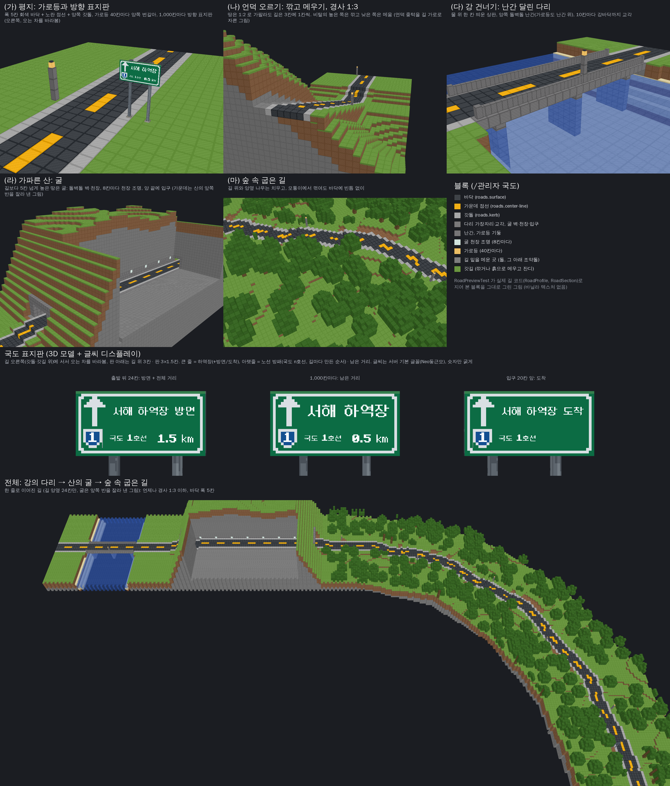

`/관리자 국도 <하역장>`: **국도 기준점**(없으면 건축월드 스폰)에서 하역장 **입구(정문)까지** 길을 놓습니다. `여기서` = 지금 서 있는 곳에서, `기준점` = 반드시 기준점에서(없으면 알려 줌). 출발점은 메시지에 나옵니다. 시간을 나눠 조금씩 하고, 진행은 액션바와 `/관리자 국도 상태`, 멈추기는 `/관리자 국도 중지`(다시 `/관리자 국도 <하역장>` = 이어서, `새로` = 처음부터). 짓던 길은 `plugins/STSV-Economy/roads/<하역장>.txt` 에 저장되어 **서버를 다시 켜도 이어집니다**. 한 번에 길 하나.

- **기준점**: `/관리자 국도 기준점 설정` = 지금 자리(월드, x, y, z)를 도로망의 출발점으로(`roads/origin.txt`), `보기`, `초기화`(다시 스폰). `/관리자 하역장 후보 <거리>` 도 여기서 잽니다. 출발 터미널을 지으면 기준점이 그 출구로 바뀌고, 길은 출구에서 곧게 20블록 나간 뒤 길을 찾습니다.
- **입구까지**: 길은 하역장 앞 20블록에서 입구로 곧게 들어가 **입구 가장자리(하역장 바닥 높이)**에서 끝납니다. 마지막 16블록은 양쪽 2칸씩 넓어지고, 입구 6~8블록 앞에 **횡단보도**, 11블록 앞에 바닥 글씨 **"하역장 입구"**(누운 글씨 디스플레이), 마지막 3블록의 갓길은 하역장 바닥처럼 포장되어 바닥과 이어집니다.
- **`/관리자 국도 <하역장> 이어짓기`**: 다 짓지 못한 길은 멈춘 곳에서 이어서, **이미 다 지은 길이 입구에 못 미쳐 끝났으면**(예전 길은 입구 6블록 앞, 땅 높이에서 끝남) 그 길의 끝 16블록 앞부터 입구까지만 짧은 길(`roads/<하역장>.tail.txt`)로 다시 이어 짓습니다(나머지 길은 그대로, 같은 노선 번호·표지판 묶음). 이미 닿아 있으면 그렇다고 알림.

- **보호 (길이 건물을 부수지 않게)**: 길은 아래 세 곳을 **지나가지도, 깎지도, 메우지도, 블록을 놓지도** 않습니다.
  - **개인 땅** (플레이어가 산 땅).
  - **서버 땅** (스폰 마을 등 `/관리자 땅 서버` 로 잡은 곳). 예외는 **그 길의 하역장 청크**와 **출발한 출발 터미널 청크**뿐(입구에 닿고 출구로 나가야 하니까). 다른 하역장·터미널 청크도 서버 땅이라 피함.
  - **`roads.avoid`** (config): 땅 없이 지은 지킬 건물을 상자(world, x1, z1, x2, z2, 높이는 전부)로 적음. 길 찾기는 상자가 닿는 청크를 통째로 피하고, 짓기는 상자 안 칸을 건드리지 않음. `/관리자 리로드` 로 적용.
  - 길 찾기는 이 땅을 막힌 칸으로 보고 돌아가며, 그다음 **길 바닥·갓돌이 닿을 칸을 블록 단위로 다시 확인**(곧게 편 길이 보호 칸에 너무 붙으면 덜 펴거나 청크 가운데로만 지나게 다시 그림). 돌아갔으면 "보호된 땅을 피해 돌아가요 (개인 땅 a · 서버 땅 b · 보호 구역 c청크, 약 X → Y블록, +n%)", 보호된 땅 때문에 길이 없으면 막힌 청크 수와 예시 좌표, **출발점이 스폰 마을 안**이거나 터미널 출구 앞 20블록·하역장 입구 앞 20블록이 보호된 땅이면 그 좌표를 알려 주고 멈춤(그 땅을 비우거나, 기준점을 땅 밖에 두거나, `여기서`). 지은 뒤에 땅이 생겨 바닥이 닿으면 그 자리에서 멈추고 무슨 땅인지 알림. 갓길 칸만 닿으면 그 칸만 건너뜀. 표지판 기둥·난간 잇기도 보호된 칸에는 하지 않음.
  - 건축월드 스폰이 스폰 마을(서버 땅) 안이면 기준점 없이 지은 길은 출발하지 못합니다: 출발 터미널을 짓거나(출구는 터미널 청크라 괜찮음) 기준점을 마을 밖에 두세요.
- **미리보기: `/관리자 국도 <하역장> 미리보기 [기준점|여기서]`**: 짓지 않고 **지형 살피기 + 길 찾기**만, 그다음 길 둘레 청크를 몇 개씩 불러와(이미 만들어진 청크, 서버가 바쁘면 쉼) 길 아래 땅 높이를 읽고 둘레를 살핌. 끝나면:
  - **입자**: 길 가운데 선을 60초 동안, 관리자 둘레 200블록 안만(관리자에게만 보임). 노랑 = 길, 하늘색 = 다리, 주황 = 굴, 빨간 기둥 = 경고 자리.
  - **요약**(채팅): 길이, 꺾이는 곳, 지나는 청크 수, 다리·굴 수와 길이, 깎기·메우기 블록 어림(폭 11칸으로: 갓길까지), 굴 파는 양, 길에서 16블록 안의 개인 땅·서버 땅 청크 수(이 하역장·터미널 청크는 뺌), 돌아간 까닭(위 "보호").
  - **경고**: 길 바닥·갓길과 그 둘레 3블록(가운데에서 10.5블록까지), **땅 밖**(어느 땅도 아니고, roads.avoid 도 아니고, 이미 있는 국도도 아닌 곳)에서, 각 칸의 맨 위 블록부터 24블록 아래까지 **사람이 놓는 블록**을 셈: 판자, 유리·유리판, 침대, 문, 상자·통, 제작대, 화로·용광로·훈연기, 카펫(이끼 카펫 빼고), 횃불, 랜턴, 양털, 벽돌(돌벽돌 등 포함), 콘크리트, 테라코타(배드랜드에서는 땅이라 뺌, 유약 테라코타는 셈), 계단·반 블록, 표지판. **자연 구조물은 뺌**: 서버가 아는 그 청크의 생성 구조물 조각(마을 집, 폐허, 폐광, 난파선, 이글루, 전초기지 등: `Chunk#getStructures` 의 조각 상자 +1칸) 안의 블록은 세지 않음. 한 청크에서 **6개 이상**이면 "땅 없이 지은 건물로 보이는 곳": 그 블록들의 가운데 좌표, 개수, 많은 종류 셋, 출발에서 몇 블록인지(가까운 순, 12곳까지, 나머지는 수와 서버 로그). 횃불 몇 개·표지판 하나는 문턱 아래라 빠지고, 마을 집 안에 사람이 지은 것은 놓침.
  - 미리 본 길은 `roads/<하역장>.preview.txt` 에 저장. **60분 안에** 같은 출발점(기준점·스폰·`여기서` 자리, 터미널 출구)과 같은 하역장 입구로 `/관리자 국도 <하역장>`(또는 `기준점`·`여기서`·`새로`)을 하면 **다시 살피지 않고 그 길로** 청크 만들기부터 시작(그사이 땅이 생겨 길이 보호 칸에 닿으면 처음부터 다시 살핌). 멈췄던 길이 있으면 그냥 `/관리자 국도 <하역장>` 은 그 길을 잇고, 미리 본 길로 지으려면 `새로`.
- **되돌리기: `/관리자 국도 <하역장> 되돌리기`**: 길이 바꾼 **모든 블록의 원래 상태**를 지으면서 적어 두었다가(`roads/<하역장>.undo`, 이어짓기 길은 `.tail.undo`) **최근 것부터 거꾸로** 되돌림. 청크를 몇 개씩 불러오며 한 틱에 `roads.blocks-per-tick` 블록, 서버가 바쁘면(`roads.max-mspt`) 쉼. 진행은 액션바, 멈추기 `/관리자 국도 되돌리기 중지`(다시 하면 남은 것부터: 이미 되돌린 블록은 "이미"로 셈).
  - **그사이 플레이어가 바꾼 블록은 덮어쓰지 않음**: 지금 블록이 길이 놓은 것과 다르면 건너뛰고 셈(같은 블록인데 상태만 다른 것, 예: 담이 이웃과 이어짐·눈 덮인 잔디, 그리고 길이 비운 자리로 흘러든 물·용암은 길의 것으로 보고 되돌림). 건너뛴 곳 몇 개는 서버 로그에.
  - **상자 등**: 길이 치운 상자·통·화로·셜커 상자 등의 **안의 물건도 저장**(로그에 남음)했다가 되돌릴 때 다시 넣음. 표지판 글씨·깃발 무늬 같은 다른 블록 데이터와 엔티티(그림·액자)는 되돌리지 않음.
  - 다 되돌리면 그 길의 **표지판·바닥 글씨를 치우고**, 길 기록은 노선 번호와 표지판 묶음 번호만 남긴 빈 기록이 되어(도로망·안내판·눈 막기에서 빠짐) 이어짓기 길·되돌리기 기록·미리보기도 지움. 다른 길에 선 이 길 안내는 `/관리자 국도 표지판 다시세우기 전체` 로 새로.
  - **이 기능 전에 지은 길은 기록이 없어 되돌릴 수 없음**(그렇다고 알려 줌). 같은 하역장 길을 처음부터 다시 지으면 예전 길의 기록은 지워짐(되돌릴 수 있는 건 마지막 길). 짓다가 서버가 꺼지면 마지막 저장(10초쯤) 뒤의 몇 블록은 기록에서 빠질 수 있음. 다 지은 뒤 세운 안내판 받침도 그 길 기록에 붙음. 난간고치기로 넣은 받침은 기록하지 않음.
  - 크기: 기록은 묶음마다(저장할 때마다, 5만 블록마다) 팔레트 + 좌표 차이 varint + gzip 으로 파일 끝에 덧붙임(메인 스레드 밖). 7천 블록 길에서 칸마다 40블록씩 바뀐 364만 블록이 약 1.5 MB(블록당 0.4바이트, `RoadUndoTest`).

1. **지형 살피기**: 출발점과 하역장을 잇는 직선 양옆 `roads.corridor`(6)청크 안의 청크를 비동기로 몇 개씩(`roads.concurrent` 4, 접속자가 있으면 `roads.concurrent-online` 2) 불러와 높이 지도(땅 높이, 물 깊이, 울퉁불퉁함, 보호된 땅인지)를 읽음.
2. **길 찾기**: 청크 한 칸씩 A*: 거리 + 오르내림(조금) + 경사 1/3을 넘는 높이(많이: 깎고 메우거나 굴을 팔 만큼) + 울퉁불퉁함 + 물(건너는 값 + 깊이). **보호된 땅(개인 땅·서버 땅·roads.avoid, 위 "보호")은 들어가지도 모서리를 스치지도 않음**(길 찾기 직전에 땅을 다시 읽음). **이미 있는 국도**(다른 하역장 길)를 따라가는 칸은 비용 1/5, 그 옆 칸은 더 비쌈: 같은 기준점에서 나가는 길은 줄기를 따라가다 **갈라져 나가고**(따라가는 부분은 새로 짓지 않음, 줄기의 가로등에서 8칸 이상 떨어진 곳에서 갈라짐), 나란히 달리지 않음. 그다음 비용이 늘지 않는 곳은 곧게 폄.
3. **청크 만들기**: 길과 둘레 `roads.pregen-radius`(2)청크를 미리 생성하고 길 아래 땅 높이를 읽음.
4. **짓기**: 폭 5칸 바닥(`roads.surface` 회색 콘크리트, 군데군데 2×2 로 기운·금 간 자리) + 가운데 노란 점선(`roads.center-line`) + 양쪽 **흰 가장자리 선**(`roads.edge-line` 매끄러운 석영) + 갓돌(`roads.kerb`) + 갓길 2칸(갓돌 옆 흙길 한 줄과 잔디: 12칸마다 **배수구**(철 다락문), 20칸마다 **반사 기둥**, 땅보다 3칸 넘게 높이 쌓은 곳은 **가드레일**(안산암 담)). 높이는 땅을 따르되 **경사는 3칸에 1칸까지**, 높이는 **반 칸 단위**: 반 칸 오르내림은 **반 블록**(바닥은 심층암 타일 반 블록, 흰 선은 석영 반 블록, 갓돌은 매끄러운 돌 반 블록, 노란 선은 반 블록이 없어 그 칸만 바닥 반 블록)이라 탈것이 덜컹이지 않고 미끄러지듯 오르내림. 높이는 길 전체를 한꺼번에 보고 깎고 메우는 양이 가장 적게 고름. 깎은 곳은 위로 남는 흙 없이 하늘까지, 메운 곳은 갓길까지 땅에 닿게. 물과 골짜기(길보다 4칸 넘게 낮은 곳)는 **난간 달린 다리**(10칸마다 교각, 16칸마다 신축 이음(현무암 줄), 상판 양쪽 가장자리는 반 칸 높이에서도 **돌벽돌 온 블록 받침**이라 난간·가로등이 그 위에 서서 반 블록 위에 떠 있지 않음), 가파른 언덕(길보다 5칸 넘게 높은 곳)은 **굴**(돌벽돌 천장(평지에서 바닥 위 4칸 비움, 오르내리는 곳은 더 높게: 아래 "높이 여유"), 벽은 회색 아랫단·흰 띠·노란 줄, 8칸마다 천장에 묻힌 등과 벽 등, 양 끝에 입구), 길 위와 양옆 나무는 치움, **가로등**은 `roads.light-every`(40)칸마다 양쪽 번갈아: 갓길의 돌벽돌 받침(아래가 비면 땅까지) 위 기둥에서 **팔이 가장자리 차로 위로 나와 등이 매달림**(등 아래 평지에서 4칸 비움, 비탈에서는 굴 천장처럼 더 높게, 표지판이 선 곳에서는 반대쪽), 담·울타리는 이웃과 이어 놓음. 땅의 칸마다 가장 가까운 길 지점 하나가 맡아서, 대각선·굽은 곳에서도 바닥에 빈틈이나 겹침이 없음. 한 틱에 `roads.blocks-per-tick`(800)블록(난간 잇기·표지판도 셈; 한 단면이 그보다 크면 다음 틱들이 쉼). 살피기·청크 준비·짓기·표지판 다시세우기·난간고치기·터널보수는 서버 평균 틱 시간이 `roads.max-mspt`(35 ms) 이상이면 그 틱엔 쉬고 80% 이상이면 절반만. 길 파일(`roads/*.txt`)은 메인 스레드 밖에서 저장.
   **보호된 땅은 건드리지 않습니다**(위 "보호"): 길 옆(갓길) 칸이 보호된 땅이면 그 칸만 건너뛰고, 길 바닥이 닿으면(계획 뒤에 누가 땅을 샀을 때) 멈추고 알림(`새로` 로 다시 찾기). 바꾼 블록은 모두 되돌리기 기록에(위 "되돌리기").
   **다른 국도는 건드리지 않습니다**: 다른 길의 차로·갓돌은 그 아래 메운 곳부터 가로등 높이까지 그대로 두고(깎지도 메우지도 않음), 그 가로등도 그대로, 새 길의 가로등·표지판은 다른 길의 차로에 서지 않음. 만나는 곳의 높이가 경사 안에서 맞출 수 있으면(2칸 이내) **평면 교차로**: 다른 길의 차로는 그대로, 새 길이 지나는 그 갓돌·갓길만 같은 높이로 포장, 새 길의 가운데 선은 교차로 앞에서 멈추고, 모서리를 넓히고, 양쪽에 횡단보도(안내 표지판은 아래 "길 안내"). 맞출 수 없으면 **입체 교차**: 새 길이 다른 길 표면(건너는 곳 앞뒤 14칸 안에서 가장 높은 곳)보다 7칸 위로 다리로 넘어감(아래 6칸 이상 비움, 교각은 다른 길 밖). 길마다 다 지은 높이를 `roads/<하역장>.txt` 에 남겨 다음 길이 압니다(예전 길은 저장된 땅 높이로 다시 계산).
- **방향 표지판**: 고속도로 안내판 느낌의 우리 디자인(공식 도안 아님). 3D 모델(`economy:model/road_sign`, `tools/assetgen/models/roads.py`, 팩에서 면 58개): 회색 강철 기둥 둘(콘크리트 받침), 폭 3 · 높이 1.5칸 초록 판에 흰 테두리, 흰 화살표(↑), 파란 노선 방패, 뒤에 강철 받침틀과 가로대. 글씨는 판 앞의 글씨 디스플레이(서버 기본 글꼴 Neo둥근모, 흰색, 숫자만 굵게, 밤에도 밝게): 큰 줄 `서해 하역장`, 아랫줄 왼쪽 방패 안 노선 번호와 `국도 1호선`(작게), 오른쪽 `6.0 km`(남은 길, 0.1 km 단위). 길이에 맞게 글씨 크기를 줄여 판 안에 들어감(`RoadSign`).
  - 어디에: 출발 24칸 뒤 `서해 하역장 방면 7.0 km`(전체 길이), `roads.marker-every`(1,000)칸마다 남은 거리, 입구 20칸 앞 `서해 하역장 도착`. 다리·굴 위면 다음 평지로 옮기고, 서로 150칸 안이면 km 표지판은 생략. **길 오른쪽**(출발에서 오는 차 기준, 갓돌·갓길 위: 길 가운데에서 2.5~5.5칸)에 서서 오는 차를 바라봄. 판 아래는 길 위 3칸이라 차선 위로 걸리는 것이 없음. 기둥이 보호된 땅이나 다른 길의 차로에 서야 하면 그 표지판은 없음.
  - **뒷면**: 판 뒤는 판만 한 **강철 통판**(판 앞면에서 3/16블록 깊이, `RoadSign.BACK`, 모델 `roads.py` 의 `BACK`). 글씨는 글씨 디스플레이라 게임이 앞뒤로 그리고 눈 쪽으로 조금 당겨 그리는데, 예전(경제 3.54까지)의 1픽셀 판은 수십 블록 떨어진 뒤쪽에서 **거꾸로 비친 글씨**가 보였음: 나가는 길에서 길 왼쪽의 **돌아가는 길 표지판**(반대쪽 차를 보는 것)과 거꾸로 오는 차용 예고판이 "거꾸로 된 표지판"처럼 보이던 까닭. 표지판 방향 자체는 맞음(`RoadSignFacingTest`: 15°마다·굽은 길에서 모델 앞면과 글씨가 모두 그 차를 바라보고, 그 차의 오른쪽에 서고, 글씨가 판 앞에 있음). 이미 선 표지판도 같은 모델이라 **리소스팩만 새로 받으면** 고쳐짐(`/관리자 국도 표지판 다시세우기 전체` 는 위치·방향을 다시 계산해 바꿔 세움: 결과는 같음).
  - **노선 번호**: 길마다 처음 만든 순서대로 1, 2, 3 …호선(`roads/<하역장>.txt` 의 `route`). 같은 하역장 길을 `새로` 지어도 번호는 그대로.
  - 디스플레이 엔티티(하역장 장식과 같은 방식): 저장되고(청크를 내렸다 불러도 그대로), 무적, 클릭 상자 없음, 하역장 이름과 표지판 묶음 번호(`signs`) 표시. 보이는 거리는 코어 `config.yml display.view-distance.road-signs`(96블록, 화면 밖 생략 `display.frustum-culling` 도 따름, `/관리자 리로드` 로 이미 선 것에도 적용). 바닥 글씨도 같은 묶음.
  - 치우기: `/관리자 국도 표지판 정리 <하역장>` = 그 길의 표지판(과 바닥 글씨) 모두(불러온 청크는 바로, 나머지는 그 청크를 불러올 때). `/관리자 하역장 제거` 도 같이 치움. 같은 하역장 길을 새로 지으면 예전 길의 표지판도 같은 방식으로 사라짐. 같은 자리를 다시 지으면(재시작 뒤 이어서) 그 자리의 것을 바꿔 세움.
  - 눈: 길(차로·갓돌·갓길, 바닥에서 3칸 위까지)과 하역장·출발 터미널 청크에는 눈이 쌓이지 않음(눈 오는 바이옴에서도). 지은 길은 서버 켤 때·리로드·길을 저장하거나 다 지었을 때만 **메인 스레드 밖에서** 다시 읽어 통째로 바꿔 끼움(그동안은 이전 것): 눈이 올 때마다는 칸 하나만 찾아봄. 예전에 쌓인 눈은 `/관리자 국도 눈치우기 [반경]`(기본 64, 최대 128, 불러온 청크만)으로 치움. 다른 땅은 그대로 눈이 쌓임.
- **길 안내 (갈림길·교차로·돌아가는 길)**: 다 지은 길들이 만나는 곳을 저장된 길(`roads/*.txt` 의 점과 높이)만으로 찾아(`RoadGuide`) 안내판을 세웁니다. 갈림길은 **두 길의 가운데 선이 갈라지는 곳**으로 찾아서, 도로망 기능 전에 지어 `branch` 줄이 없는 길(줄기와 겹쳐 출발한 길)도 갈림길로 잡힘(겹친 두 길 중 먼저 만든 번호가 줄기). 평면 교차로는 한 길의 가운데가 다른 길 차로 위를 짧게 지나는 곳(높이 2칸 이내, 입체 교차는 아님).
  - **안내판**(`economy:model/road_sign_guide`): 폭 4 · 높이 2칸 초록 판(아래는 길 위 3칸, 길 가운데에서 2.5~6.5칸, 기둥은 그 가운데 ±1칸), 줄마다 **화살표 모델**(`road_arrow_up` · `up_left` · `up_right` · `left` · `right`, 흰 화살표만 오려 낸 판, 줄 크기에 맞춰 키움) + 그 길로 가면 나오는 곳 + 표지판에서의 거리. 화살표는 그 길이 나가는 쪽(앞 22.5° 안 ↑, 67.5° 안 ↖/↗, 그 밖 ←/→, 170° 넘는 유턴은 뺌), 줄은 왼쪽부터.
  - **예고**: 갈림길·교차로로 들어오는 모든 길에 **120칸·40칸 앞**, 그 길 오른쪽 갓길에 서서 오는 차를 바라봄. 예: 줄기에서 `↖ 동해 하역장 0.2 km` / `↑ 서해 하역장 0.5 km`(갈라지는 길이 나가는 쪽으로 화살표), 줄기를 거꾸로 오는 차에는 `↑ 본사 출발 터미널` / `← 동해 하역장`, 교차로는 세 줄(← · ↑ · →).
  - **갈림 안내**: 두 길 가운데가 14칸 벌어진 곳, **두 길 사이 V** 에 `↖ 왼쪽 길` / `↗ 오른쪽 길`.
  - **확인**: 지나서 60칸 쯤(그 길의 표지판이 300칸 안에 없을 때) `동해 하역장 n km`.
  - **돌아가는 길**: 길 왼쪽(반대 방향 차의 오른쪽)에 반대로 서서 `↑ 본사 출발 터미널 n km`(터미널 출구에서 시작한 길은 터미널 이름, 기준점이면 `국도 기준점`; 갈라진 길은 줄기를 거쳐 잰 거리): 입구에서 60칸, 그 뒤 2,000칸마다, 갈림길·교차로를 지나서 60칸.
  - 줄기 갓길에 서는 안내판은 **두 하역장 표시**(그 길과 상대 길, 각자의 표지판 묶음)가 붙어 어느 쪽 `표지판 정리`·`다시세우기`·`하역장 제거` 로도 치워짐. 기둥은 어느 길의 차로에도, 다른 길의 갓돌에도 서지 않고, 받침(돌벽돌)은 갓길이 비었을 때만. 가로등에서 3칸 넘게 떨어진 평지에만, 표지판끼리 25칸(같은 쪽)·5칸 안이면 쓸모 큰 것만(갈림 안내 > 예고 > 출발·도착 > 확인 > km > 돌아가는 길).
  - 새 길을 다 지으면 그 하역장 길에 대해 저절로 다시 계산해 세움. **`/관리자 국도 표지판 다시세우기 [하역장|전체]`**(기본 전체): 이미 지은 길의 표지판(안내판·돌아가는 길·출발·km·도착·입구 바닥 글씨)을 저장된 길에서 다시 계산(메인 스레드 밖)해, 예전 것은 묶음 번호를 올려 치우고(불러온 청크는 바로, 나머지는 불러올 때) 청크를 몇 개씩 불러오며 새로 세움. 길 블록은 건드리지 않음(빈 갓길의 표지판 받침만). 두 번 해도 한 벌만 남음. 기둥이 플레이어 땅에 걸리면 그 표지판은 건너뜀.
  - **`/관리자 국도 난간고치기 [하역장|전체]`**: 이미 지은 길에서 반 블록 위에 떠 있던 담(다리 난간, 가로등 기둥)의 밑을 고침: 반 블록이면 그 온 블록(돌벽돌 반 블록 → 돌벽돌, 매끄러운 돌 반 블록 → 매끄러운 돌 …), 흙길이면 돌벽돌, 비었으면 땅까지 돌벽돌. 어느 길의 차로도, 플레이어 땅도 건드리지 않음. 청크를 몇 개씩 불러오며 천천히.
- **높이 여유** (`RoadClearance`): 탈것의 충돌 상자는 기울지 않고 납작해서, 그 아래 가장 높은 바닥에 얹힘. 긴 탈것이 3칸에 1칸 비탈을 내려가면 뒤는 아직 높은 바닥에 있는데 앞의 상자는 이미 내려간 천장 밑으로 들어감: 탑차(길이 6.5 · 높이 3)는 뒤 바닥이 앞보다 2칸 가까이 높아, 바닥을 따라 내려가던 예전 굴 천장(바닥 위 4칸)에 걸려 멈췄음(오르막도 같음). 그래서 길이 위에 짓는 것(굴 천장, 가로등의 등과 팔, 깎는 높이, 다리 위 비움)은 **앞뒤 9칸(가장 긴 탈것 + 2) 안의 가장 높은 바닥 + 4칸**(가장 큰 탈것 높이 3 + 턱 오르기 1) 위에 둠: 평지는 예전과 같고, 비탈에서는 천장이 먼저 올라가고 늦게 내려옴(계단진 곳은 돌벽돌로 막고, 등은 천장에 묻힘). 입체 교차의 상판은 아래 길의 건너는 곳 앞뒤 14칸 안 가장 높은 바닥보다 7칸 위. 테스트(`RoadClearanceTest`)가 `content/stsv/items/vehicles*.yml` 의 모든 탈것(트레일러 포함) 크기를 읽어 이 값이 덮는지 보고, 배를 뺀 모든 탈것을 실제 탈것 물리로 오르내리는 굴·미리보기 길(가로등·언덕·다리·굴)·입체 교차 아래로 양쪽 방향 몰아 봄. 얼음 가시 바이옴의 **얼음 가시**(꽁꽁 언 얼음 기둥)는 땅으로 치지 않음(옆 눈 바닥 높이): 예전에는 언덕으로 읽혀 길이 오르내리며 굴을 팠음.
  - **`/관리자 국도 터널보수 [하역장|전체]`**(기본 전체): 이미 지은 길의 굴을 지금 짓는 높이로 고침. 굴 단면마다 다시 계산해 **예전 천장 높이(바닥 위 5칸째)부터 위만**, 그것도 **굴 블록(돌벽돌·바다 랜턴·흰 콘크리트·노란 테라코타·윤나는 안산암)·땅 블록(돌·흙·얼음·눈·광석 …)·공기만** 바꿈: 바닥·아래쪽 벽, 플레이어가 놓은 블록(판자·상자·유리 …), 플레이어·서버 땅, 다른 길의 차로는 건드리지 않음. 평평한 굴은 그대로(바뀌는 블록 0). 청크를 몇 개씩 불러오며 한 틱에 `roads.blocks-per-tick` 블록, 서버가 바쁘면(`roads.max-mspt`) 쉼. 진행은 액션바, 끝나면 바꾼 블록 수. 되돌리기 기록이 있는 길은 바꾼 블록도 그 기록에 붙음. 두 번 해도 더 바뀌지 않음.
- **속도 보너스**: 길 바닥(바닥·선·반 블록·기운 자리 등 차로의 블록) 위에서 탈것 최고 속도 ×`roads.speed-bonus`(1.2, 서버 상한 `vehicles.max-speed` 를 넘지 않음, 물·모래 위에서는 없음).
- 시험: `RoadTest`(물·경사·땅 피하기, 경사 1/3, 다리·굴, 저장, 표지판 글씨·자리·방향), `RoadPreviewTest`(만든 땅 위에 실제로 지어 봄: 빈틈·차로 위 4칸 장애물·반 칸 넘는 턱·떠 있는 흙 없음, 담·기둥이 반 블록이나 허공 위에 서지 않음, 3칸에 1칸, 표지판, 입구 높이, 갈림길 안내판·입체 교차), `RoadGuideTest`(저장된 길에서 갈림길 찾기(`branch` 없는 예전 길도), 예고판 자리·쪽·방향, 왼쪽/오른쪽 화살표, 거리, 교차로 세 갈래, 입체 교차는 아님, 기둥이 차로에 없음, 두 번 세워도 한 벌), `SnowNetsTest`(눈 막기 길: 찾아볼 때는 다시 읽지 않음), `RoadGateTest`(기준점 저장·스폰으로 되돌아감, 입구까지 빈틈 없이 바닥 높이로, 횡단보도, 예전 길의 이어짓기), `RoadNetworkTest`(줄기를 따라가다 갈라짐, 평면 교차로가 다른 길 차로를 그대로 둠, 입체 교차 판단, 고가가 다른 길을 건드리지 않음), `RoadGuardTest`(서버 땅은 막히고 하역장·터미널 청크만 열림, 마을을 돌아감·막힘·출발점이 마을 안, roads.avoid 상자 읽기와 돌아가기, 짓기가 보호 칸에 블록을 놓지 않음), `RoadScanTest`(미리보기 요약 수치, 땅 밖 건물 찾기: 집은 경고, 마을 조각 안·횃불 몇 개·배드랜드 테라코타·이끼 카펫·자연 블록은 아님), `RoadUndoTest`(기록 읽고 쓰기·잘린 묶음, 플레이어가 바꾼 블록은 건너뜀·상자 내용·두 번 바뀐 블록, 멈췄다 다시, 364만 블록 기록 크기), `RoadSignFacingTest`(모든 방향·굽은 길에서 표지판이 맞는 차를 바라봄).
- 미리보기: `cd economy && ./gradlew test` (RoadPreviewTest 가 지은 블록을 `economy/build/roads/strip.json` 으로 씀) 뒤 `python3 tools/assetgen/road_preview.py` → `docs/previews/road.png` (장면 9개: 갈림길 안내판, 반 칸 다리 난간 포함 + 블록 설명, 표지판 일곱 가지를 정면에서, 전체 그림).

## 콘텐츠 수치 (plugins/STSV/contents/economy/, `/관리자 리로드` 로 적용)

| 파일 | 내용 |
|---|---|
| `events.yml` | 사건 간격(6시간)·새벽 시간, 사건 종류(지속 시간, 배수, 나오는 비율 등) |
| `shop.yml` | 판매 카테고리와 매입 품목(기준가, 1인 적정량 q: 기준가 구간 하나의 규칙, 하루 한도: 다이아몬드 32개·네더라이트 파편 4개, 커스텀 작물은 없음, 줄마다 `floor` 로 그 물건만의 바닥가: 커스텀 작물 5%), 판매가 하락 곡선(사람마다 따로: 내가 판 양으로만 내려감. `depth` 완만함 6배 = Q 는 q × 6, `curve-exponent` 하락 모양 0.5, `hourly-recovery` 매시간 12% 회복, `daily-decay` 매일 05시 절반, `floor` 최저 25%), 판매 소득세(`income-tax`: 누진 구간), 구매 카테고리와 상품(물건·칭호, `gacha: true` = 치장 뽑기 칸(확률·가격은 코어의 `content/stsv/gacha.yml`), `single: true` = 한 번에 1개씩만 삼(쉬프트로 8번 사기 없음, 가구), 수선 책처럼 `minecraft:enchanted_book[stored_enchantments={mending:1}]` 같은 구성 요소가 붙은 바닐라 물건도 됨), 수요 고시(요일·개수·배수), 상인 행렬 상품(`rare`: 사건마다 하나), 기념비 문구 길이. 카테고리는 화면 한 줄: 판매 7개까지, 구매 9개까지(상인 행렬 자리 포함, 짝수 개면 가운데 칸을 비우고 양쪽으로 나눔) |
| `trade.yml` | 거래소(7%)·경매(10%)·직거래 수수료와 제한, 구매 주문(`orders`: 1인 10건, 7일, 개당 최소 1 G, 최대 3,456개) |
| `jobs.yml` | 레벨 곡선(Lv1~30), 직업 변경 비용(`change-cost`: 바꿀 직업의 내 레벨 → 골드, 점 사이는 고르게), 직업별 효과(레벨 따라 오르는 값, 레벨에 열리는 기계 효과), 경험치표, 발견품, 특별 재료(`specials`: 직업, 얻는 곳, Lv1·Lv30 확률, 다른 직업 확률, 참고가) |
| `machines.yml` | 직업 기계 6종 + 공용 압착기의 레시피 160개(강화 단계, 시간, 숙성), 강화표(비용·필요 레벨·줄·속도, 기계마다 `lanes` 로 줄 수 따로), 기계 경험치(기준가 5G당 1), 작동 효과 |
| `weights.yml` | 적재 무게: 물건 하나의 무게 (완제품: 기본 매입가 ÷ `finished-value-per-weight` 500, 물건마다 따로 `items` / 그 밖의 모든 것: 원재료 `raw`). 위 "적재 무게" |
| `land.yml` | 1인당 무료 청크, 청크 값(기본·증가분), 청크당 재산세(100G), 누진 기준 두 단계(10 + 구성원 1명당 5청크 넘으면 2배, 25 + 구성원 1명당 10청크 넘으면 3배), 미납 유예, 금고 부족 알림, 초대 시간 |
| `requests.yml` | 의뢰 후보, 주간 공동 의뢰(목록을 차례로 돌아가며) |
| `missions.yml` | 일일·주간 미션: 한 번에 몇 개, 다시 뽑기 횟수, 보너스, 미션 목록(세는 기록, 목표, 직업, 묶음, 보상, 뽑힐 비율) |
| `stocks.yml` | 주식 규칙(10분 간격, 상하한가, 보유 한도, 수수료, 매도 대기, 뉴스 빈도, 활동 반영, 배당 몫, 알림), 산업 6개, 회사 42개(위험도, 시작가, 민감도) |
| `news.yml` | 주식 뉴스 문구: 머리말, 산업별 호재·악재 원인 12개씩, 변동 크기별 결과 |
| `fish.yml` | 낚시 등급(이름, 색), 전설 비율, 진주 확률, 도감 묶음과 칭호, 물고기 98종(사는 곳, 때, 크기, 기준가, 모양) |
| `crops/crops.yml` | 작물 17종 (멜론·배추·무는 한 번에 두 개 이상: 개당 값은 낮게) |
| `items/`, `recipes/`, `menus/`, `titles/` | 아이템 317종(발견품 6 + 특별 재료 8 + 생산품 148 (직업 139 + 압착기 9) + 예전 손질감 22 + 기계 7 + 통발·가두리 2 + 작물 씨앗·수확물 32 + 물고기 92), 기계 조합법, 메뉴 18종, 칭호 |

**PvP** (config.yml `pvp.always: false`, 기본 꺼짐): 다른 플레이어를 직접·화살·삼지창·폭죽·늑대로 때릴 수 없고, 해로운 투척·잔류 물약도 다른 사람에게는 효과가 없습니다. 엔드 수정(친 사람의 공격), 레드스톤·디스펜서로 터진 TNT, TNT 광산수레, 지옥·엔드에서 터뜨린 침대와 리스폰 정박기(쓴 사람만 다침)도 다른 플레이어를 다치게 하지 않습니다. 다른 플레이어 3.5칸 안에는 용암을 붓거나 불을 붙일 수 없고(디스펜서도), 낚싯대로 다른 플레이어를 끌어당길 수 없습니다.

**땅 보호와 몹:** 남의 땅과 마을의 주민·떠돌이 상인은 그 땅 사람만 때릴 수 있습니다(적대 몹은 어디서나 잡을 수 있음: 팬텀·슬라임·가스트·셜커·호글린 포함). 땅과 건축월드에서는 몹이 블록을 바꾸지 못합니다(엔더맨이 들고 가기, 파괴수, 위더, 좀벌레, 문 부수기). 모래·자갈은 같은 땅 안에서만 떨어지고, 디스펜서는 다른 땅으로 쏘거나 붓지 못합니다. 마을의 문·울타리 문·버튼은 도구를 들고도 열 수 있고, 주인 없는 곳에서도 소·염소 젖은 짤 수 있습니다.

**순위·업적의 순자산:** 순자산 = 현금 + 경매 입찰금·등록 보증금 + 구매 주문에 맡긴 돈 + 땅에 쓴 돈 + 내 땅의 금고 + 가진 주식(현재가) + 아직 아무도 입금하지 않은 내 수표. 주간 순위의 '번 돈'은 이 순자산이 늘어난 만큼이되 **다른 플레이어와 주고받은 돈은 빼고** 셉니다(송금·직거래·거래소(구매 주문 포함)·경매·남이 입금한 내 수표·구성원의 금고 입금·땅 양도로 넘어간 금고). 서버에서 번 돈(상점·직업·미션·의뢰·배당)과 주식 시세 차익에서 세금·수수료를 뺀 만큼입니다. 순자산 업적도 같은 이유로 받은 돈은 빼고, 땅 업적은 **내가 직접 산 청크**만 셉니다(양도받은 땅은 세지 않음). 주식 거래 업적·미션은 한 번에 500G 이상인 거래만 셉니다.

주민·떠돌이 상인과는 거래할 수 없습니다(상점 가격과 한도를 우회하지 못하게; config.yml `villagers.trading: true` 로 켤 수 있음, 권한 `stsv.economy.villager.trade`).

운영 설정(시간대, 하루가 바뀌는 시각, PvP, 주민 거래, 사이드바, 보고서의 소멸/생성 목표)은 `plugins/STSV-Economy/config.yml`, 문구는 `plugins/STSV-Economy/messages.yml`.

## 매일 05시

(월요일이면 먼저) 주간 순위 결산 → 시세 회복(각자 판 양 절반) → 수요 고시(월요일, 지난주 품목·진행 중인 품귀/폭락 품목 제외) → 의뢰 갱신 → 새 미션(접속 중인 사람은 바로, 월요일은 주간도) → 재산세 → 경제 보고서(운영자 채팅 + 콘솔, `/관리자 보고서`).
보고서는 밸런스 목표(통화량 증가율 3~8%, 소멸/생성 비율 목표 45%, 지니 0.35~0.55, 하위 25% 시간당 수입 ≥ 상위의 1/4, 누군가 자기 바닥가까지 판 품목 ≤ 2)를 넘으면 조정 방향을 알려줍니다.

## 빌드

```bash
cd economy && ./gradlew build        # ../plugin (코어)을 함께 빌드해서 컴파일
python3 tools/assetgen/economy_build.py --render   # 아이콘, 기계 모델, 메뉴 배경 (저장소 루트에서)
```

