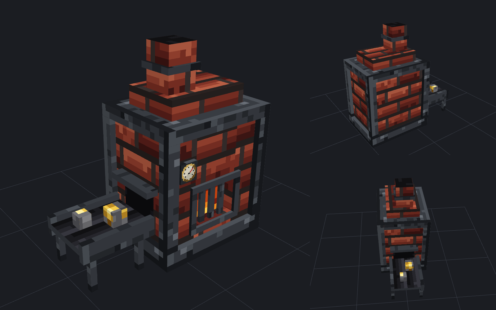

# 용광로 시제품 (모델링 파이프라인 검증)



외부 이미지 생성 도구 없이, **코드만으로** 3D 모델과 텍스처, 리소스팩, Blockbench 파일을 만드는 시제품입니다.

## 구성
| 파일 | 내용 |
|---|---|
| `build.py` | 모델 정의(큐브 37개)와 리소스팩, `.bbmodel` 생성 |
| `textures.py` | 공통 팔레트와 고정 시드로 텍스처 생성 (16x16, 항상 같은 결과) |
| `out/smelter.bbmodel` | Blockbench에서 바로 열어서 수정 가능 |
| `out/resourcepack/` | 리소스팩 (`item_model` 컴포넌트 `stsv:smelter`로 사용) |
| `render/render.mjs` | three.js로 미리보기 이미지(`preview.png`) 렌더링 |

## 다시 만들기
```bash
python3 build.py
```
```bash
cd render && npm install && cd .. && node render/render.mjs
```

## 메모
- 크기: 가로 2블록, 높이 2블록 (`item_display` 엔티티로 배치하는 것을 전제로 함)
- 불꽃 부분은 `light_emission: 15`로 어두운 곳에서도 빛납니다.
- `pack.mcmeta`의 포맷 번호는 서버 버전(26.x)을 확정하면 그 번호로 맞춥니다.
